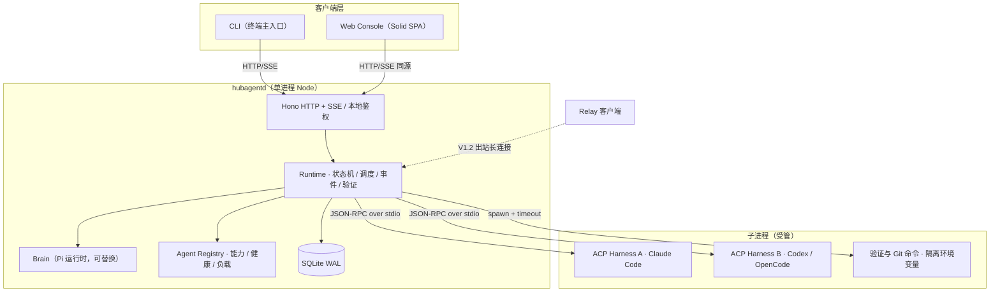

# HubAgent 系统架构设计

**文档版本：** V1.1
**对应 PRD：** V1.1（`docs/PRD.md`）
**文档定位：** 技术落地基线。与 PRD 冲突时，PRD 的版本边界、产品约束、安全底线优先；本文负责回答"怎么建"。
**目标读者：** 架构师、后端、前端、Agent 集成、测试、运维/发布

> **V1.0 → V1.1 变更**
>
> 1. HTTP 框架由 Fastify 改为 **Hono**。
> 2. 前端由 React 19 改为 **Solid 2.x + Vite**，并据其生态缺口重做前端方案（任务图自研）。
> 3. 仓库结构由 8 个包收敛为 **2 个包 + 目录分层 + 依赖规则**。
> 4. 新增 §2.4「AI 编写代码友好度」与 §8.7「Solid 纪律与陷阱」。
> 5. CLI 框架定为 **commander**。

---

## 0. 阅读指引

| 你想知道 | 看哪一节 |
|---|---|
| 整体长什么样、有几个进程 | §1 |
| 用什么语言/框架/库，为什么不选别的 | §2 |
| 代码怎么放 | §3 |
| 决策怎么和持久化对齐（重启不丢） | §4、§6.1、§6.4 |
| 前端怎么做 | §8 |
| 数据表怎么设计 | §11 |
| 安全怎么落地 | §12 |
| 怎么测、怎么发版 | §15、§16 |

本文所有设计都受三个不可谈判的约束支配：

1. **本地优先**：单机单用户，无外部依赖（不需要 Redis / 消息队列 / 云数据库）。
2. **结果可信**：判定必须来自可执行证据，不能采信 Agent 自述。
3. **大脑可替换**：Brain 是接口，不是产品。换 Brain 不得改写 Runtime 与数据模型。

---

## 1. 架构总览

### 1.1 设计目标

| 目标 | 架构上的承诺 |
|---|---|
| 常驻、可恢复 | 单进程 daemon + SQLite WAL + 事件投影；重启后从快照重建 |
| 长任务不阻塞 | 委派两阶段：`delegate_task` 立即返回，进度通过事件回流 |
| 多 Agent 并发安全 | 工作区租约（`WorkspaceLease`）+ 写入路径白名单 + 单写者 |
| 结果可验收 | 确定性验证在 Runtime 执行，证据落库，结论可回溯 |
| 成本可控 | 预算四层（Goal/Subtask/Brain 回合/委派），LLM 只在决策点参与 |
| 可解释 | 每个决策写 `DecisionRecord`，前端可查 |

### 1.2 分层视图



### 1.3 进程与部署形态

```text
hubagentd                     常驻守护进程（唯一写库者）
 ├── Hono HTTP/SSE server     :127.0.0.1:<port>
 ├── Runtime                   调度、状态机、事件、验证
 ├── Brain（Pi）               按决策点按需运行，不常驻轮询
 ├── SQLite                    单写者，WAL
 └── 子进程
      ├── ACP harness 进程      可被 kill，进程组统一回收
      └── 验证命令进程          有超时、有输出上限
```

**只有一个写数据库的进程。** 这不是"暂时简化"，而是刻意的架构决定：

- ACP 是 stdio JSON-RPC，天然要求父进程管理子进程生命周期；
- SQLite 单写者模型与"多进程写"冲突，强行拆服务只会引入锁竞争与一致性负担；
- 本地单用户场景不存在水平扩展需求。

**预留的演进缝：** `AgentHost` 是一个接口（`spawn/attach/kill/onEvent`）。当需要崩溃隔离或远程 Agent 宿主时，可把它拆成独立进程，通过 Unix Domain Socket 通信，**不需要改 Runtime 与数据模型**。

### 1.4 关键架构决策（ADR 摘要）

| # | 决策 | 结论 | 主要理由 | 放弃的方案 |
|---|---|---|---|---|
| D1 | 部署形态 | 单 daemon + 子进程 | 本地优先、SQLite 单写者、无运维 | 微服务、Electron 内嵌服务 |
| D2 | 状态存储 | SQLite + 投影表 | 零依赖、事务强、可备份 | Postgres、Redis、纯 Event Sourcing |
| D3 | Brain 调度 | 决策点 + 快照纯函数 | 重启/换模型/压缩上下文均无损 | 常驻事件循环、消息注入唤醒 |
| D4 | 委派 | 契约化 + 两阶段异步 | 不阻塞、可幂等、可验收 | 同步等待、纯 Prompt 交接 |
| D5 | 实时通道 | SSE（服务端→客户端） | 单向足够、自动重连、可 `sinceSeq` 续读 | UI 用 WebSocket、轮询 |
| D6 | 前端形态 | 同源静态 SPA | 无 CORS、无跨域 token 问题、单端口 | 独立前端服务、Next.js SSR |
| D7 | 验证位置 | Runtime 执行确定性检查 | 禁止自证、证据可落地 | 让 Brain 判断一切 |
| D8 | 代码索引 | V1 不做语义索引 | 编码 Agent 自己读仓库，Brain 只需 repo map | 自建向量索引 |
| D9 | 模型接入 | 经 Brain 适配层；优先 Pi provider | 可换模型/厂商、可统计成本 | 直接耦合某家 SDK |
| D10 | 沙箱 | V1 不做系统沙箱 | 多数 harness 依赖写缓存/依赖目录 | 容器化执行（后续可选） |
| D11 | HTTP 框架 | **Hono** | 心智简单、Web 标准、SSE 一等公民、类型推断好 | Fastify（插件封装有隐性作用域）、Express |
| D12 | 前端框架 | **Solid 2.x + Vite** | 细粒度响应式匹配 SSE 高频更新；无 VDOM、运行时小 | React 19（生态最全，但需额外绑定库） |
| D13 | 任务图渲染 | **自研 SVG + dagre + d3-zoom** | React Flow 无官方 Solid 绑定；图形需求简单 | 引入 React / 第三方流程图库 |
| D14 | 代码组织 | **单包 + 目录分层 + 依赖规则** | 降低跨包认知成本，边界由 CI 规则强制 | 8 包 monorepo |

---

## 2. 技术选型

### 2.1 后端

| 领域 | 候选 | 结论 | 理由 / 放弃原因 |
|---|---|---|---|
| 语言 | TypeScript / Go / Rust | **TypeScript (strict)** | ACP/A2A 生态与 harness 工具链都在 JS/TS；领域模型全是结构化 JSON；团队上手成本最低。Go/Rust 的启动与内存优势在本地单用户场景收益有限 |
| 运行时 | Node 22+ LTS / Bun / Deno | **Node 22+ LTS（ESM）** | 子进程、`node:sqlite`/native 模块、库兼容性最稳；Bun 可作为可选"更快的开发运行时"，但不作为发布基线（native 模块与 harness 兼容性风险） |
| HTTP 框架 | Hono / Fastify / Express | **Hono** | 心智模型是中间件数组 + Web 标准 `Request/Response`，无插件封装与装饰器魔法；`streamSSE()` 是一等公民，正好是主通道；路由与类型错误会直接报错。Fastify 的插件作用域与 type provider 泛型接线是 AI 生成代码"写得出来但报错难懂"的典型区域；Express 缺类型与校验 |
| 请求校验 | Zod / TypeBox / Ajv 手写 | **Zod（单一 schema 源）** | 同一份 schema 同时用于 HTTP 边界、Brain 结构化输出、事件 payload。性能在本地规模下不是瓶颈 |
| 数据库驱动 | better-sqlite3 / libsql / node:sqlite | **better-sqlite3** | 同步 API 简单、事务语义明确、WAL 支持好。`node:sqlite` 仍不稳定；libsql 引入网络形态，与本地优先无关 |
| ORM/查询 | Drizzle / Kysely / 手写 SQL | **better-sqlite3 + 手写 SQL**（Drizzle 推迟到 M6+ 的仓储层再评估） | 投影写入是固定 SQL，手写反而更短、更可审计；引入 ORM 会让"事件 → 投影"这条热路径多一层抽象。M2 已按此实现，与当时选型不一致处已在此修正 |
| 迁移 | Drizzle Kit / 自研 | **自研迁移（`src/storage/migrations/*` + `schema_migrations` 表）** | 迁移必须启动前前向兼容执行、失败即拒绝启动；只需"按 id 幂等应用 SQL"，不需要 schema 生成器 |
| 进程管理 | `node:child_process` / `execa` | **`node:child_process` + 薄封装** | 需要精确控制进程组、信号、stdio 分帧；`execa` 用于验证命令这类短命令 |
| 执行隔离 | `@anthropic-ai/sandbox-runtime` / 自研 bwrap 包装 / 容器 | **`@anthropic-ai/sandbox-runtime`（薄封装）** | 直接复用 macOS Seatbelt + Linux bubblewrap + 代理式网络白名单；自带违规归因（可进证据链）与 per-command 域名白名单。Apache-2.0，Node ≥ 22.12。目前 0.0.x beta，必须经 `SandboxProvider` 隔离以便替换 |
| JSON-RPC | 自研分帧 / 社区 SDK | **优先官方 ACP TS SDK；否则自研行分帧层** | ACP 是 stdio 上的 JSON-RPC，需自己处理背压、粘包、stderr 分离 |
| 校验/输出约束 | JSON Schema / 函数调用 | **JSON Schema + 解析后二次校验** | 模型输出的计划/动作必须过 schema 才能进 Runtime（PRD §6.1.3/§18.2） |
| 模型接入 | Pi provider / Vercel AI SDK / 各家 SDK | **Pi provider 优先，AI SDK 兜底** | 前者与本项目 Brain 运行时一致；后者在多厂商、成本统计、结构化输出上更成熟时切换 |
| 日志 | pino / winston | **pino** | 结构化、低开销、redact 支持好 |
| 配置 | TOML / YAML / JSON5 | **TOML（`~/.hubagent/config.toml`）** | 可读、有类型、注释友好；YAML 缩进坑多；JSON 不能注释 |
| 文件监听 | chokidar / fs.watch | **chokidar** | 跨平台一致性；fs.watch 在 macOS 上大目录事件不可靠 |
| 搜索 | ripgrep 子进程 / 自研 | **ripgrep 子进程** | 不在 V1 造索引；直接复用 rg 的速度与忽略规则 |
| 加密 | node:crypto / libsodium | **node:crypto（X25519 + AES-GCM）** | Relay 信封加密够用，避免额外 native 依赖 |
| 加密存储 | SQLCipher / 字段级 | **字段级脱敏 + OS Keychain 存密钥** | 整库加密带来迁移与工具链成本；密钥本身放系统钥匙串 |
| 打包 | tsc+tsup / esbuild / SEA | **tsup（库）+ Node SEA（可选单文件）** | 开发快、发布可用 SEA 或 npm 包；不引入 pkg 的维护风险 |

### 2.2 前端（Web Console）

| 领域 | 候选 | 结论 | 理由 / 放弃原因 |
|---|---|---|---|
| 框架 | Solid 2.x / React 19 / Vue / Svelte | **Solid 2.x** | 细粒度响应式 + 无 VDOM：SSE 高频进度更新（每秒数十至数百条）正是其擅长场景；内存与运行时开销小。代价是部分生态需自建，见 §8.7 |
| 构建 | Vite + `@solidjs/vite-plugin` / vite-plugin-solid | **Vite + Solid 2 工具链** | Solid 2 拆出了 `@solidjs/web` 与 `@solidjs/compiler`，Vite 插件包名随之变化（SDK 的 devDeps 用的是 `@solidjs/vite-plugin@3`）；需在 spike 中固定版本组合 |
| 路由 | @tanstack/solid-router / @solidjs/router | **@tanstack/solid-router** | 类型安全路由 + search params 校验；与 Query 同一套心智 |
| 服务端状态 | @tanstack/solid-query / 手写 | **@tanstack/solid-query** | 缓存、失效、分页、重试现成；SSE 只做失效通知，不当状态源 |
| 客户端状态 | `solid-js/store`（内置）/ Zustand / 自研 | **`createStore` + `createSignal`（内置）** | Solid 原语本身就是状态方案，零依赖；引入外部 store 会破坏细粒度追踪 |
| 样式 | Tailwind v4 / CSS Modules / styled | **Tailwind v4 + CSS 变量主题** | 与设计令牌打通，深色/浅色切换成本低 |
| 组件基座 | UI SDK（vercel-labs/ui）/ Kobalte / Ark UI / 完全自研 | **UI SDK 行为层（`@ui-sdk/solid`）+ 自研视觉层** | 把弹层/选择/输入/虚拟滚动抽象为 behavior，组件由行为组装；`peerDependencies` 直接要求 `solid-js ^2.0.0`，是当前少数原生适配 Solid 2 的 UI 层。Apache-2.0（ADR 0004） |
| UI 依赖白名单 | — | **`tailwindcss` + `@ui-sdk/core` + `@ui-sdk/solid` + `lucide-solid`** | 白名单外的新增需先写 ADR；不得引入整套设计系统 |
| 版本与封装策略 | 直接使用 / 门面封装 | **精确锁版本 + `components/ui` 门面** | SDK 处于 `0.1.0-beta`：`features/` 直接 import 会在 API 变更时全线返工 |
| 设计令牌 | Tailwind v4 `@theme` / CSS 变量 / JS 主题对象 | **Tailwind v4 `@theme` + CSS 变量** | 单一来源；深浅色只切变量。组件内禁止硬编码颜色/间距 |
| 图标 | lucide-solid / heroicons | **lucide-solid** | 官方 Solid 包，无框架耦合 |
| 任务图可视化 | React Flow / 自研 SVG / d3 | **自研 SVG + dagre（或 elkjs）+ d3-zoom** | React Flow 无官方 Solid 绑定。任务图只需 5~30 个带状态色节点、平移缩放、点击详情，自研约 300~500 行。缩放层可评估复用 `createViewport`（ADR 0004 spike 项 6） |
| 图表 | ECharts / Chart.js / 自研 | **ECharts（按需引入 + tree-shaking）** | 框架无关；Solid 生态没有 Recharts 等价物 |
| 表格 | @tanstack/solid-table / AG Grid | **@tanstack/solid-table** | 官方适配，轻、可组合，与 Query 配合好 |
| 表单 | @modular-forms/solid / 原生 signal + zod | **@modular-forms/solid + zod** | 避免 `react-hook-form`（仅 React）；schema 仍与后端共享 |
| Lint | Biome / ESLint + eslint-plugin-solid | **Biome（格式+通用）+ eslint-plugin-solid（仅响应式规则）** | Solid 的 props 解构会**静默破坏响应式**，`tsc` 抓不到，必须有专用规则拦截（§8.7） |
| 测试 | Vitest + @solidjs/testing-library / Playwright | **Vitest + @solidjs/testing-library + Playwright** | 组件层快，关键路径用真实浏览器 |
| 可访问性 | axe-core / 手测 | **Playwright + `@axe-core/playwright`** | 自研组件的最大风险在 a11y，用自动化兜底 |
| 视觉回归 | 手测 / Storybook / 自建 gallery | **自建 `/dev/ui` gallery + Playwright 截图比对** | Storybook 对 Solid 支持差；gallery 同时是组件契约的验收面 |
| i18n | @solid-primitives/i18n / i18next | **@solid-primitives/i18n** | 轻量、无框架耦合；zh-CN 默认，en 备用 |
| 桌面壳（后续） | Tauri / Electron | **Tauri（可选，不进 V1）** | 体积小、内存低；V1 先用浏览器 + 本地服务 |

### 2.3 工程与工具链

| 领域 | 结论 | 理由 |
|---|---|---|
| 包管理 | **pnpm workspaces** | 严格依赖隔离，monorepo 磁盘友好 |
| 任务编排 | **Turborepo（可选）** | 只在构建缓存收益明显时引入，不预设 |
| Lint/Format | **Biome**（格式+通用规则）+ **ESLint + `eslint-plugin-solid`**（仅响应式规则） | Solid 的静默失效只能靠专用规则拦截；两套各管一段，不重叠 |
| 测试 | **Vitest**（单元/集成）+ **Playwright**（E2E）+ **fast-check**（状态机属性测试） | 状态机与 reducer 的不变量最适合属性测试 |
| 类型检查 | `tsc --noEmit` 独立跑 | 构建工具不做类型检查，避免"构建过了但类型错" |
| 提交规范 | Conventional Commits + changesets | 版本与变更记录可自动生成 |
| CI | GitHub Actions（macOS + Ubuntu 矩阵） | 必须两端都跑：进程组、路径、文件锁行为不同 |
| 依赖边界 | **dependency-cruiser** | 用规则代替包拆分强制分层，CI 失败即阻断 |
| AI 协作约定 | 根目录 **`AGENTS.md`** | 把目录地图、依赖方向、禁令、验证命令写给 Coding Agent |

### 2.4 选型的第一性标准：AI 编写代码友好度

本项目代码会大量由 Coding Agent 生成，因此“是否好写、好读、错误是否显性”被当作一等标准。

| 标准 | 含义 | 对选型的影响 |
|---|---|---|
| 语料密度 | 模型见过多少正确用法 | 选 Hono 而非自研路由；选 commander 而非小众 CLI 框架 |
| 失败是否“吵” | 写错是立刻报错，还是静默出错 | 排除无官方绑定的流程图库；对 Solid 的 props 解构设强制规则 |
| 类型可验证性 | `tsc` 能否替你抓住错误 | Zod + 显式类型；禁 `any` 逃逸 |
| 心智半径 | 单个文件能否自洽理解 | 禁 barrel 文件、禁隐式 DI 容器、构造器显式传依赖 |
| 生态缺口 | 缺的组件是否核心界面 | 唯一缺口（任务图）用自研兑现，其余全选有官方 Solid 适配的库 |

**为什么性能没有排在第一：** 本地单用户的真实瓶颈是 `better-sqlite3` 同步调用、SSE payload、子进程 stdout 解析与 JSON 序列化，框架之间的吞吐差会被这些掩盖。性能应靠度量与针对性优化解决，而不是靠换框架。

---

## 3. 仓库结构

```text
hub-agent/
├─ AGENTS.md                       给 Coding Agent 的仓库地图与纪律
├─ docs/
│   ├─ PRD.md
│   ├─ ARCHITECTURE.md
│   └─ adr/                       决策记录（D1…D14 逐条展开）
├─ packages/
│   ├─ hub/                        后端（单个 npm 包，内部按层分目录）
│   │   ├─ src/
│   │   │   ├─ domain/             纯模型与不变量（零 IO）
│   │   │   │   ├─ goal/ plan/ task/ subtask/ execution/
│   │   │   │   ├─ contract/       DelegationContract、TaskBrief
│   │   │   │   ├─ verification/   检查类型、结论、证据
│   │   │   │   └─ event/          事件枚举、投影类型
│   │   │   ├─ brain/              决策层
│   │   │   │   ├─ orchestrator-brain.ts   接口（唯一对外契约）
│   │   │   │   ├─ pi/             唯一允许 import Pi 的目录
│   │   │   │   ├─ prompt/
│   │   │   │   └─ action/         结构化动作 + 校验
│   │   │   ├─ runtime/            执行管理层
│   │   │   │   ├─ state-machine/  迁移表 + 不变量断言
│   │   │   │   ├─ scheduler/
│   │   │   │   ├─ selection/      确定性打分
│   │   │   │   ├─ verify/         确定性验证执行
│   │   │   │   ├─ event/          写入、reducer、投影
│   │   │   │   ├─ workspace/      租约、worktree、合并、回滚
│   │   │   │   ├─ recovery/
│   │   │   │   └─ budget/
│   │   │   ├─ adapters/
│   │   │   │   ├─ acp/
│   │   │   │   ├─ a2a/            V1.1
│   │   │   │   └─ relay/          V1.2
│   │   │   ├─ agent-host/         AgentHost 接口与子进程实现
│   │   │   ├─ sandbox/            SandboxProvider：srt 实现 + 依赖检测（fail-closed）
│   │   │   ├─ storage/            schema、迁移、仓储、投影查询
│   │   │   ├─ interfaces/
│   │   │   │   ├─ http/           Hono 应用、SSE、鉴权、静态资源
│   │   │   │   └─ cli/            commander 命令
│   │   │   ├─ shared/             错误码、时间、ULID、日志（叶子层）
│   │   │   └─ bin/                hubagentd.ts、hubagent.ts
│   │   └─ test/
│   └─ web/
│       ├─ src/
│       │   ├─ routes/             与 §8.2 页面一一对应
│       │   ├─ features/           tasks / agents / approvals / network / settings
│       │   ├─ components/         graph/、charts/、ui/
│       │   └─ shared/             api 客户端、SSE 原语、格式化
│       └─ e2e/
└─ fixtures/
    ├─ regression-tasks/           §17.2 回归基线任务
    └─ acp-traces/                 适配器录制回放样本
```

### 3.1 依赖方向（由 `dependency-cruiser` 强制）

```text
interfaces  →  runtime  →  domain
                  ↓          ↑
      brain / adapters / storage / agent-host
                  ↓
               shared（叶子）
```

规则（CI 检查，违规即失败）：

| # | 规则 | 理由 |
|---|---|---|
| R1 | `domain/**` 不得 import 任何其他层 | 领域模型必须可在任何环境求值 |
| R2 | `brain/**` 不得 import `storage/**`、`adapters/**` | Brain 只能看快照，不能直接读写库或起进程 |
| R3 | `runtime/**` 不得 import `brain/pi/**` | 只依赖 `brain/orchestrator-brain.ts` 接口 |
| R4 | `adapters/**` 不得 import `runtime/**` | 防止反向依赖；Runtime 调 Adapter 接口 |
| R5 | `interfaces/http` 只读时可用 `storage/queries`，不得 import `storage/write` | 读投影便宜，写必须走 Runtime |
| R6 | `shared/**` 不得 import 任何业务层 | 防止变成垃圾桶 |
| R7 | 禁止 barrel 文件（`index.ts` 转导出） | 减少 AI 的 import 歧义与循环依赖 |
| R8 | 只有 `agent-host/**` 与 `sandbox/**` 可 import `node:child_process` | 保证所有子进程都经过隔离层，无法旁路 |
| R9 | `agent-host/**` 不得 import `storage/**` | 拒绝启动的路径不能顺手写任务/执行记录；记录由 Runtime 在 spawn 成功后写 |

> **必须知道的一个失效模式：** dependency-cruiser 与 TypeScript 版本不匹配时会**静默空转**——输出 `0 modules, 0 dependencies cruised` 并返回 0，所有规则实际不生效。
> 现在用 `parser: 'swc'`（TypeScript 7 不被 depcruise 支持），并在 `test/arch/rules.test.ts` 中断言 cruised 模块数 > 0。
> 改解析器或升级 TS 时，先看这个数字。

**为什么只有 2 个包：** 包拆分的主要收益是构建隔离与发布独立，我们在本地单产品场景都不需要；而跨包 import 会让 Coding Agent 每次改动都要理解两套边界。边界靠规则强制，比靠目录墙更轻。

---

## 4. 运行时架构

### 4.1 模块职责与禁止事项

| 模块 | 负责 | 禁止 |
|---|---|---|
| `interfaces/http` | 鉴权、路由、SSE、参数校验、静态资源 | 业务判断、直接写业务表 |
| `runtime` | 状态迁移、调度、租约、事件写入、验证执行、恢复 | 调用 LLM |
| `brain` | 读快照 → 产出结构化动作 | 直接改库、直接起 Session、直接写文件 |
| `adapters/acp` | 协议分帧、会话、事件翻译、进程监管 | 业务决策、重试策略 |
| `storage` | SQL、迁移、投影维护 | 业务规则 |

### 4.2 启动序列

```text
1. 解析配置（CLI > env > 项目配置 > 用户配置 > 默认）
2. 获取单实例锁（~/.hubagent/hubagent.lock），失败则提示已在运行
3. 打开 SQLite，设置 WAL / busy_timeout / foreign_keys=ON
4. 执行迁移，失败即退出（不做半迁移运行）
5. 加载并校验未完成任务（恢复扫描，见 6.7）
6. 启动 Agent Registry 健康巡检（无 LLM）
7. 启动调度循环与事件分发
8. 启动 HTTP/SSE，写入 port 文件与 token 文件，打印访问方式
9. 进入就绪；按需触发 Brain 决策点（可能来自恢复）
```

### 4.3 关闭序列

```text
1. 停止接受新任务（API 返回 503 + 明确错误码）
2. 等待进行中的命令完成或超时（可配置，默认 5s）
3. 将运行中的 Execution 标记为 unknown（不是 failed），交恢复流程处理
4. 向所有 harness 进程组发送 SIGTERM，超时后 SIGKILL
5. flush 事件队列，关闭 SQLite
```

> 关键点：**正常关闭也要把在跑的执行标成 `unknown`**。因为"我们不知道 Agent 到底做到哪一步"，这正是 PRD §15.1 说的"结果不确定"。

---

## 5. Brain 层设计

### 5.1 接口与边界

```ts
interface OrchestratorBrain {
  step(input: BrainInput): Promise<BrainAction[]>;
  explain(input: BrainInput): Promise<DecisionRationale[]>;
}
```

`BrainInput` 是**渲染好的快照**（不是数据库句柄）：

- Goal 摘要与预算余额
- 当前 `PlanRevision`
- 各 Subtask 的状态、进度摘要、证据引用
- 可用 Agent 的能力与健康摘要（已过滤，只给候选）
- 待决事项（Approval、无进展告警、失败原因分类）
- 版本号（`stateVersion`）

`BrainAction` 是**意图**，不是副作用：

```ts
type BrainAction =
  | { type: "revise_plan"; subtasks: SubtaskDraft[]; reason: string }
  | { type: "delegate"; contract: DelegateRequest }
  | { type: "cancel"; executionId: string; reason: string }
  | { type: "accept"; subtaskId: string; rationale: string }
  | { type: "reject"; subtaskId: string; reason: string; next: "retry" | "replan" }
  | { type: "request_human"; question: string; options?: string[] }
  | { type: "finish"; summary: string };
```

Runtime 校验（schema → 权限 → 预算 → 幂等）后才落库执行。**Brain 永远拿不到数据库句柄，也拿不到 shell。**

### 5.2 一次回合的边界

| 约束 | 值（可配置） |
|---|---|
| 单回合最大 token | 目标 32k 输入 / 4k 输出量级 |
| 单回合最大动作数 | 16 |
| 单回合超时 | 90s |
| 输出格式 | JSON Schema 强约束 + 解析后 Zod 校验 |
| 重试 | schema 失败重试 1 次，带错误信息；仍失败则降级为 `request_human` |

### 5.3 提示词与上下文组装

```text
[系统策略]   角色、禁止事项（不写文件、不改契约、不臆造路径）
[任务上下文] Goal、PlanRevision、Subtask 契约与验收条件
[环境事实]   仓库 map（目录树 + 关键文件清单 + 最近提交）、可用 Agent 摘要
[证据摘要]   已完成 Subtask 的 diffstat 与验收结论
[待决问题]   需要本回合处理的决策点
[输出契约]   JSON Schema + 反例（禁止输出自然语言计划）
```

**上下文纪律：**

- 不注入 Agent 的原始工具调用流水（PRD §6.10.3）。
- 不注入完整日志，只给引用与摘要。
- 仓库 map 有大小上限（默认 ≤ 2k 行），超出按"改动相关目录 → 顶层结构"裁剪。

### 5.4 Pi 集成方式

- Pi 负责 agent loop、provider 适配、工具调用协议。
- 我们只为它注册**一组稳定元工具**（`discover_agents`/`delegate_task`/`await_any`/`get_task_result`/`cancel_task`/`revise_plan`/`request_human`），**不按 Agent 生成工具**。
- 每个元工具都是 Runtime 的瘦封装：参数校验 + 调用 Runtime + 精简返回。
- `agentId` 只作为偏好透传，实际执行者由 Selection Engine 决定。
- **`pi` 依赖只允许出现在 `src/brain/pi/`**，由 R3 规则强制（其余模块只看到 `orchestrator-brain.ts` 接口）。

### 5.5 唤醒

`DecisionQueue` 是一张表（见 §11.6），不是内存队列：

- Runtime 在产生决策点时 `INSERT` 一行（含 `dedupe_key`）；
- 单写者循环 `claim` 一行（`UPDATE ... WHERE status='pending'`）后执行一个 Brain 回合；
- 回合结束写入 `stateVersion`，冲突则重新 claim（乐观并发）；
- 进程重启后，未 claim 的行自动成为待处理项。

> 这样"消息注入能否叫醒 Agent"就不再是正确性前提，只是延迟优化。

**M6 落地。** `brain/{types,snapshot,scripted-brain,validate}.ts` 定义接口、派生快照、测试替身与动作校验；`brain/pi/{session,pi-brain,meta-tools}.ts` 用 Pi 官方 SDK 创建 in-memory session，并注册 8 个稳定元工具（工具只读/记录 intent）；`brain/create-brain.ts` 按 env 选择。`runtime/{decision-queue,decision-record,brain-loop,clarify,brain-run}.ts` 实现表驱动队列、DecisionRecord、预算约束、clarify/decide 路由，以及 Goal → 拆计划 → dispatch（delegate/cancel/request_human）→ accept/finish 的 Brain 驱动入口。默认 `HUBAGENT_BRAIN_MODE=pi`，Pi 模型/认证缺失时 fail-closed；`ScriptedBrain` 只在显式 `scripted` 时用于测试/离线。`hubagent run` 默认走 Brain，`--no-brain` 保留 M4 固定脚本用于排障。

---

## 6. Runtime 层设计

### 6.1 状态机

状态枚举见 PRD §6.5。此处定义**执行语义**，实现必须以此为准：

```text
Task:    draft → planning → ready → running → (completed | failed | canceled)
                              ↕
                        waiting_approval / waiting_input / paused

Subtask: blocked → ready → assigned → running → (succeeded | failed | canceled | skipped)
                              ↕
                        waiting_approval / waiting_input / paused

Execution: created → starting → running → (succeeded | failed | timeout | canceled | unknown)
                              ↕                        ↕
                        waiting_permission / waiting_input   paused
```

**暂停的顺序约定（I5）：** 暂停 Task 前必须先把其下活跃 Execution 转为 `paused`（或终止），
恢复时顺序相反（先 Task → running，再 Execution → running）。
`paused` 不计入 `ACTIVE_EXECUTION_STATUSES`，但它仍持有工作区现场（租约不因暂停释放，见 PRD §6.5.6 / §11.12）。

**不变量（必须写成断言并测试）：**

1. `Task.completed` ⇒ 所有必需 Subtask 均为 `succeeded` 或 `skipped`。
2. `Subtask.succeeded` ⇒ 至少一个 `Execution.succeeded` **且** 存在 `verdict = pass | manual_required` 的 `VerificationRun`。
3. `Execution.succeeded` ⇒ 有证据记录；否则只能是 `unknown`。
4. 同一 `WorkspaceLease` 下，`running` 的写入型 Execution 数量 ≤ 1。
5. Task 暂停必须传播到其下所有 `running` Execution（转为 `paused` 语义由 Runtime 记录）。
6. 终态不可逆（`completed/failed/canceled` 不再迁移）。
7. `Task.completed` ⇒ 交付动作已落地（`branch-only` 的分支已保留 / `patch-export` 的 patch 已导出 / `auto-merge` 已合入）。**验收通过不等于完成**（PRD §6.12.4）。

> **I7 是 V1.4 新增**，与 I1 同层校验：只检查子任务收敛会让“合并冲突未解决”的任务看起来完成了。
> 落地位置：M5（证据与验收）+ M7（交付与合并）。

> **I5 必须双向守卫。** 只拒绝“有活跃执行时暂停”不够——还要拒绝“暂停期间启动或恢复执行”，否则会出现 `task=paused + execution=running` 的非法组合。
> 这一点由 M1 的属性测试实测击穿后补上（见 `docs/PLAN.md` M1）。

### 6.2 调度器

单线程事件循环 + SQLite 队列，**不引入外部队列**。

```text
loop（每 200ms 或收到唤醒信号）:
  1. 取 ready 的 Subtask（按 priority, created_at）
  2. 过滤：依赖未满足 / 预算耗尽 / Agent 不在线 / 无租约可用
  3. 选择 Agent（确定性打分，见 PRD §6.6）
  4. 申请 WorkspaceLease（冲突则排队或换 Agent）
  5. 创建 Execution + 契约记录，状态 assigned
  6. 交给 AgentHost 启动/复用 Session（异步）
```

**限流三个维度**（PRD §14.5）：

| 维度 | 实现 |
|---|---|
| Goal 级并发 | 配置上限，超出则排队 |
| Agent 级并发 | `AgentHealth.maxConcurrency`（由能力协商 + 实测得出） |
| Provider 级 | 令牌桶；429 归类为 `resource`，退避重试，**不计入 Agent 可靠性** |

### 6.3 执行与进程管理

| 关注点 | 做法 |
|---|---|
| 启动 | `spawn(cmd, args, { cwd, env: scrubbedEnv, detached: true })`；记录 pid 与进程组 |
| 输出分帧 | ACP 走 stdout 行分帧（JSON-RPC）；stderr 独立写入日志，**不混入协议流** |
| 背压 | stdout 使用流式解析 + 有界缓冲；超限即断开并判 `protocol` 失败 |
| 取消 | 先发 ACP cancel；超时后对进程组 `SIGTERM`，再 `SIGKILL` |
| 僵尸回收 | 进程退出必须被监听；daemon 退出时统一回收进程组 |
| 环境隔离 | 不继承无关环境变量；`PATH` 白名单；`HOME` 可控 |
| 超时 | 三层：协议握手、单次调用、总执行 |

### 6.4 事件与投影

写入路径（单事务）：

```text
```
BEGIN
  INSERT INTO events(seq AUTOINCREMENT, id, type, aggregate, actor, payload, trace_id) VALUES ...
  UPSERT 实体表（goals / tasks / subtasks / executions / verification_runs / approvals）
  UPDATE projection_meta（last_applied_seq）
COMMIT
```

> 注意：**实体表就是投影表**，不另建 `*_view`（M2 决策，见 PLAN M2 与 `001-init.ts` 注释）。
> 早期写的 `task_view / subtask_view / execution_view` 已废弃，两份命名必然漂移。

原则：

- `events.seq` 用 `INTEGER PRIMARY KEY AUTOINCREMENT`，天然单调、可续读。
- 原始事件只增不改；投影表可重建（提供 `rebuild-projections` 命令）。
- 不做全量 Event Sourcing：读路径走投影，写路径双写。
- 事件写入失败 = 操作失败，不允许"内存改成功、库没落"。

### 6.5 验证器（Verification Runner）

```text
输入：VerificationCheck[] + Execution 的工作区
流程：
  1. 校验命令在允许清单内（或命中"需审批"策略）
  2. 在工作区目录执行，env 清洗，超时 + 输出上限
  3. 采集 exitCode / 耗时 / 输出（落文件，库里只存引用）
  4. 计算 verdict：全通过=pass；有失败=fail；含 llmReview 或需人工=manual_required
  5. 写 VerificationRun + 证据
```

**禁止**：在验证里调用被验收 Agent；用自然语言判断代替退出码；证据缺失时给 `pass`。

**M5 落地。** `runtime/verify/runner.ts` 实现五类检查；命令经 AgentHost/SandboxProvider 执行，cwd 固定 worktree，输出写 `artifacts/<executionId>/<checkId>.log`，`VerificationCheckResult` 只存引用。verdict 规则：任一确定性检查失败 → `fail`；含 `llmReview` 或没有检查 → `manual_required`；全通过才 `pass`。`runAcpTask` 先写 evidence、再跑验收，最后按 verdict 收敛 Execution/Subtask；pass 时 Task 仍保持 running（交付属 M7），`sandbox_denied` 生成 Approval 并停在 `waiting_approval`。`task show --evidence` 与 `approval list/approve/reject` 由 CLI 提供。

### 6.6 工作区与租约

| 模式 | 实现 | 适用 |
|---|---|---|
| shared | 对 `project.rootPath` 加 DB 互斥锁 | 只读任务 / 路径不重叠 |
| worktree | `git worktree add ~/.hubagent/worktrees/<leaseId> <baseRef>` | 默认（写任务） |
| copy | 复制目录（排除 `node_modules`、`.git` 可选） | 大型实验任务 |

规则：

- 租约入库（`workspace_leases`），带 `expires_at`，进程崩溃后由恢复扫描判定是否 `abandoned`。
- 写入型执行结束：产出 `{ branch, commitSha, diffstat, changedFiles }`；`diffScope` 校验越界。
- **是否合并、合并到哪由交付策略决定**（PRD §6.12.4）：默认 `branch-only`（不合并），`auto-merge` 需显式开启且满足全部前置条件；V1.0 不 `push`、不开 PR。
- 需合并时走确定性流程（`merge --no-ff` 或 cherry-pick），冲突即升级 Brain，**禁止静默覆盖**。
- 保留每个 Execution 的基线 ref，支持回滚到基线。

**M7 落地（核心库）。** `runtime/workspace/lease.ts` 实现租约互斥与过期 sweep；`git.ts` 用 `GitRunner`/`AgentHostGitRunner` 封装 worktree add/remove、`merge --no-ff`、`reset --hard`、diff patch，Runtime 不直接 `child_process`；`delivery.ts` 实现 branch-only / patch-export / auto-merge 五条件降级。不同 worktree 路径可并行，同一路径只允许一个写入者。`run` 默认 worktree 隔离：自动注册项目、建 worktree、租约、branch-only 交付并完成 Task；`task clean` 默认拒绝丢弃未提交改动。`--agents a1,a2` 走一个 Goal/Task、两个 Subtask、各自 worktree/lease，并行执行后 `merge --no-ff`；冲突抛 `DELIVERY_CONFLICT`。

### 6.7 恢复扫描（重启后）

```text
对每个非终态 Goal：
  1. 读取最近投影与未消费事件
  2. 校验 WorkspaceLease 是否仍有效（目录存在 / branch 存在）
  3. 校验 Agent 是否仍在线、Session 是否可恢复
  4. 判定在跑 Execution：
       - 进程不存在 + 有 diff        → unknown → 进入核验
       - 进程不存在 + 无 diff        → 可安全重试
       - 进程仍存活                  → 重新 attach 或强杀（可配置）
  5. 写入恢复决策点，交由 Brain 决定继续/回滚/放弃
```

**M8 落地。** `runtime/recovery/{failure,side-effect,no-progress,idempotency,scan,pause,fail}.ts` 实现失败分类与升级链、副作用核验、无进展检测、幂等契约、恢复扫描、暂停/恢复与最终失败收敛。`runtime/acp-retry.ts` 已接自动重试：协议/启动最多 2 次、无 diff 同 Agent 重试 1 次、无候选时交给 Brain 自动重规划（最多 2 次，新 Task 计划）；有 diff/审批/人工输入不静默重试。`hubagentd` 启动时执行 `scanRecovery`；`runAcpTask` 创建 Execution 前用 `delegation_contracts.idempotency_key` 去重。换 Agent/重规划仍需 Selection Engine，`task retry` 只支持 paused 任务 resume。

---

## 7. Agent 接入层

### 7.1 ACP

| 关注点 | 设计 |
|---|---|
| 传输 | stdio JSON-RPC；预留 socket 传输以便未来 agent-host 拆进程 |
| 握手 | `initialize` 后**以协商结果为准**，不假设方法存在（PRD §6.4.5） |
| 会话 | `session/new` 按契约创建；`session/resume` 仅在协商支持时尝试 |
| 事件映射 | ACP 的进度/工具调用/权限请求 → 内部事件枚举（`execution.progress` 等），保持一一映射可回放 |
| 权限请求 | 转成 `Approval` 或直接拒绝，取决于策略；**Agent 的工具调用不等于自动授权** |
| 能力来源 | 声明能力 / 实测能力 / 统计表现三层分开存（PRD §6.3.4） |
| 兼容性矩阵 | 维护每个 harness 的支持矩阵（initialize 字段、resume、cancel、文件操作），随版本更新 |

**M4 落地（SDK 2.9.1）。** `adapters/acp` 用官方 SDK 的 `ndJsonStream` 做 ACP v1 分帧，自己不重写 JSON-RPC：

- `AgentHost` 已经把 stdout/stderr 按行切开；`transport.ts` 把 stdout 行编码为字节流交给 SDK，stderr 只进日志/证据回调。stdin 写方向用 `writeLineAsync` 等待 `drain`，不丢行。
- 客户端能力只声明最小面：不暴露 `fs/*` / `terminal/*`；`session/request_permission` 默认拒绝，调用方显式提供 handler 才可 allow。
- `session/close` 仅在 `agentCapabilities.sessionCapabilities.close` 声明时调用；`session/resume` 只做能力判断，M4 不调用。
- 所有协议超时/解析失败归因 `ADAPTER_INCOMPATIBLE`，不污染 Agent 可靠性统计。
- 固定脚本闭环：先 `initialize` + `session/new`，成功后才写 Goal/Task/Execution；prompt 后采集 git 证据，先写 `execution.evidence` 再置 succeeded（I3），Subtask/Task 留给 M5 验收。

### 7.2 A2A（V1.1）

- Server：Hono 路由 + A2A 语义；只暴露 Agent Card 允许公开的能力。
- Client：`fetch`/undici，SSE 接收状态更新。
- **状态映射表**（必须有，且要有测试）：

| A2A | 内部 |
|---|---|
| submitted | `Subtask.assigned`（远端 `Task.draft`） |
| working | `Subtask.running` |
| input-required | `waiting_input` |
| completed | `succeeded`（**仍需本地重验**） |
| failed | `failed` |
| canceled | `canceled` |

- 幂等：A2A 任务 ID ↔ 内部 `remote_task_ref`，重复投递不重复执行。
- **禁用 push notification 回调**（无公网入口），只用请求/响应 + 流。

### 7.3 Relay（V1.2）

- 出站 WSS 长连接，TLS + 短期凭证 + 可撤销。
- 信封：`{peer, purpose, nonce, ciphertext}`，X25519 + AES-GCM；Relay 只见路由元数据。
- 只承载 A2A 的 HTTP 语义封装，**不引入第二套业务协议**。
- 限流、消息大小上限、过期丢弃、断线重连退避。

---

## 8. 前端架构（Web Console）

### 8.1 形态决策

**同源 SPA，由 daemon 托管静态资源。**

```text
http://127.0.0.1:7788/                -> packages/web/dist/index.html
http://127.0.0.1:7788/api/v1/...      -> Hono API
http://127.0.0.1:7788/api/v1/events   -> SSE
```

- 生产：`vite build` 产出 `packages/web/dist`，由 `@hono/node-server/serve-static` 托管。无 CORS、无跨域 Cookie、单端口。
- 开发：Vite dev server 反向代理 `/api` 到 daemon，保持同源语义。

> 放弃 SSR：本地单用户控制台不需要 SEO 或服务端渲染，引入它只会让发布与鉴权变复杂。

### 8.2 路由与页面映射（对应 PRD §9.2）

| 路由 | 页面 | 主要数据 | 实时 |
|---|---|---|---|
| `/` | Dashboard | 系统状态、任务/Agent 计数、成本 | SSE 增量 |
| `/tasks` | Task Center | 任务列表 + 过滤 | SSE |
| `/tasks/:id` | Task Detail | 计划图、Subtask、证据、决策记录 | SSE |
| `/agents` | Agent Center | Agent 列表、健康、负载 | 轮询 5s + SSE 事件 |
| `/agents/:id` | Agent Detail | 能力、Session、执行历史、日志 | 按需 |
| `/approvals` | Approval Center | 待审批、风险等级 | SSE（必须即时） |
| `/network` | Network（V1.2） | Relay 状态、对端 | SSE |
| `/settings` | Settings | 模型、Agent、权限、并发、保留策略 | 无 |

### 8.3 数据获取与实时

```text
REST 读模型 ──► @tanstack/solid-query 缓存（staleTime 分级）
SSE /api/v1/events?sinceSeq=N ──►
   ├─ 轻量事件（进度、状态变更）→ 精准 invalidate 对应 queryKey
   ├─ 重要事件（审批产生）→ 同时触发通知/角标
   └─ 断线 → 记录 lastSeq，重连后从 lastSeq 续读
```

实现要点（Solid）：

- SSE 封装为 primitive `createEventStream({ sinceSeq })`：用 `createSignal` 暴露连接状态，`onCleanup` 关闭 `EventSource`。
- 高频事件用 `batch()` 合并，避免每个 token 触发一次渲染。
- **SSE 不是状态源**：只做失效通知 + 最小增量，最终以 REST 读为准。
- 审批事件不节流，且需桌面通知 + 标题闪烁。

### 8.4 任务图（自研，Solid 原生）

核心界面，也是唯一没有现成库的部分。

| 维度 | 决策 |
|---|---|
| 布局 | `dagre` 计算层级坐标；节点 > 100 或需正交路由时换 `elkjs` |
| 渲染 | 手写 SVG：节点 `<g>` + `rect`/`text`，边用贝塞尔路径 |
| 缩放平移 | `d3-zoom`（框架无关），作用于外层 `<g transform>` |
| 状态表达 | 颜色 + 图标 + 文本三重编码，不只靠红绿 |
| 交互 | 点击节点 → 右侧详情；hover 显示耗时/成本 |
| 性能 | < 200 节点直接渲染；更多时折叠子图 |
| 范围 | **V1 不做拖拽编排**（否则会滑向"工作流编辑器"，与产品定位冲突） |

约 300~500 行组件代码，换来无框架绑定、无版本升级风险、渲染性能可控。

### 8.5 核心交互设计要点

| 场景 | 设计要求 |
|---|---|
| Task Detail | 左侧自研 SVG 任务图，节点着色表状态；右侧 Tab：计划 / 证据 / 决策理由 / 成本 |
| 证据查看 | 命令 + 退出码 + 日志引用；大日志走分页与虚拟滚动 |
| 决策解释 | 每条 `DecisionRecord` 显示"为什么这样拆/为什么选它/为什么重规划" |
| 审批 | 展示动作、资源、风险、影响范围；支持"仅本次 / 按策略" |
| 长日志 | 虚拟列表 + 服务端分页，禁止一次性拉全量 |
| 空态 | 首次运行引导：发现 Agent → 注册项目 → 跑第一个任务 |

### 8.6 状态管理、组件层与构建

```text
routes/     页面骨架与路由参数
features/   按领域组织的 query hooks + 组件
  tasks/ agents/ approvals/ network/ settings/
components/
  graph/    自研任务图
  charts/   ECharts 薄封装
  ui/       基于 UI SDK 行为层的自研组件（门面）
  tokens/   设计令牌导出（色阶/间距/圆角/字体/密度）
shared/
  api/      fetch 封装（带 token、错误码统一处理）
  sse/      createEventStream
  lib/      格式化、节流
```

- 服务端数据：`@tanstack/solid-query`；UI 局部状态：`createStore` / `createSignal`。
- **禁止**把服务端数据复制进 store，也**禁止**引入外部状态库。
- 路由级代码分割；ECharts 按需引入；任务图懒加载。
- 首次可交互目标：本地 < 1.5s（冷启动）。
- SSE 每秒 ≤ 200 条事件时以 `batch` 合并；超出走服务端聚合。

#### 组件层约定（自研组件的纪律）

- **依赖白名单**：`tailwindcss`、`@ui-sdk/core`、`@ui-sdk/solid`、`lucide-solid`。新增 UI 依赖必须先写 ADR。
- **门面封装（强制）**：`features/**` 与 `routes/**` 只能 import `components/ui/*`，**不得直接 import `@ui-sdk/*`**。SDK 是 beta，必须留隔离带。
- **用行为，不用成品**：优先用 behavior（`createPopup` / `createSelection` / `createTypeahead` / `createVirtualizer`）组装；需要成熟组件时才用它的子路径导出（如 `@ui-sdk/solid/combobox`）。
- **手写易错项交给 SDK**：combobox / listbox / date picker / 虚拟滚动 / 命令面板，不手写键盘导航。
- **样式只走令牌**：颜色/间距/圆角/字号均来自 `@theme` 变量，组件内不写魔法值。
- **API 统一**：`class` 透传、受控/非受控一致、不暴露内部 state；组件内不做数据获取。
- **每个组件三件套**：`<Component>.tsx` + `<Component>.test.tsx` + `/dev/ui` gallery 条目。
- **Agent 接入**：在 `AGENTS.md` 登记 `node_modules/@ui-sdk/solid/docs/llms.txt`，并安装官方 skill（`npx skills@latest add vercel-labs/ui --skill ui-sdk`），避免 agent 凭记忆猜 API。
- **三道回归网**：gallery 截图（视觉）、`@axe-core/playwright`（a11y）、Vitest 行为测试。
- **手写易错项**：combobox / listbox / date picker 先用原生控件顶住；确需自研时针对 Ark UI 做兼容 spike，并补键盘导航用例。

### 8.7 Solid 纪律与陷阱（强制）

Solid 的失败模式是**静默**的：代码能编译、页面不报错，但数据不再更新。以下条目写进 `AGENTS.md`，并由 lint / E2E 兜底。

| # | 陷阱 | 规则 |
|---|---|---|
| S1 | 解构 props 会切断响应式 | 只用 `props.x`；拆分用 `splitProps` / `mergeProps`，由 `eslint-plugin-solid` 拦截 |
| S2 | 用 `map` 渲染列表 | 用 `<For>` / `<Index>`；`map` 会失去复用与粒度 |
| S3 | 直接改 store 对象 | 必须走 `setStore` 的路径写法或 `produce` |
| S4 | 把 `createEffect` 当 `useEffect` | 它是响应式副作用，依赖运行时收集；不要用它做数据获取 |
| S5 | 在组件外读取 signal | 读取必须发生在追踪作用域内（effect / memo / JSX） |
| S6 | 引入 React 心智 | 不装 `react` 及任何 React 生态包 |
| S7 | 2.x 是新 major | 锁定版本；不引入未声明支持 2.x 的依赖（例外须经 spike 验证并写入 ADR）；升级前跑完整 E2E |
| S8 | 自研小工具 | 优先 `@solid-primitives/*` |

**为什么保留 ESLint：** Biome 目前没有 Solid 响应式规则，而 S1/S2/S3 这类错误 `tsc` 抓不到、E2E 也可能漏。这是"两套 lint"的唯一理由，与风格偏好无关。

---

## 9. CLI 架构

| 关注点 | 设计 |
|---|---|
| 框架 | **commander**（语料密度高、子命令直白） |
| 输出 | 默认人类可读；`--json` 输出机器可读（供脚本与测试） |
| 长任务 | `hubagent run` 默认前台流式输出；`--detach` 后台执行并打印 taskId |
| 退出码 | 0 成功；2 参数错误；3 权限/审批被拒；4 验收失败；5 运行中异常 |
| 命令集 | `init / start / status / run / task * / agent * / approval * / config / logs / doctor` |
| 交互式 | 审批用 `hubagent approval list` / `approve` / `reject`，不做全屏 TUI（V1） |

`hubagent doctor` 是重要的落地功能：检查 Node 版本、SQLite 可写、git 可用、各 harness 能否启动、端口占用、配置文件合法性。

**M11 Chat（P2/P3）。** `chat_threads/chat_messages`（006/007）持久化 thread；`ChatService` 在 daemon 内后台跑 `runGoalWithBrain`，`POST /api/v1/chat/threads/:id/messages` 返回 202；Ask 只读快照。`GET /api/v1/chat/threads/:id/stream` 是 SSE 增量通道：以 `rowid` 作为 seq 游标（ULID 同毫秒内不单调，不能当游标），推送 `message` 与 `status` 两类帧，线程离开 `active` 后自行关闭；前端不再轮询整页，断线时才回落到轮询。Chat UI 路由 `/chat/:id` 已接真实 API；消息 100 条分页，1,000 条 E2E 覆盖。Approval/Clarification 的“继续”首版是 `/chat/threads/:id/resume` 新 attempt，不是原 execution 精确恢复（已记入 ADR 0018）。

**M11 落地（P1 生产基础）。** `interfaces/http/app.ts` 提供 tasks/evidence/decisions/agents/approvals/SSE；`hubagentd` 默认监听 `127.0.0.1:7788`，token 写入 `$HUBAGENT_HOME/token`（0600）。`packages/web` 是 Solid 2 + Vite + `@solidjs/router@2.0.1` 控制台，使用真实路由、三态主题、typed i18n、图标按钮与无边框选中；Chat 后端/UI 仍按 WEB-CONSOLE-PLAN P2/P3 推进。

**M9 落地。** CLI 已覆盖 `init/config/logs/gc/doctor/maintenance`、`agent add|list|show`、`run`（单 Agent / `--agents` 并行）、`task list|show|events|evidence|decisions|pause|resume|cancel|retry|clean|answer`、`approval list|approve|reject`，全部支持 `--json`。退出码由 `interfaces/cli/exit-codes.ts` 统一映射 0/2/3/4/5；`scripts/acceptance-v1.sh` 跑最小闭环。

---

## 10. API 设计

### 10.1 约定

| 项 | 约定 |
|---|---|
| 前缀 | `/api/v1`（PRD 中的 `/api/tasks` 视为 v1 之内） |
| 鉴权 | `Authorization: Bearer <token>`，token 在启动时生成写入 `~/.hubagent/token`（权限 0600） |
| Origin | 校验 `Origin`/`Host` 必须是回环地址；拒绝跨站请求（防 DNS rebinding） |
| 错误 | `{ code, message, details?, traceId }`，`code` 稳定可枚举 |
| 幂等 | 写接口支持 `Idempotency-Key` |
| 分页 | `cursor` + `limit`，禁止 offset 深翻 |
| 实时 | `GET /api/v1/events?sinceSeq=N`（SSE，`text/event-stream`） |

### 10.2 Hono 应用结构

```text
app.ts
 ├─ middleware: requestId / logger / auth / originGuard / errorHandler
 ├─ route("/api/v1/tasks",     tasks.routes)
 ├─ route("/api/v1/agents",    agents.routes)
 ├─ route("/api/v1/approvals", approvals.routes)
 ├─ route("/api/v1/projects",  projects.routes)
 ├─ route("/api/v1/system",    system.routes)
 ├─ get("/api/v1/events/stream", sseHandler)   // streamSSE
 └─ use("/*", serveStatic({ root: "packages/web/dist" }))
```

- 每个路由用 `@hono/zod-validator` 声明入参 schema，类型自动推导。
- 统一 `app.onError` 把领域错误码映射为 HTTP 状态，**不泄漏堆栈**。

### 10.3 端点分组

```text
Tasks      POST/GET /tasks, GET /tasks/:id, /plan, /evidence, /decisions, /artifacts
           POST /tasks/:id/{pause,resume,cancel}
Agents     GET/POST /agents, GET/PATCH/DELETE /agents/:id, /start /stop /health-check
Approvals  GET /approvals, POST /approvals/:id/{approve,reject}
Projects   GET/POST /projects
System     GET /system/status, GET/PATCH /system/config, GET /models, GET /usage
Events     GET /events, GET /events/stream
```

---

## 11. 存储设计（SQLite）

### 11.1 文件布局

```text
~/.hubagent/
├─ config.toml
├─ token                (0600)
├─ hubagent.lock
├─ state.db             WAL
├─ logs/                pino 输出，按天轮转
├─ artifacts/<goal>/    交付物与日志引用
└─ worktrees/<leaseId>/ git worktree
```

### 11.2 PRAGMA 基线

```sql
PRAGMA journal_mode = WAL;
PRAGMA synchronous  = NORMAL;
PRAGMA busy_timeout = 5000;
PRAGMA foreign_keys = ON;
```

### 11.3 表清单

| 表 | 说明 | 关键索引 |
|---|---|---|
| `goals` | 目标与预算 | `status` |
| `tasks` | 任务（含 `goal_id`, `workspace_id`） | `(goal_id, status)` |
| `subtasks` | 子任务、依赖、验收 | `(task_id, status)`, `(status, priority)` |
| `executions` | 执行尝试 | `(subtask_id, attempt)`, `(status)` |
| `delegation_contracts` | 契约快照 | `subtask_id`, `idempotency_key UNIQUE` |
| `plan_revisions` | 计划版本 | `(goal_id, revision)` |
| `verification_runs` | 验收结论（`checks` 以 JSON 存储，不单开子表） | `execution_id` |
| `events` | 追加事件（`seq` 自增） | `(aggregate_type, aggregate_id, seq)`, `seq` |
| `approvals` | 审批 | `(status, expires_at)` |
| `permission_policies` | 长期授权 | `(scope, scope_id)` |
| `agents` / `agent_health` | 注册与健康 | `status` |
| `projects` / `workspace_leases` | 项目与租约 | `(project_id, status)`, `expires_at` |
| `usage_records` | 成本 | `(goal_id)`, `(created_at)` |
| `decision_records` | 决策理由 | `goal_id` |
| `decision_queue` | 待处理决策点 | `(status, dedupe_key UNIQUE)` |

### 11.4 投影表

`goals`、`tasks`、`subtasks`、`executions`、`verifications`、`approvals` 本身就是投影：读路径直接查它们，事件与投影在同一事务内更新，崩溃后通过 `rebuild-projections` 从 `events` 重建。

> **实现状态（M2）**：`plan_revisions`、`agent_view`、`usage_rollup` 尚未建表，分别在 M6（计划版本）与 M5/M9（成本与 Agent 视图）落地。本文保留它们作为目标形态，不代表已存在。

### 11.5 并发与写纪律

- 只有 daemon 进程写库。
- 事务短：**禁止在事务内做 I/O**（起进程、跑命令、调模型）。
- 事件写入与其他投影更新必须同事务，避免"事件有了、状态没变"。
- 长耗时操作（索引扫描、diff 统计、日志解析）放 `worker_threads`，避免阻塞事件循环。

---

## 12. 安全架构落地

```text
                     ┌───────────────┐
 浏览器/CLI ──token──►│ Hono middleware│──► 参数校验(Zod) ──► Runtime
                     └───────────────┘
                              │
                   路径白名单/租约校验
                              │
                     ┌────────▼────────┐
                     │ AgentHost 子进程 │
                     └────────┬────────┘
                              │
                     ┌────────▼─────────┐
                     │ SandboxProvider   │ 文件 + 网络 + 凭据 强制隔离
                     └────────┬─────────┘
                              │
                     diffScope / violation 归因
```

| 风险 | 落地措施 |
|---|---|
| 本地 API 被本机恶意页面/进程调用 | 回环监听 + Bearer token + Origin/Host 校验 + 拒绝无 token 的跨站请求 |
| Prompt injection | 外部内容标记 untrusted；契约不可被 Brain 运行期修改；越界写与新增依赖强制审批 |
| 路径穿越 | 路径只能由 `projectId` → 注册根目录解析，`path.resolve` 后再做 `startsWith` 前缀校验（含 realpath） |
| 越界修改 | `diffScope` 默认开启；CI/脚本/锁文件变更为高风险 |
| Secret 泄漏 | pino redact + 事件落库脱敏 + Artifact 导出前扫描；密钥存 OS Keychain |
| 供应链 | harness 命令首次使用需确认；记录可执行文件哈希；禁止自动执行下载脚本 |
| 子进程逃逸 | 固定 cwd + 清洗 env + 进程组统一回收；不授予额外 capability |

### 12.1 执行隔离（强制层）

V1.0 起，隔离是**强制层**，不是策略层。

**唯一执行入口。** 所有子进程必须经 `SandboxProvider` 启动，不允许旁路：

```text
AgentHost ──► SandboxProvider.wrap(spec) ──► spawn
Verifier  ──► SandboxProvider.wrap(spec) ──► spawn
```

由架构规则强制（§3.1 R8）：`agent-host/**` 与 `sandbox/**` 之外不允许出现 `child_process`。

**实现。** `@anthropic-ai/sandbox-runtime`：macOS 用 `sandbox-exec`（Seatbelt），Linux 用 `bubblewrap` + `socat`，Windows 用随包分发的 `srt-win`（`srt-sandbox` 本地账户 + WFP 出网围栏 + 写受限令牌 + NTFS ACL）。**三平台同一 `SandboxProvider` 接口**；平台矩阵与 Windows 已知限制见 PRD §6.9.8。实测要点（0.0.83 / macOS arm64，见 `poc/tc-014`）：

- `wrapWithSandboxArgv()` 返回 `{ argv, env }`，但 argv 仍是 `/bin/bash -c "env ... <cmd>"` —— **包装层必然引入一层 shell**。ACP 的 stdio 分帧与信号必须显式冒烟，不能假设 argv 形式就绕过了 shell。
- 强制拒绝路径（`.git/hooks`、`.git/config`、`.bashrc` 等）**以进程 cwd 为基准**：cwd 不在 worktree 内时该层保护静默失效（实测可从仓库外写 `.git/hooks/pre-commit`）。AgentHost 与 Verifier 都必须设 `cwd = worktree`。
- 传命令必须用 `-c`（字符串）或 argv；`srt "cmd"` 会把整串当成可执行文件名，返回 rc=127，极易被误认为“已拦截”。
- violation store 在库模式下不落数据（`getTotalCount()` 恒为 0），见下方“违规即证据”。
- **Windows 需一次性提权安装**（`windows-install`：账户 + 组 + 机器级 WFP 过滤器）；未安装时 `doctor` 报 `SANDBOX_NOT_PROVISIONED` 并拒绝执行。走 Schannel 的客户端（`curl.exe`、PowerShell `Invoke-WebRequest`、.NET、`winget`）在沙箱内无法握手——这是 srt 的已知限制，记录在案但**不做 per-harness 特判**（PRD §18.9）。

**会话级与命令级（0.0.83 实测）。** `SandboxManager` 是进程级单例：`initialize()` 固定网络代理、`allowLocalBinding`、`deniedDomains` 与 Windows 写授权；`wrap()` 的 `customConfig` 只能收紧文件与 profile，**不能**替代代理的会话域名白名单。因此：

- 单命令域名必须 `registerCommandNetworkLists(commandId, { allowedDomains })`，key 由 `SrtProvider` 随机生成（≥22 字符）并随 `wrap()` 返回；`AgentHost` 必须在子进程退出或启动失败后调用 `SandboxProvider.release(commandId)`。
- 后续命令若要求不同的 `allowLocalBinding` / `deniedDomains`（或 Windows 的写授权），重新初始化会打断在跑的命令；`SrtProvider` 对此 fail-closed，不静默放宽。
- Windows 的 `wrap` 不接受 `allowRead/allowWrite`（srt-win 只提供 per-exec deny），所以 Windows 的写授权固定在首个 `initialize()`；多 worktree 并行需要按任务重建会话或等待 srt 支持 per-exec grant。

**AgentHost（M3 落地）。** `agent-host/**` 是唯一 spawn 子进程的地方：

- 调用方只给 `worktree`，AgentHost 自己填 `SandboxSpec.cwd` 与 spawn `cwd`，从结构上保证 C2。
- stdout / stderr 分行，stderr 不进协议流；POSIX 用新进程组 + 负 pid 收尸，Windows 用 `taskkill /T /F`。
- 三层超时：`startupMs`（首段输出前）、`idleMs`（输出间隔）、`totalMs`（总时长）；取消走 SIGTERM → `killGraceMs` → SIGKILL。
- 每流独立输出上限；超限即终止并标记 truncated。
- 退出路径只有一条：超时、取消、自然退出、spawn 失败最终都走 `finalize()`，并在此调用 `release(commandId)`。
- 真实链路冒烟：`pnpm test:srt-acp`（srt 包装层 + JSON-RPC 行往返 + 越界写拒绝）。

**默认策略。**

| 项 | 默认 | 说明 |
|---|---|---|
| 写 | 仅 worktree + 任务私有 tmp | 全局配置目录强制拒绝（`.bashrc`、`.gitconfig`、`.git/hooks` 等） |
| 读 | 系统路径 + worktree | 凭据目录默认拒绝（`~/.ssh`、`~/.aws`、`~/.kube`）；harness 自身状态目录放行 |
| 网络 | 本地受信 Agent：`agent-managed`；高风险/远程：`allowlist` / `deny` | 默认不套网络白名单，模型 API/外部资源由 Agent 自己负责；allowlist 才走项目 base + 子任务增量（ADR 0006） |
| 凭据 | 不进沙箱明文 | env 与文件走 mask / deny |
| 本地端口 | 按项目开关 | dev server / 集成测试需要（`allowLocalBinding`） |
| 依赖缺失 | **拒绝执行** | fail-closed，不用“降级为无隔离”换可用性 |

**违规即证据（降级实现，主要适用于 allowlist/deny）。** srt 0.0.83 的 violation store 在库模式下为空，因此证据来自：stderr 的拒绝信号（`Operation not permitted` / `403`）+ 我们自己记录的 spawn 规格（cwd、允许路径、允许域名）。写入 `ExecutionEvidence` 与事件流，不得只写日志。若后续版本修复 store，可在 `SandboxProvider` 内部切回结构化归因，上层不变。

**违规即审批（allowlist/deny）。** 因隔离失败的任务必须给出可操作的下一步：从 stderr 与契约声明的资源反推被拦项（域名 / 路径 / 端口），生成 `Approval`（`reason = sandbox_denied`，携带建议放宽项），用户批准后**仅本次**生效。

> 沙箱因此是“可协商的边界”，而不是黑盒报错。不设“跳过沙箱”的常规开关；必要时只能由用户显式、按项目、带有效期授权，并记为高风险事件。
>
> 决策依据、实测数据与被否方案：`docs/adr/0002-sandbox-from-day-one.md`、`docs/adr/0006-local-trusted-agent-network.md`；可执行验证：`poc/tc-014/`。

---

## 13. 可观测性

| 维度 | 实现 |
|---|---|
| 日志 | pino 结构化；字段 `traceId / goalId / subtaskId / executionId / agentId`；按天轮转 + 大小上限 |
| Trace | `traceId` 贯穿事件、Execution、模型调用；前端可按 traceId 聚合查看 |
| 模型调用 | 每次调用记录 provider/model/token/耗时/成本/是否命中缓存 |
| 指标 | 本地计数器表 + `/system/status` 暴露；可选 OTLP 导出（默认关闭） |
| 事件回放 | `events` 表 + 投影重建命令；用于排障与回归 |
| Agent transcript | 落文件、库里存引用；默认保留 30 天或 1 GB（先删最老），删除后引用标记为 `purged`（PRD §14.7） |

---

## 14. 性能与容量

| 场景 | 目标 | 手段 |
|---|---|---|
| 本地 API P95 | < 300ms | 投影读、避免事务内 I/O、索引覆盖 |
| SSE 推送延迟 | < 1s | 事件即写即推，批量合并 |
| 重启恢复（100 个历史任务） | < 3s | 只加载非终态 + 投影 |
| 事件写入 | < 20ms | 单事务、WAL |
| 并发执行 | 默认 3（可配） | 三层限流 |
| 磁盘 | 日志/artifacts 可清理 | 保留策略 + `hubagent gc` |

**已知瓶颈与对策：**

- `better-sqlite3` 是同步 API：长查询会阻塞事件循环 → 大范围查询必须走 worker thread。
- ACP stdout 高吞吐：解析必须是流式的，缓冲有界。
- 前端长列表：虚拟滚动 + 服务端分页。

---

## 15. 测试策略

| 层 | 工具 | 重点 |
|---|---|---|
| domain 单元 | Vitest | 状态迁移表、不变量、契约校验 |
| 状态机属性测试 | fast-check | 随机事件序列下不变量恒成立（如不出现双终态） |
| 适配器契约 | Vitest + 录制回放 | ACP/A2A 消息 ↔ 内部事件映射不漂移 |
| Runtime 集成 | Vitest + 临时目录 + 真实 git | worktree 隔离、租约互斥、diffScope、回滚 |
| HTTP | Vitest + `app.request()` | Hono 可直接测，无需起端口 |
| 前端组件 | Vitest + `@solidjs/testing-library` | 任务图渲染、SSE 续读、状态映射 |
| 架构约束 | dependency-cruiser | R1~R7 规则 |
| 故障注入 | 自研 harness | `kill -9` daemon / harness、磁盘满、DB 锁、429、超时 |
| E2E | Playwright | 创建任务 → 审批 → 查看证据 → 完成 |
| 回归基线 | `fixtures/regression-tasks` | 24 个任务描述符 + `pnpm bench`；默认 mock 编排基线，可用 `--agent-command` 接真实 harness |

**必须存在的负向测试**：越界写入、自述成功但构建失败、重复投递、不该拆的任务、重启不重复执行、仓库注入指令。

---

## 16. 分发、升级与迁移

| 项 | 方案 |
|---|---|
| 安装 | npm 包（`npm i -g hubagent`）+ Homebrew tap（macOS）+ 安装脚本（Linux） |
| 单文件（可选） | Node SEA 打包 `hubagentd`，用于不想装 Node 的用户 |
| 前端资源 | 随包发布 `packages/web/dist`，由 daemon 直接托管 |
| 升级 | `hubagent upgrade`（检查新版本 + 迁移预检）；自动更新默认关闭 |
| 数据库迁移 | 启动时执行；迁移前自动备份 `state.db`（保留最近 3 份） |
| 兼容性 | 迁移必须前向兼容一个次要版本；不支持降级（降级需从备份恢复） |
| 多实例 | 锁文件 + 端口检测，第二个实例直接退出并提示 |

---

## 17. 风险与演进

| 风险 | 影响 | 缓解 |
|---|---|---|
| harness 行为差异大 | 适配层不断打补丁 | **只实现标准 ACP，不做 per-harness 兼容**；能力差异走 capability 协商；不符合标准归因 `ADAPTER_INCOMPATIBLE`（PRD §18.9） |
| worktree 合并冲突率高 | 多 Agent 并行收益下降 | 默认"路径不重叠才并行"；冲突即串行化 |
| Brain 输出不稳定 | 计划抖动、重复拆解 | schema 强约束 + 只读快照 + 决策记录回放 |
| 上下文交接损耗 | 委派质量低于预期 | Task Brief 模板化 + 项目记忆 + 回归基线度量 |
| 成本失控 | 用户不敢用 | 四层预算 + 硬熔断 + 模型分级 |
| **沙箱造成“假失败”** | 用户误以为产品坏了 | violation 归因 + 可审批放宽 + `hubagent doctor` 依赖自检 |
| **UI SDK 处于 beta** | `0.1.0-beta` API 变更导致组件层返工 | 精确锁版本 + `components/ui` 门面 + gallery 截图回归 |
| **Solid 2 + SDK beta 双新叠加** | 新编译器/插件与新组件库同时不对 | Phase 0 先做 1 天 spike（渲染/交互/打包三项）；不同时引入第二套新工具链 |
| **包装层引入 shell** | ACP stdio 分帧或信号异常 | spawn 后必须做一次 stdio 往返冒烟；异常时回退到自研 argv 包装 |
| **Solid 生态缺口** | 部分组件需自建 | 视图层保持薄；仅任务图自研；其余选有官方适配的库 |
| **Solid 2.x 成熟度** | 第三方库与工具链适配滞后 | 锁版本；CI 跑完整 E2E；禁止引入未声明支持 2.x 的依赖 |
| **AI 生成 Solid 代码出错** | 静默不更新，难排查 | §8.7 纪律 + `eslint-plugin-solid` + AGENTS.md |
| 本地 API 被滥用 | 安全事件 | token + Origin 校验 + 最小暴露面 |

**演进路线（与 PRD §16 对齐）：**

1. V1.0：单进程 daemon + ACP + 本地闭环 + 证据链。
2. V1.1：A2A（含状态映射与远程重验）。
3. V1.2：Relay（出站隧道 + 信封加密）。
4. 后续：agent-host 拆进程（UDS）、可选沙箱、语义索引（仅在基线证明有效时）。

---

## 附录 A：关键技术接口（草案）

```ts
// Brain
interface BrainInput { goal: GoalSnapshot; plan: PlanSnapshot; facts: Facts; pending: Pending[]; stateVersion: number }
interface OrchestratorBrain { step(i: BrainInput): Promise<BrainAction[]>; explain(i: BrainInput): Promise<DecisionRationale[]> }

// Agent 宿主（未来可拆进程）
interface AgentHost {
  ensure(agentId: string): Promise<void>;
  createSession(agentId: string, opts: SessionOptions): Promise<SessionRef>;
  prompt(session: SessionRef, brief: TaskBrief): Promise<void>;
  cancel(session: SessionRef): Promise<void>;
  onEvent(cb: (e: AgentEvent) => void): () => void;
  kill(agentId: string): Promise<void>;
}

// 验证
interface Verifier { run(checks: VerificationCheck[], ws: WorkspaceRef): Promise<VerificationRun> }

// 存储（最小面）
interface Store {
  tx<T>(fn: (t: Tx) => T): T;
  appendEvents(events: NewEvent[]): Promise<void>;
  readSnapshot(goalId: string): Promise<BrainInput>;
}
```

## 附录 B：术语与 PRD 的对应

| 本文 | PRD |
|---|---|
| Brain | HubAgent Core / 决策层 |
| Runtime | Task Runtime + Agent Registry 的执行部分 |
| Agent Team | 本地 Agent Pool + 远程 Agent |
| 契约 | `DelegationContract` |
| 决策点 | §6.10.2 定义的六类事件 |
| 证据 | diff + 命令输出 + transcript 引用 |

## 附录 C：待与 PRD 附录 B 对齐的开放项

| 本文影响 | 依赖 PRD 开放问题 |
|---|---|
| 唤醒队列实现（Q4） | 决策点用进程内还是持久化待办 |
| A2A 传输（Q5） | 是否禁用 push notification |
| 验证命令允许清单（Q2） | 是否引入沙箱 |
| 计划确认交互（Q1） | 是否默认要求用户确认计划 |
| 依赖新增策略（Q7） | Agent 能否自行安装依赖 |
