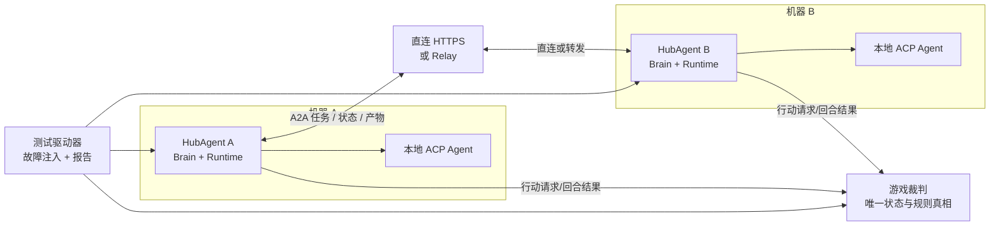
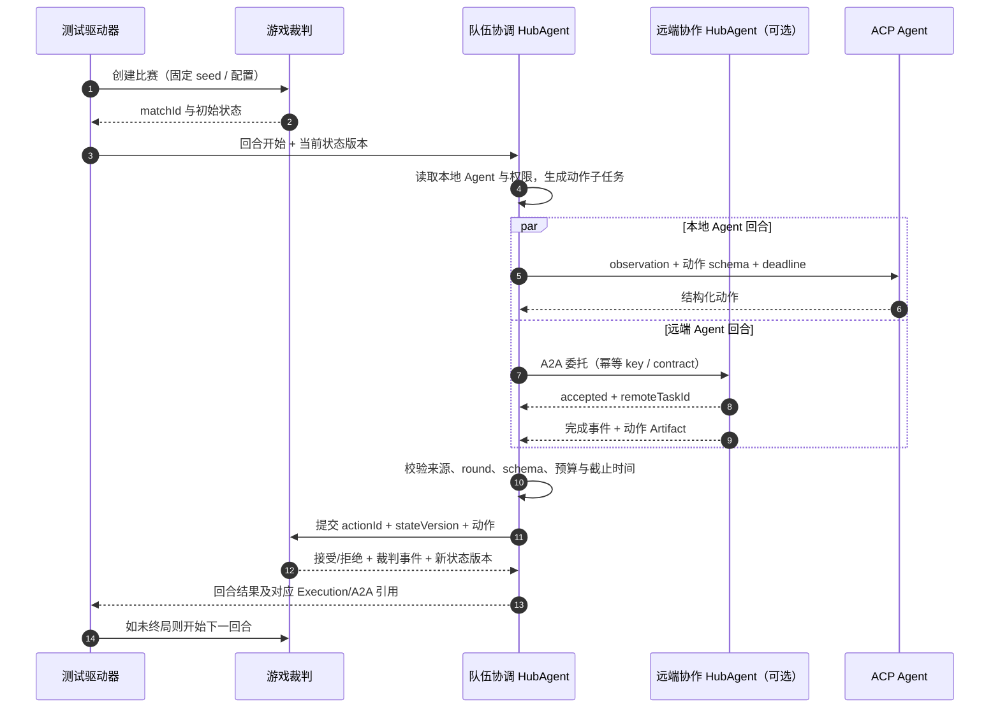

# A2A 跨机器游戏编排测试计划

**状态：** 测试方案基线  
**目的：** 用可重复的回合制游戏，验证 HubAgent 通过 A2A/ACP 组织跨机器 Agent 的调度、协作、恢复与结果收敛。  
**依赖计划：** [PLAN-A2A.md](PLAN-A2A.md)  
**测试定位：** 游戏是跨机器编排的集成测试台，不代替代码任务、沙箱和交付验收。

## 1. 通过标准

“赢了游戏”不等于架构通过。一次测试只有同时满足下列条件才算通过：

1. 所有玩家动作都来自对应的 HubAgent 执行记录，且能追溯到 `matchId / round / team / agent / Task / Execution / A2A remoteTaskId`。
2. 裁判接受的动作都合法；同一动作请求不会因重试或重连执行两次。
3. A2A 任务状态、两端 Runtime 状态、裁判回合状态最终收敛，无永久 pending/claimed 任务。
4. 断线、daemon 重启、远端超时、取消竞态后能查询、恢复或明确失败，不会静默丢任务或错误报告成功。
5. 混合团队能把动作请求分配给本机 ACP Agent 或远端 A2A Agent；完成结果汇回唯一的本局协调者。
6. 任务授权、预算、Peer 身份和 Agent 隔离有效；未授权玩家不能读取或修改比赛状态。
7. 裁判记录为唯一胜负真相；HubAgent 只能依据裁判状态和动作结果决定回合完成。

胜率、平均得分和策略质量单独报告，不能替代以上架构门禁。

## 2. 测试系统组成



### 2.1 游戏裁判

裁判是一个独立、确定性的程序，负责：

- 保存比赛和队伍状态，生成唯一 `matchId`、回合号和状态版本。
- 发布每个 Agent 在当前回合可见的观察数据（observation），按规则校验动作。
- 拒绝非法、过期、重复或越权动作；同一 `actionId` 重放返回原结果，不再次推进比赛。
- 记录事件序号、状态哈希、比分、终局原因和动作来源。
- 支持固定随机种子；相同种子与动作序列应产生相同结果。

裁判不负责选择 Agent、不调用 LLM、不修正非法动作，也不替 HubAgent 重试。它只执行规则并提供可核验结果。

### 2.2 HubAgent 游戏任务桥接

游戏决策不是代码修改任务。开始编写游戏前，先做一个窄的可行性 spike：让本地 ACP Agent 和远程 A2A Agent 都能收到结构化局面，并返回符合 schema 的单个动作。

- 测试输入：`matchId`、`round`、`stateVersion`、本 Agent 可见的 observation、允许动作 schema、deadline。
- 测试输出：`actionId`、`agentId`、`round`、一个 schema 合法的动作；附带的自然语言解释仅用于展示，不参与裁判。
- HubAgent 仍拥有任务状态、预算、授权、超时、取消、重试和审计。
- 结构化动作走 A2A 的 `data` Part；schema 由本地校验器执行，远端的 schema 声明只作参考，不作为验收依据。
- ACP/A2A Adapter 只负责把任务输入/结果映射到协议；不能由测试驱动器绕过 Runtime 直接启动子进程或伪造 Task 成功。
- 如果现有 `DelegationContract` 无法表达结构化 observation 与结果 schema，先增加通用的输入/输出 schema 或 TaskBrief 引用能力；不要加入生产代码中的游戏专用分支。

这个 spike 是进入 G1 的门禁。若必须在 Runtime 中写游戏规则才能让 Agent 返回动作，先停下来收敛通用任务契约。

## 3. 游戏选择与最小规则

第一版选一个**回合制、完全可观察或观察范围明确定义、低动作空间、确定性**的对抗游戏。优先小型网格战术游戏或简化棋盘游戏；不选需要帧同步、实时输入、图像识别、外部账号或玩家手速的商业游戏。

首版游戏至少满足：

- 两队，每队 2–4 个 Agent；每个 Agent 每回合提交至多一个动作。
- 动作集合固定且有机器可校验 schema，例如 `move / defend / collect / pass`。
- 明确胜负、平局、回合上限、超时、非法动作和缺席 Agent 的处理。
- 每个 Agent 只拿到权限范围内的 observation；是否提供全局状态是可配置且被记录的。
- 支持固定种子和脚本化基准策略，便于区分策略差异与调度缺陷。
- 单个动作调用有上限时间和 token/成本预算；超时不能无限阻塞整局。

首版具体地图和动作数由 G0 spike 后确定，以“足以暴露调度问题、足够快跑重复实验”为准；游戏规则不成为 HubAgent 产品领域模型的一部分。

## 4. 两个必测场景

### 场景 A：两台机器对抗，且必须发生 A2A 委托

这一场要证明的是跨机委托，不是“两个本机 daemon 各跑各的”。

- A 和 B 各运行一套 HubAgent，双方各有本地 ACP Agent。
- **强制约束：每回合至少有一个动作必须由一方通过 A2A 委托到另一方的 HubAgent 计算**，结果回到发起方再提交裁判。若某回合双方都只用自己的本地 Agent，该回合不计入通过样本。
- 两个 HubAgent 作为独立队伍，通过裁判 API 读取允许的 observation 并提交动作。
- 每队 HubAgent 负责本队 Agent 的分派、等待、超时和回合收敛。
- 使用直连 HTTPS 运行首轮；Relay 可达性不作为此阶段通过条件。

**验证重点：** 两套 HubAgent 独立持有状态、Peer 认证、跨机委托与结果回传、并发动作、回合推进和对抗隔离。

> 不加这条约束，本场景会退化成“两台单机 HubAgent + 一个裁判”：零次 A2A 调用也能打完，什么都证明不了。

### 场景 B：跨机器混合组队

- 一个逻辑队伍由 A、B 两台机器上的 ACP Agent 组成；另一个队伍按相同方式组成，或先用单队混合模式逐步验证。
- 每局明确唯一的 `teamCoordinator`，负责本队的计划、回合截止时间和动作提交；另一 HubAgent 作为受信协作者执行其被委托的 Agent 回合。
- 可配置每个回合的 Agent 路由：本机 ACP 或远端 A2A；同一个比赛配置中至少各有一个本地和远程 Agent。
- 结果通过 A2A 返回协调者，再由协调者提交裁判；禁止双方 HubAgent 同时推进同一个队伍回合。

**验证重点：** 本地/远程路由、同队结果汇合、跨机身份与权限、A2A 断线续接，以及统一回合 deadline。

通过场景 B 后，再测 A、B 互换协调者的反向角色，避免实现只支持单向委托。

## 5. 每回合的数据与调用流程



每个 Agent 的子任务应有独立 deadline；队伍的回合 deadline 到期后协调者必须按规则收敛，不能为了等待一个失联 Agent 卡住整局。失败策略（`pass`、弃权、替补 Agent 或判负）由游戏配置固定，不允许测试中临时改变。

## 6. 故障与安全测试矩阵

| 故障注入点 | 预期结果 |
|---|---|
| A2A 请求到达前断网 | 本地任务保持可恢复；按退避重连，不创建多个远端任务 |
| B 已接受任务但响应丢失 | A 通过幂等键/对账找回同一个远端 Task，不重复执行动作 |
| SSE 中途断开 | A 用 remoteTaskId 重新订阅/查询，补齐状态后继续 |
| Worker 执行中关闭 B daemon | B 的 Execution 恢复为可核验状态；不能谎报成功；A 等待或按 deadline 处理 |
| Brain/Runtime claim 决策点后退出 | 租约过期后被新的调度者重新 claim 并继续；仅“回收为 pending”而没有新触发者不算通过 |
| 重放已提交 actionId | 裁判返回原动作结果，比分与状态版本不重复推进 |
| 超时后远端迟到返回 | 已过期回合的动作被裁判拒绝；不会改变下一回合状态 |
| 撤销 Peer 信任/授权 | 新任务拒绝；现有任务按策略取消或等待人工，不扩大权限 |
| 非法或恶意 Artifact | 限额/格式/路径检查拒绝；比赛状态不被修改 |
| Relay 断线或重启 | 双方出站连接重连；活动任务可通过 A2A 状态查询恢复 |

故障时必须记录 `matchId`、round、HubAgent、Task/Execution、A2A task、故障注入点和最终裁判状态，便于一条 trace 还原全链路。

## 7. 指标与测试报告

每轮和每局都输出机器可读 JSON 报告，至少包含：

| 指标 | 口径 |
|---|---|
| 合法动作率 | 裁判接受动作数 / 收到动作数 |
| 重复副作用数 | 同一逻辑动作导致裁判推进超过一次的次数；目标为 0 |
| 路由正确率 | 实际执行 Agent 符合任务指定 peer/local route 的比例 |
| 回合收敛率 | 在 deadline 内完成或按配置终结的回合比例 |
| 任务对账率 | A/B 两侧记录能按 remoteTaskId 与幂等键关联的任务比例 |
| 故障恢复率 | 故障后在预算内恢复或按明确策略终结的注入用例比例 |
| 状态一致性 | HubAgent 终态与裁判终态冲突数；目标为 0 |
| 延迟/成本 | 单 Agent 动作、每回合、整局的 P50/P95 延迟与 token/费用 |
| 游戏表现 | 胜率、平局率、平均分；与固定策略基线比较，作为策略质量参考 |

架构门禁建议：固定种子下所有规则与状态不变量通过；注入故障用例不出现重复推进、状态冲突、未授权执行或永久挂起。性能阈值在 G0 实测本地 ACP 和网络基线后写入配置，不能预先编造毫秒数。

报告应区分 `architecture_pass` 与 `strategy_result`。胜率低但协议、调度和状态全正确时，判为架构通过、策略待改；胜率高但出现重复动作或状态不一致时，架构仍判失败。

## 8. 实施阶段与门禁

| 阶段 | 产出 | 进入下一阶段的门禁 |
|---|---|---|
| G0 · 可行性与规则冻结 | 定游戏规则、动作 schema、裁判接口；本地 ACP 与 A2A 各跑通一次结构化动作往返 | 动作可解析、裁判可确定性判定；确认不需游戏专用 Runtime 分支 |
| G1 · 单机基线 | 一台 HubAgent 管理 2–4 个本地 ACP Agent，固定 seed 跑完整局 | 本地回合调度、deadline、动作去重和报告正确；建立延迟/成本基线 |
| G2 · 双机对抗 | A/B 两个 HubAgent 直连 HTTPS，分别管理本地 Agent | A2A 身份/授权、状态订阅、任务对账与故障矩阵首批通过 |
| G3 · 混合组队 | 单队内同时有本地 ACP 与远端 A2A Agent；再交换协调者方向 | 两个方向均能路由、汇合、验收；无双主回合推进 |
| G4 · Relay 与断网恢复 | 双方无公网入站端口，经 Relay 建立 A2A；执行完整故障矩阵 | 断线、Relay 重启、daemon 重启后无重复动作、状态可恢复且无永久挂起 |
| G5 · 回归与基线 | 多固定 seed、并发场次、策略基线和归档报告 | 架构指标达标；性能和游戏策略指标单独报告；可一条命令重复运行 |

不要在 G1 之前同时引入 Relay、跨机对战和多个模型变量，否则失败时无法区分是游戏规则、ACP、A2A、网络还是策略问题。

## 9. 测试仓库落点

建议放在独立测试工具目录，不向生产 HubAgent 加游戏概念：

```text
fixtures/a2a-game/
  README.md                 # 规则、运行拓扑、复现步骤
  game/                     # 确定性裁判、状态机、动作 schema
  driver/                   # 创建比赛、驱动回合、注入故障
  agents/                   # 固定策略基线、ACP/A2A 玩家适配
  scenarios/                # duel / mixed-team / failure cases
  reports/                  # 本机报告；默认不提交大产物
```

实际接入若需要 package workspace 或测试专用 CLI，先由 G0 spike 决定；保持游戏裁判与生产 Runtime 分离，并复用 HubAgent 正式 API/协议入口，不能直接调用生产私有函数绕过边界。

## 10. 开始开发前的必答问题

G0 需要冻结以下事项并记录在 `fixtures/a2a-game/README.md`：

1. 选择的游戏规则、状态观察范围、胜负/超时/非法动作规则。
2. 每次 Agent 决策是一个独立 A2A Task 还是同一个多轮 Task 的续接；优先选择便于幂等、重连和审计的形式并用 spike 验证。
3. A2A Client/Server 使用的正式版本、binding、SSE 重订阅方式与 Artifact 格式。
4. 游戏裁判与 HubAgent 的部署位置、比赛状态是否对双方可见、如何防止越权读取。
5. Peer 配对与测试凭证生命周期；测试环境不得使用个人生产 API key 或真实项目目录。
6. 每个 Agent 的动作 deadline、每回合 deadline、模型预算和本地失败策略。
7. 固定 seed 集、并发场数、架构门禁阈值，以及报告保留位置。

## 参考

- [A2A Protocol v1.0 Specification](https://a2a-protocol.org/latest/specification/)：Task、消息、Artifact、版本和 binding 的正式契约。
- [A2A Task Update Delivery](https://a2a-protocol.org/latest/specification/#35-task-update-delivery-mechanisms)：查询、SSE 与 push notification 的能力声明和恢复选择。
- [跨机器 A2A 编排架构与实施计划](PLAN-A2A.md)
- [产品边界与验收](PRD.md)
