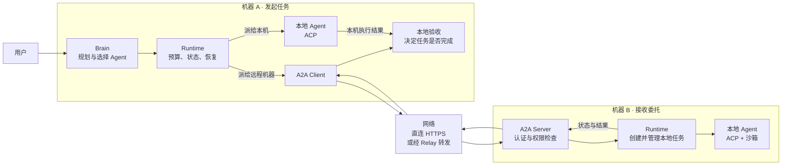
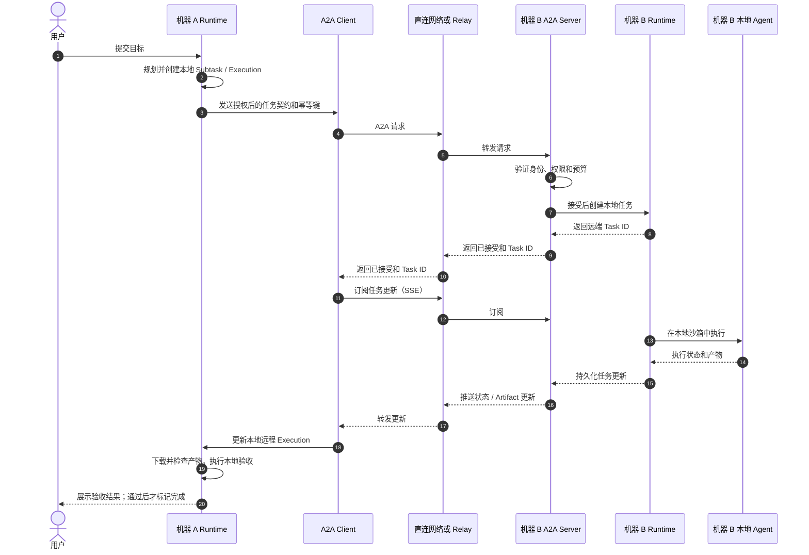

# HubAgent 跨机器 A2A 编排架构与实施计划

**状态：** 规划基线  
**范围：** 本地多 Agent 与不同机器上的 HubAgent / A2A Agent 混合编排  
**产品约束：** PRD 是产品边界唯一口径；本计划细化 A2A、远程任务与 Relay 的落地步骤。

## 1. 目标与非目标

### 1.1 必须交付

- HubAgent 同时提供 A2A Client 与 Server。
- Brain 统一规划本地 ACP 和远程 A2A 子任务；Runtime 统一负责状态、预算、幂等、恢复、验收与交付。
- 不同 HubAgent 能在可达网络上互相委托任务；一方可将本地 Agent 提供给对端，双方组成混合团队。
- 远程断连、daemon 重启、重复请求、取消、等待人工输入等情况有明确且可恢复的语义。
- 远程结果不能自行证明成功：发起方持有远程执行状态，并对交付物执行本地可执行验收。
- 无公网入口的节点通过 Relay 的出站连接建立可路由的 A2A 通信。

### 1.2 明确不做

- 不把对端完整内部计划、私有任务图、Agent 私有目录或凭证暴露给远端。
- 不允许远程 Agent 默认二次委托；是否可再委托由本地策略显式授权并受深度/预算上限约束。
- 不把 Relay 做成第二套任务协议或任务状态数据库；A2A 是唯一远程任务语义。
- 不因引入 Restate/Hatchet 而替换现有 Domain、Runtime 或 SQLite 事件模型。持久化运行时只有在故障注入证明现有机制无法满足目标后才另行评估 ADR。

## 2. 当前项目基线

截至本计划编写时，仓库已有：

- `Goal / Task / Subtask / Execution / Approval / VerificationRun / DelegationContract` 领域模型、合法状态迁移与不变量。
- SQLite WAL、事件追加、同事务投影更新、按事件重建和 `decision_queue`。
- `OrchestratorBrain` 与 Pi Brain，Runtime 动作校验、DecisionRecord、预算与幂等键。
- ACP 执行闭环；`AgentHost → SandboxProvider` 强制隔离；确定性验收、证据、审批、worktree、并行和恢复扫描。
- HTTP/CLI、同源 Web Console、SSE 与事件查询。
- A2A/Relay 目录和文档设计，但尚无可用于跨机器编排的 A2A Client/Server 运行链路。

因此，这不是另起一套多 Agent 框架的项目。A2A 应成为 `adapters` 的远程协议实现，接入现有 Runtime 和契约；本地 ACP 和远程 A2A 最终汇入同一套任务状态、决策、证据和恢复机制。

> **开工前置（不得跳过）：** A0 之前先完成 §5.1 / §5.1.1 的 claim 租约、outbox 原子性，并定下 `await_any` 语义。A2A 会让“远端已完成、我方未落结果”成为常态；没有可靠的派发/恢复语义时，跨机编排会把现有恢复缺口放大成丢任务。阶段表见 §7，但顺序以本节为准。

## 3. 目标架构

### 3.1 谁负责什么

先看这张简图：A 负责决定“派给谁”和“结果是否合格”；B 负责在自己的机器上安排和执行；网络只负责把请求和结果送到对方。



机器 A 和机器 B 各自用 SQLite 保存自己的任务状态。Relay 只帮助网络不可直连时转发 A2A 通信，不保存任务真相；状态和最终结论仍由两端 Runtime 管理。

### 3.2 一次远程委托怎样往返



图中 Relay 是“直连网络”的替代传输路径，A2A Client/Server 和两端 Runtime 不变。断线后，A 用已保存的远端 Task ID 重新查询或订阅；不因连接断开就重发一个新任务。

### 3.3 所有权边界

| 责任 | 所有者 | 约束 |
|---|---|---|
| 用户目标、内部计划、策略与最终完成判定 | 发起方 Runtime | 不把内部 DAG 透传为 A2A 任务 |
| 远程协议消息、版本、SSE、错误映射 | `adapters/a2a` | 只做协议转换，不决定任务是否成功 |
| 远程可公开能力与 Agent Card | 接收方 A2A Server | 仅暴露明确配置的能力，不枚举本机全部 Agent |
| 远程请求身份与授权 | 接收方 Trust/Policy | 未认证、未授权、超预算请求拒绝进入 Runtime |
| 接收方本地计划、ACP Agent 选择与沙箱执行 | 接收方 Runtime | 远程调用和本地 CLI 任务共用状态机与隔离执行路径 |
| 最终验收 | 发起方 Runtime | 必需检查在本地证据与下载产物上运行；远端 `completed` 不是本地成功 |
| NAT/内网穿透与连接路由 | Relay | 只转发授权的 A2A 流量，不成为任务真相源 |

## 4. 统一任务模型与跨机器语义

### 4.1 远程委托仍是本地 Subtask

发起方为远程工作创建普通 `Subtask` 和 `Execution`，并记录一条远程委托关联：

```text
local Goal / Task / Subtask / Execution
  └─ remote execution reference
       ├─ peerId + peerCard fingerprint
       ├─ A2A contextId + remoteTaskId
       ├─ request/idempotency key
       ├─ selected capability + contract digest
       ├─ last observed remote state / event cursor
       └─ artifact manifest + verification result
```

不得把 `remoteTaskId` 当成本地 Execution ID。远端可以自行建内部 Goal/Task/Execution；它们只通过 A2A Task、状态事件和 Artifact 对外呈现。

#### 4.1.1 持久化模型（A0 定契约，迁移随 A2 落地）

A0 只冻结字段、主键与不变量；建表迁移与 A2 的实现同一个 PR，避免先建一张没人读写的表。

**`peers`（对端身份与授权）**

| 字段 | 说明 |
|---|---|
| `id` (PK) | 本地生成的 peerId，不用对端自报的名字 |
| `display_name` | 便于人读，可重复 |
| `public_key` | 配对时交换的长期公钥（mTLS/请求签名用） |
| `card_fingerprint` | Agent Card 签名摘要，变更即重新校验 |
| `status` | `pending` / `trusted` / `revoked` |
| `capabilities` | 允许调用哪些能力（白名单，JSON） |
| `budget` | 预算/并发/速率上限（JSON） |
| `created_at` / `trusted_at` / `revoked_at` | 审计用 |

不变量：`status=revoked` 的 peer 不得新建任务（在创建任务之前拒绝）；撤销不依赖对端配合。

**`remote_task_refs`（远端任务关联与对账）**

| 字段 | 说明 |
|---|---|
| `id` (PK) | — |
| `local_execution_id` | **UNIQUE**：一 Execution 一远端任务 |
| `peer_id` | 指向 `peers` |
| `idempotency_key` | **UNIQUE**：重放命中的唯一依据 |
| `remote_task_id` | 远端生成；在同 peer 内唯一 |
| `context_id` | A2A 会话上下文，续聊/补输入用 |
| `observed_state` | 最近一次看到的 `TaskState`（不代替本地状态机） |
| `event_cursor` | SSE 重订阅/对账游标 |
| `message_id` | 首次请求的 `Message.messageId`（协议级去重抓手） |
| `created_at` / `last_seen_at` | — |

不变量（与 PRD §7.6.4 一一对应）：`local_execution_id` 唯一；`idempotency_key` 唯一；
`observed_state` 只能从远端读取更新，不得由本地“推断”写入。

**`remote_artifacts`（交付物 manifest）**

| 字段 | 说明 |
|---|---|
| `id` (PK) | — |
| `remote_task_ref_id` | 指向 `remote_task_refs` |
| `artifact_id` | 远端 `artifactId`；同 ref 内唯一 |
| `form` | `patch` / `commit` / `bundle` / `analysis` |
| `base_ref` / `base_commit` / `lock_digest` | 基线与环境可比性 |
| `sha256` / `size` / `media_type` | 完整性 |
| `signer_peer_id` | 产出方身份 |
| `local_path` | 下载后的本地位置（不入库内容，只存引用） |
| `verified_at` / `verdict` | 本地验收结论（不采信远端自述） |

不变量：`verified_at` 为空时，不得把对应 Execution 置 succeeded。

### 4.2 只发送最小 Delegation Contract

从现有 `DelegationContract` 派生远程请求，只携带：

- 目标、必要输入材料/引用、输出格式、验收要求。
- 预算和截止时间、允许的二次委托规则。
- 需要公开给对端的上下文；敏感路径和密钥默认剔除。
- 双方协商后的能力标识和协议版本。

不发送本地绝对路径、原始环境变量、provider 凭证、完整对话、未授权文件内容或内部完整计划。Artifact 下载后按不可信输入处理，限制大小、数量、MIME 类型和解包路径，禁止路径穿越。

### 4.3 A2A 状态映射

不能只按名称一一映射；A2A Task 状态、输入等待、身份验证等待和本地状态机需要按当前规范做显式转换。计划实现时先固定支持的 A2A 版本与 binding，并用官方规范建立映射表和兼容性测试。原则如下：

| 远端信号 | 发起方 Runtime 语义 |
|---|---|
| 已接受/排队/执行中 | 本地 Execution 保持 active；记录远端可观测状态 |
| 远端等待输入 | 本地转 `waiting_input`，创建可路由到该远程 Execution 的 clarification |
| 远端要求授权 | 本地转审批等待态；Task 用 `waiting_approval`、Execution 用 `waiting_permission`，A0 定表时必须写死到底落在哪个实体；只展示经过净化的授权请求，不自动转发秘密 |
| 远端成功 | 进入 `verifying`；下载/校验 Artifact 后本地验收 |
| 远端失败 | 记录稳定 `failureCategory` 与协议错误；先核查副作用再走升级策略 |
| 远端取消 | 只有远端确认终态后本地才收敛 canceled；超时/断线不等于取消成功 |
| 连接中断/未知 | 标记远端状态暂不可知；订阅恢复或查询对账，不盲目重发任务 |

最终字段名称与枚举以锁定的 A2A 版本为准（见 §4.4）。

**现状澄清（避免误传）：** PRD 目前**没有** A2A 状态映射表——§7.2 只列了 A2A Server 的 9 项能力，§7.4 只有文字流程。因此 A0 的交付是**新建**映射表并配兼容性测试，不是“复核已有表格”。映射还必须落到具体实体：Task/Subtask 用 `waiting_approval`，Execution 用 `waiting_permission`（见 `domain/status.ts`），远程的 `input-required`、`auth-required` 各自对应哪一层要先定，不能两个语义合用同一个状态。

### 4.4 协议硬约束（编码前必须遵守）

以下条款来自 A2A 1.0.0 规范，直接决定客户端与中继的实现形态，不遵守会在联调阶段返工：

- **锁定版本与 binding**：只支持 `protocolVersion: "1.0"` + `JSONRPC` binding；遇到不支持的版本返回 `VersionNotSupportedError`，不做版本嗅探或静默降级。
- **必须显式发送版本头**：规范规定空 `A2A-Version` 头按 **0.3** 处理，所以客户端每个请求都要带 `A2A-Version: 1.0`。
- **SendMessage 默认阻塞**：`SendMessageConfiguration.returnImmediately` 缺省为 `false`，会等到终态或 `INPUT_REQUIRED`/`AUTH_REQUIRED` 才返回。做异步委托必须显式传 `returnImmediately: true`，再用 `SubscribeToTask` 或 `GetTask` 跟进。
- **流式是可选能力**：`capabilities.streaming: false` 时 `SendStreamingMessage` / `SubscribeToTask` 返回 `UnsupportedOperationError`，因此客户端必须同时实现 `GetTask` 轮询兜底。
- **幂等只能靠协议抓手**：规范只保证 `GetTask` / `CancelTask` 幂等，`SendMessage` 仅为“**MAY** 用 `messageId` 去重”。因此 `Message.messageId` 是一级幂等键，业务幂等键放 contract metadata，两者都要落库。
- **interrupted 不是 terminal**：`INPUT_REQUIRED` / `AUTH_REQUIRED` 是可续状态，答复必须作为**同一 `taskId`/`contextId` 的后续 Message** 发回，而不是新建任务。
- **1.0 相对 0.3 是破坏性升级**：`kind` 判别符已移除（改为以字段名判别），AgentCard 改为 `supportedInterfaces`、`capabilities.extendedAgentCard`；不能沿用 0.3 的字段知识。

### 4.5 远程交付物与本地验收

“B 在自己机器上改代码、A 下载 Artifact 后本地验收”对游戏动作够用，对代码任务**不成立**：A 无法仅凭一个产物判断它能否落到自己的基线上。因此远程执行状态与远程交付物必须分开建模，交付物至少记录：

- 两端项目身份与基线：仓库标识、`baseRef` / 基线 commit、依赖锁文件摘要；
- 交付形式：`patch` / `commit` / `bundle` / 只读分析结论，四者验收方式不同；
- 可应用性：patch 能否在 A 的指定基线干净应用（`git apply --check`），冲突时如何升级到人工；
- 完整性：内容 hash、大小、MIME、签发者与来源 `peerId`；
- 验收对象：A 验证的是“应用后的产物”还是“B 提供的可重放证据”——两者都要写进 contract，默认前者。

游戏测试只需要结构化的 action result，代码任务需要 patch/commit；二者不能混成同一种“结果”。

## 5. 可靠性：先补现有 Runtime，再决定是否增加 Restate

### 5.1 本地先完成可恢复通知

本地第一阶段采用现有 SQLite，而不是先引入另一个调度数据库：

1. Runtime 事务内写入领域事件、投影和待处理决策/通知记录。
2. 事务提交后通过进程内唤醒器通知 Brain Loop；进程内通知只是加速器，不是事实来源。
3. daemon 启动和周期性恢复扫描从 SQLite 找出未消费/过期 claim 的工作，安全地重新派发。
4. Brain 按 `dedupeKey + stateVersion` 读取新快照；处理成功后完成决策点。
5. SSE/CLI 是观察端，不承担可靠消息投递职责。

必须补齐的路径包括：`await_any` 现在只读取快照并立即返回；Subtask/Execution 更新后需要明确触发决策点；已 `claimed` 但进程崩溃的 DecisionPoint 必须能租约过期后重新 claim。所有重试都要以幂等键和状态版本防止重复副作用。

**实施状态（2026-11-26）：** 分两步，已做的一半与未做的一半必须分清。

已实现（迁移 `016-decision-claim-lease`，测试 `test/unit/decision-lease.test.ts`）：

- 每次 claim 生成 `claim_token`，并累计 `attempts`；
- `completeDecisionPoint` / `renewDecisionClaim` 都必须匹配 `id + claimToken + status = 'claimed'`，租约过期被回收后旧执行者无法改写新 claim；
- `claimed_at` 用注入的时钟写入，租约可测；
- 回收拆成独立的 `reclaimExpiredDecisionPoints`（可限定 `goalId`），只由恢复扫描调用，**不再在 `claimDecisionPoint` 里隐式回收**；
- `attempts` 到上限后判 `failed`，不再无限重领；
- Brain 回合在 `explain` 前续租，续租失败即丢弃本轮动作；
- **outbox**：`scanRecovery` 的“置 unknown”与“建恢复决策点”在同一事务内提交；崩在中间整体回滚，下次启动重来。可能做 I/O 的租约检查放在事务外。（`test/unit/recovery.test.ts` 用 SQLite 触发器注入崩溃点验证）

未实现（下一步）：

- **调度循环**：回收后只是变回 `pending`，目前没有常驻调度者在 daemon 存活期间重领（回收只在启动扫描发生）。这不等于自动恢复执行。
- **Dispatcher**：`runGoalWithBrain` 仍是单栈阻塞循环，不是可恢复的通用调度器。骨架（持久化意图 + 带 fencing 的执行队列）已落地并测试，但**尚未接线**，原因与待定事项见 §5.4。

历史备注：曾有一版“180 秒租约”因为缺 fencing token、在任意 claim 里全库回收、并因 `claimed_at` 用系统时间导致单测失败而被撤回；本次重做已逐条覆盖这三个问题。

### 5.1.1 claim 必须改成带 fencing token 的租约

A1 门禁会逐条验的实现要点（全部已落地，⑦ 由 ADR 0027 裁定）：

1. ✅ 每次 claim 生成唯一 `claimToken`，并记录 `attempts` 计数。
2. ✅ 续租（heartbeat）、完成、失败都必须匹配 `id + claimToken + status = 'claimed'`；不匹配时静默丢弃并留痕，不得改写别人的 claim。
3. ✅ `claimed_at` 由注入的时钟写入（可测）；租约 180s 大于 `step` 的 90s 超时；`step` 与 `explain` 都受 `budget.timeoutMs` 约束，前后各续租一次。
4. ✅ 过期回收只由恢复扫描执行，可限定 `goalId`；不在业务路径上隐式回收。
5. ✅ 回收与 `attempts` 耗尽都会写一条 `DecisionRecord`（`retry` / `abort`），事后可回答“这个决策点为什么被重跑/放弃”；`ha doctor` 额外把队列积压与失败数报成可见的一行。
6. ✅ `attempts` 到 `DEFAULT_MAX_CLAIM_ATTEMPTS` 即判 `failed`，不再重领。
7. ✅ 已由 **ADR 0027** 裁定：Brain 回合不阻塞，`await_any` 只读快照；PRD §10.1 / §13.5.3 已同步修订，无用参数 `timeoutMs` 已从工具 schema 删除。
8. ✅ 结果落库与下一决策点同一事务，由 Runtime 驱动下一回合（`drainDispatches` 已实现，见 §5.4）。

### 5.2 远程可靠性策略

- 先持久化本地委托意图，再发 A2A 请求；保存本地幂等键与远端 Task 关联。
- 网络超时后先用已知 remoteTaskId 查询/订阅；只有确认远端未接收时才重试创建。
- 若请求可能已到达但 remoteTaskId 未返回，发送端需要以协议支持的消息/业务幂等标识对账；没有远端幂等保证时进入 `unknown` 和人工/策略恢复，不做“未知即重试”。
- 远端状态事件与本地 `seq` 分开保存；用 A2A Task ID 和事件游标恢复 SSE 订阅，断线后通过任务查询补齐状态。
- Worker 心跳/网络活性不能被解释为任务成功或失败；租约、超时、取消、业务终态分别建模。

### 5.3 Restate 决策门

Restate 是候选的 durable execution 层，不是 A2A Adapter，也不自带操作系统沙箱。第一版 A2A 不要求接入它。只有满足以下证据再写 ADR 决定是否集成：

- SQLite 决策队列、恢复扫描、幂等和对账无法满足跨机器验收指标；
- 故障注入复现了会丢失任务或不可控重复副作用的缺口；
- 已证明把远端调用包入 durable step 后，外部操作的幂等边界仍成立；
- 单机安装/升级、数据备份和跨机器拓扑的运维成本可接受。

任何持久化执行系统都无法单方面保证远端 Agent 的外部副作用“绝对只执行一次”。远端 A2A Server/业务操作仍需幂等键、去重记录或可查询对账结果。

### 5.4 Dispatcher 骨架（C3）

目标：把「派给谁、派什么」先落库，再执行。这样进程崩在派发途中时，库里留有可对账的记录，而不是只剩下一个再也回不来的内存调用栈。

**落地点**：`runtime/dispatch/{types,queue,runner,acp-executor}.ts`；表 `dispatch_queue`（迁移 `017`）；测试 `test/unit/dispatch.test.ts`、`test/unit/idempotency.test.ts`。

意图字段：`goal_id` / `task_id` / `subtask_id` / `target`（`local-acp` | `remote-a2a`）/ `agent_id` / `objective` / `idempotency_key`（UNIQUE，由 Runtime 派生）/ `status` / `attempts` / claim 三件套。

语义：

1. **先落库再执行**：`enqueueDispatch` 是 `INSERT OR IGNORE`，同一 `idempotency_key` 只有一行，`created=false` 表示早就派过。
2. **claim 带 fencing**：与决策点同构（`claim_token` + `attempts` + 封顶）。过期回收只由恢复扫描/调度器执行：`scanRecovery` 启动时同时回收决策点与派发意图的过期 claim（`RecoveryReport.reclaimedDispatches`）。
3. **收尾与下一决策点同事务**：`drainDispatches` 在 executor 返回后用**一个事务**完成「意图 done/failed」+「写下一决策点」，避免“执行完了却没人继续决策”的半状态。
4. **执行本身不在事务里**：executor 是异步 I/O（ACP 会话、未来的 A2A 调用），事务里不能等它。因此“执行结果”与“意图收尾”之间不是原子的，靠**对账**收敛：意图仍为 claimed/pending 时，先查该 `idempotency_key` 对应的已有执行，再决定重跑还是补收尾。
5. **租约时长不同**：决策点 180s（Brain 回合），派发 30min（ACP 执行以分钟计）。超过租约的长任务必须续租，否则会被判为持有者已死。
6. **执行器先对账**（`acp-executor.ts`）：同一 `idempotencyKey` 已有执行时**绝不重跑**——终态就按已有结果收尾，在途就返回 `requeue` 把意图退回 `pending`（runner 收到 `requeue` 时会结束本轮，避免立刻重领同一条）。

**接线前必须定的三件事（第 1、2 项已由 ADR 0027 裁定，第 3 项待定）：**

- ✅ **Execution ID 派生**：ADR 0027 D4 定为“由 `idempotencyKey` 确定性派生 + 重放命中已有 intent 不重复执行”，且**已实现并已接线**：`deriveExecutionId` + `createAcpDispatchExecutor`（先查契约、终态对账、在途退回），`runGoalWithBrain` 的单条派发已经走 `enqueueDispatch → drainDispatches`。
- ✅ **Brain 回合是否阻塞**：ADR 0027 D1/D2 定为不阻塞；入口允许过渡态同步等待（D5），A1 退出前必须改成“派发即返回”。
- ⏳ **远程 target 的 executor 形态**：`remote-a2a` 现在只有类型占位；接远程时需要 `RemoteTaskRef` + 交付物 manifest（§4.5）才能定义 `ok`。

**接线现状（2026-11-26）**

- `runGoalWithBrain` 的单条派发已走 Dispatcher：`enqueueDispatch` → `drainDispatches(intentId)` → `createAcpDispatchExecutor`；意图先落库再执行，终态后收尾为 `done`/`failed`，`decisionFor` 产出与循环一致的 `goal:<goalId>:dispatch:<n>` 键。
- 意图携带**可独立执行的规格**（迁移 `018` 的 `payload`：worktree / checks / 网络策略…），所以从库里捞起也能跑：`runtime/scheduler/local-executor.ts`。
- **daemon 常驻调度**已接：`startHub` 启动后异步补一轮，之后每 5s 跑 `runSchedulerTick`（先回收过期 claim，再消费派发意图）；单次失败只记不抛。
- **崩溃矩阵已覆盖**（`test/unit/crash-matrix.test.ts`）：崩在 claim 前 / claim 后执行前 / 执行中 / 写结果后收尾前四个点，均不重复执行、不丢任务、不永久 claimed。进程级 `kill -9` 仍走 `test/manual/kill9-test.ts` 手工验证。
- **仍是过渡态**（ADR 0027 D5）：入口回合在派发后**同步等待** drain 结束，而不是“派发即返回”。这条边界是**显式且有测试守的**：`runSchedulerTick` 只把 pending 决策点报成 `pendingDecisionGoals`，绝不代办；没有 Brain 回合就不会有人推进它们（`test/unit/scheduler.test.ts`）。
- **并行入口已迁移**：`runParallelAgents` 现在也为每个子任务写意图（带 worktree 租约固定的 `executionId`）并走同一条 drain，不再是绕过队列的第二条路径（`test/unit/parallel.test.ts`）。
- **决策点仍靠 Brain**：tick 只把“有 pending 决策点但没可派发意图”的 Goal 报成 `pendingDecisionGoals`，不代为决策。真正的“决策点驱动下一回合”还需要把 Brain 循环做成可恢复状态机。
- 远程 target（`remote-a2a`）只有类型占位，需要 `RemoteTaskRef` + 交付物 manifest（§4.5）才能定义 `ok`；接线时不要把它当成 `local-acp` 的同类。

## 6. 安全、信任与暴露面

- 现有本地 HTTP API 继续只监听 loopback；A2A Server 作为独立受控监听面，默认关闭，显式启用后要求 TLS/受信反向代理或 Relay，不复用本地 token。

> **与现行规则冲突，需先立 ADR。** AGENTS.md 写死“本地服务只监听回环地址”。在 ADR 批准前，A2A Server 不得监听非回环地址；ADR 需同时定下：独立端口/独立进程/反向代理三选一、TLS 终止点、Peer 身份机制（配对密钥 / mTLS / access token）、撤销与轮换的存放位置、Relay 可见的元数据范围。
- Agent Card 只公开管理员允许的能力、输入/输出模式、协议版本与可达端点；Agent Card 本身不代表授权。
- Peer 身份、授权策略、撤销、密钥轮换和审计记录属于 A2A 接入门禁。未知 peer 默认拒绝；首次配对需要可验证的用户操作。
- 每个入站请求限大小、并发、速率、任务时长、模型预算、Artifact 总量与二次委托深度；超限失败关闭。
- 远程任务必须经接收方 `SandboxProvider`；拒绝执行不能降级成普通子进程。
- A2A 请求/响应、DecisionRecord 与审计事件要脱敏；不记录 bearer token、API key 或完整敏感 Artifact。
- HTTPS 直连优先；无公网入口时由双方主动连接 Relay。Relay 的身份认证、端到端信封加密、路由授权和重放保护单独验收。
- **传输层有两个 web 框架是故意的**：A2A 端口跑 SDK 自带的 Express transport（ADR 0028），主服务仍是 Hono。两者端口、鉴权、进程边界都独立；不要把 A2A 路由并进 `interfaces/http`，也不要把本地 token 带过去。

## 7. 分阶段实施与验收门禁

| 阶段 | 交付 | 必须通过的门禁 |
|---|---|---|
| A0 · 规范与契约对齐 | 锁定 A2A 1.0 + JSONRPC；**PRD §7.6/§7.7 已写入**状态与错误映射、对账不变量、交付物语义；**§4.1.1 已冻结** Peer / RemoteTaskRef / 交付物字段与不变量 | 规范版本明确；映射穷尽到具体实体；拒绝未声明能力/版本；安全审查通过 |
| A1 · Runtime 唤醒与恢复 | 裁决并实现 `await_any` 语义；状态迁移与待派发意图**同事务**（outbox）；DecisionPoint 带 `claimToken` 的租约、续租、重启恢复、去重与 `attempts` 封顶；事件触发决策 | kill daemon 于 claim、dispatch、执行中、结果写入前后，以及“写 unknown 与建决策点之间”；无永久 claimed、无静默丢任务、旧持有者无法改写新 claim、重复动作可检测 |
| A2 · 直连 A2A Server（协议完整、产品收窄） | 官方 SDK 作协议层（ADR 0028）：Agent Card、`SendMessage`/`GetTask`/`ListTasks`/`CancelTask`、`SubscribeToTask`（SSE）+ 重订阅、`INPUT_REQUIRED`/`AUTH_REQUIRED` 续聊；SQLite `TaskStore` + `AgentExecutor`；Peer token 鉴权（mTLS 推到 A4，见 ADR 0026 变更节） | 两个本地 HubAgent 通过 SDK Server/Client 互委托；重启后查询状态一致；未经认证/授权的任务零副作用；不支持版本/能力时返回 SDK 规范错误 |
| A3 · A2A Client 与 Runtime 调度 | 远端目录/peer 绑定、能力选择、委托、流订阅/断线续接、结果对账、本地验收与重规划 | 本地 ACP + 远程 A2A 混合 Plan；断网/超时/重复请求/取消/远端失败均按策略收敛 |
| A4 · Relay 跨 NAT | 出站连接注册、peer 路由、加密信封、心跳/重连/限流；Relay 只转发 A2A 语义 | 双方均无公网入站端口仍可委托；Relay 重启/断线恢复；未授权 peer 无法路由或读取消息 |
| A5 · 真实混合团队基线 | 多机 ACP Agent 与 A2A Agent 的回归套件、故障矩阵、成本/延迟/成功率报告 | 单机、LAN/VPN 直连、NAT+Relay 三种拓扑通过；所有成功来自本地验收证据 |

### A2 范围：协议完整、产品收窄

“最小”只能指**产品范围**，不能指协议实现。协议必须完整（否则不可互操作），收窄的是部署形态与可选能力。

| 必须做 | 明确不做（后续阶段） |
|---|---|
| Agent Card（`.well-known/agent-card.json`）+ 签名校验 | Relay 跨 NAT 穿透（A4） |
| `SendMessage` / `GetTask` / `ListTasks` / `CancelTask` | Push notification callback（需单独安全评审） |
| `SubscribeToTask`（SSE）+ 断线重订阅 | gRPC / HTTP+JSON binding |
| `INPUT_REQUIRED` / `AUTH_REQUIRED` 续聊 | mTLS（A4 之前必须补，见 ADR 0026） |
| 状态 → 本地实体映射（PRD §7.6.2） | Extended Agent Card |
| 按 peer 的 token 鉴权与本地撤销 | 二次委托（默认禁止，需显式授权） |

### A2 进度（2026-11-26）

已落地（有测试）：

- 迁移 `020`：`a2a_peers`（token 只存 sha256）+ `a2a_tasks`（Task 投影）。
- `adapters/a2a/mapping.ts`：本地 Task 状态 ↔ `TaskState`（PRD §7.6.2），含终态/中断态判定。
- `adapters/a2a/card.ts`：Agent Card，只声明 1.0 + JSONRPC（不声明 0.3）。
- `adapters/a2a/task-store.ts`：SQLite `TaskStore`，按 `resolveUserScope` 做 owner 隔离、同 ID 覆盖、分页。
- `runtime/a2a-executor.ts`：`AgentExecutor`，首帧 `task` → `WORKING` → 终态/`INPUT_REQUIRED`；取消复用 runner 回的 `contextId`。
- ADR 0028 追加变更节：**改用 `JsonRpcTransportHandler` 挂 Hono，不引入 express**。

未落地（下一步）：

- 双 daemon 真实互委托（A2 门禁的最后一环，需要进程级启动 + HTTPS）。
- `interfaces/a2a` 接入 `startHub` 的独立端口与生命周期。
- 出站 Client（A3）。

### A2 进度补充（2026-11-26，第三轮）

**A2 服务端已完成并接进 daemon**（有测试）：

- `interfaces/a2a/server.ts`：独立监听器（默认 `127.0.0.1`，默认端口 7789），端口 0 时回填真实 URL 到 Agent Card；启动时幂等注册配置里的 Peer。
- `startHub` 新增 `a2a?: { enabled, port?, host?, publicUrl?, peers? }`：**默认关闭**，开启失败则整个 daemon 启动失败（不静默降级）；`HubHandle.a2a` 暴露实际地址，`close` 先关 A2A 再关库。
- `runtime/a2a-runner.ts`：brain/agent 改为**运行时惰性解析**，缺配置时任务 FAILED，不拖垮 daemon（fail-closed 针对鉴权/授权，不是“没配模型就拒绝启动”）。
- `test/unit/a2a-daemon.test.ts`：真实 HTTP 验证——默认关闭、独立端口、卡片回填、未认证 401 且零任务、缺版本头 `-32009`、认证后受理并落库、**重启同 home 后 GetTask 仍可查到**。

**A2 仍未完成的一项**：真正的“两个 daemon 互委托”——需要出站 Client（A3），目前 A2 侧只证明“别人能委托我”。

### A5 核心验收场景

1. A 本机 Brain 规划并行任务：一个本地 ACP，一个远程 HubAgent；结果汇合后由 A 本地验收。
2. B 将一个受限能力公开给 A；A 委托后 B 仍在自己的 sandbox/worktree 执行，不向 A 暴露内部子任务图。
3. A、B 互为受信 peer，双方各自的本地 Agent 能参与同一任务团队；所有跨边界委托都有独立预算、幂等键和审计链。
4. 在请求到达前、远端已接收但响应丢失、远端执行中、远端已完成但本地未落结果、SSE 断线、Relay 重启等时点注入故障，验证恢复行为。
5. 远端返回 `completed` 但 Artifact 缺失、格式错误或本地检查失败时，本地不得标记任务成功。
6. 权限撤销、超预算、超时、取消竞态、远端请求二次委托和恶意 Artifact 均有拒绝或人工升级路径。

## 8. 代码落点建议

保持现有单包分层，不新增平行的 orchestration package：

```text
packages/hub/src/
  adapters/a2a/               # 只做协议：编解码、映射、客户端；不得 import runtime
    client.ts                 # Agent Card / JSON-RPC / SSE / query / cancel
    protocol.ts               # 请求/响应/错误编解码，不知道 Runtime 存在
    mapping.ts                # A2A ↔ Domain 状态、错误、Artifact 映射
    peer-auth.ts              # peer 身份与请求认证适配
  interfaces/a2a/             # 入站组合根：挂路由、鉴权、把协议调用转成应用服务调用
    routes.ts
  runtime/
    remote-dispatch.ts        # Subtask/Execution -> 远端调用意图（复用 delegation_contracts 幂等）
    remote-task.ts            # RemoteTaskRef 生命周期、对账、恢复、交付物 manifest
    a2a-task-service.ts       # 实现 A2aTaskService 端口：接收 / 查询 / 取消远程任务
    decision-wakeup.ts        # Durable queue + 进程内唤醒加速器
    recovery/                 # 扩展现有扫描，不另建恢复状态机
  storage/
    migrations/               # peers、remote task refs、event cursor、claim lease
    queries/                  # peer/remote task 只读查询
    write/                    # 事务内状态与关联写入
```

依赖方向必须是**端口注入**，不能让 adapter 反向依赖 Runtime（R4 会直接 CI 失败）：

```text
interfaces/a2a（组合根）→ 创建 adapter 的编解码器
                      → 注入 runtime 实现的 A2aTaskService
                      → adapter 只依赖自己声明的端口类型
```

`adapters/a2a` 负责 JSON-RPC / SSE / 协议映射；“接收远程任务、查询状态、取消任务”由 Runtime 的应用服务实现。`interfaces/http` 继续做本机认证后的入口与查询，不直接写 Storage。

## 9. 文档与决策待办

- [x] A0：PRD §7.6（状态映射 / 错误映射 / 对账不变量 / 版本与能力校验）与 §7.7（交付物与本地验收）已写入；持久化模型冻结在 §4.1.1（建表随 A2 落地）。
- [ ] A0 余项：兼容性测试（验 `TASK_STATE_* → 本地实体` 的穷尽性）跟随 A2 的首个真实实现一起写，不先写空测试。
- [x] 立 ADR：A2A 暴露面与 Peer 身份（ADR 0026）；Brain 回合语义与 outbox/租约（ADR 0027）。
- [ ] 确认 `reply` 是否进入 PRD §13.5 的正式元工具契约：实现与提示词已有它，PRD §13.5 的 8 个工具里没有。
- [ ] 为远程 peer、委托二次分发、Artifact 安全建立 ADR。
- [ ] 已同步 `docs/ARCHITECTURE.md`、`docs/PLAN.md`、`docs/README.md` 一次（2026-11-26，标注了实现缺口）；此后每次实现变化同 PR 更新，避免文档再次声称尚不存在的能力。

## 参考

- [A2A Protocol v1.0 Specification](https://a2a-protocol.org/latest/specification/)：实施时以锁定的正式版本为准，不能混用旧版字段/状态表。
- [A2A Task Update Delivery](https://a2a-protocol.org/latest/specification/#35-task-update-delivery-mechanisms)：轮询、流式订阅和 push notification 是不同交付机制；HubAgent 当前产品边界优先采用请求查询与 SSE，push callback 需单独做安全评审。
- [产品边界与验收](PRD.md)
- [当前技术分层与安全约束](ARCHITECTURE.md)
