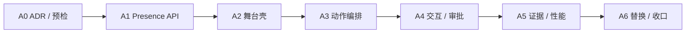

# Agent Office（3D Agents 舞台）开发计划

- **状态：** 已实施（A0–A6 首轮落地；presence 读模型 + 3D 舞台 + HUD/审批 + 文档；见 ADR 0020）
- **日期：** 2026-11-25
- **里程碑：** M12（不计入 V1.0；依赖 M11 的 Console Shell 与 UI 基元）
- **范围：** 将 `/agents` 从表格替换为 3D Dispatch Floor
- **视觉基线：** `preview/agent-office-3d.html`（无 2D 兜底的 three.js 版本）；截图 `preview/screenshots/agent-office-{light,dark,drawer,mobile,unsupported}.png`
- **参考：** `docs/PRD.md` §6.3 / §9.2 / §14.4 / §14.5、`docs/ARCHITECTURE.md` §8、`docs/UI-SPEC.md`、ADR 0019；`AgentSystemLabs/agent-office`（只借交互与工程骨架）
- **硬约束：** **3D-only；无 2D 降级；WebGL2 不支持即阻断；CLI 是非 3D 路径。**

> `preview/agent-office-3d.html` 是视觉 spike，不是生产架构。生产实现必须拆模块、走 ADR、做门禁；不要直接搬这个单文件。

---

## 0. 一句话

把 Agents 页从"状态表格"改成"接单办公室"：

```text
工单打印 → Agent 进场 → 空位蓝图 → 工位弹起 → 落座 → 等待/审批 → 盖章 → 工位折回 → 离场
```

3D 是 Runtime 状态的视图，不是游戏；每个可见动作必须有事件来源，**没有随机走动、没有假进度、没有假终端**。

---

## 1. 目标与边界

### 1.1 目标

1. `/agents` 只保留 3D 舞台；移除现有 Agents 表格，不提供运行时 2D 替代页。
2. 场景能准确表达：在线/忙碌、等待授权/输入、暂停、降级、故障、完成、离线/未上线。
3. 支撑 Agent 进场、开台、落座、审批、完成、离场的完整动作链。
4. 提供可操作的 2D DOM 控制层（调度卡、CALL SHEET、抽屉、注意力横幅），但它属于 3D 视图，不是降级视图。
5. WebGL2 预检失败、context lost、渲染初始化失败时，显示阻断式 unsupported 状态；不加载/不显示办公室，也不显示 2D 名单。
6. 保持 HubAgent 的语义：Brain 唯一决策、审批走 Runtime、验收看证据、所有写操作有审计。

### 1.2 非目标（本里程碑明确不做）

- **不做 `/lite`、2D 列表/看板、自动降级、移动端 2D 视图**。
- 不做语音、多人屏幕共享、共享终端输入、聊天室。
- 不做城堡/空间站/办公室狗/街机/超跑等地图或娱乐内容。
- 不做"Agent 管理 Agent"；Brain 是唯一决策层。
- 不做 WASD 第一人称、自由 orbit；保留固定等距与镜头预设。
- 不做 UI 注册 Agent / UI 直接 hire / 直接 send home；空位只展示 CLI 注册命令。
- 本轮不新增 pause/cancel 端点；没有端点就不放按钮。
- 不做多楼层/电梯；单层 8 工位 + 6 等候位，更多 Agent 先由 HUD 承载，第二层后续评估。
- 不做实时终端流式渲染；只展示真实事件/证据摘要，点击进任务抽屉。

### 1.3 硬门槛（不可跳）

| 门禁 | 判定 |
|---|---|
| **3D-only** | `/agents` 不渲染表格/2D 看板；没有 `3D → 2D` 的运行时切换 |
| **WebGL2** | 预检失败/context lost/初始化失败 → 阻断卡；HUD 与场景全部隐藏 |
| **No Three on unsupported** | 未通过 WebGL2 预检时，不发起 `three` 动态 import，不下载 3D chunk |
| **No fake data** | 场景中每个任务、状态、计时、证据都能追到 presence/任务查询/事件 |
| **No hidden write** | 审批只走现有端点；姿态/动画/前端状态不回写 DB |
| **CLI path** | unsupported 环境用 `hubagent agents` 查看/操作；不是 2D UI 回退 |

---

## 2. 体验语法

### 2.1 场景构成

- **8 个 hot desk**：承载当前活跃/需注意的 Agent；空位显示蓝图，派发时折纸式弹起。
- **6 个等候位（bench）**：在线但空闲的 Agent 坐在这里；被派发时起身走向空桌。
- **调度台**：工单打印、计划板、队列；不是人物。
- **DONE 墙**：完成工单/证据入口，不是装饰。
- **门**：未在场景中的 Agent 从门进场；离场从门离开。
- **窗/植物**：空间氛围，不承载状态。
- **布局数据化**：桌位/等候位/相机预设由 `layout.ts` 提供，不写死在渲染循环。

### 2.2 状态映射

| 服务端事实 | 场景表现 | HUD |
|---|---|---|
| `discovered` / 未握手 | 不在场景 | 名单「未上岗」 |
| `offline` / `disabled` | 不在场景 | 名单「离线 / 停用」 |
| `online` 且无活跃执行 | 坐在 bench，待命 | 「待命」 |
| `busy` + `running` | 在工位，伏案/打字 | 「执行中」 |
| `waiting_permission` | 在工位，举手 + 「签」纸旗 + 琥珀灯 | 「等你授权」 |
| `waiting_input` | 在工位，侧头 + 待答牌 | 「等待补充」 |
| `paused` | 在工位，靠背 + 杯子 + 暗灯 | 「已暂停」 |
| `degraded` | 在工位，降级灯/折角票 | 「降级运行」 |
| `error` / `failed` / `timeout` | 工位亮红灯，纸面「退回」；Agent 可离场，工位短暂保留后折回 | 「故障」 |
| `succeeded` | 盖章 → 工单飞向 DONE 墙 → 工位折回 → 离场/回 bench | 「刚完成」→「待命」 |
| 无 presence 数据 | 不猜；显示「未上报」 | 「未知」 |

**`entering` 和 `done` 是前端表现阶段，不是 DB 状态。** 服务端只提供 Agent 状态 + 执行状态 + 审批；前端由 diff 推导进场/完成/离场。

### 2.3 工位与容量

- **一个 Agent 一个工位**（不是一次执行一个工位）；多执行时显示主执行 + `+n`，抽屉展开全部。
- **获得工位**：Agent 从 bench/未在场进入活跃（running/waiting/paused/error）时，分配第一个空桌；工位在活跃期间保持稳定。
- **重复派发给已在座的 Agent**：只换任务牌，不重新弹桌、不重新走位。
- **释放工位**：执行成功/失败/取消且无其他活跃执行 → 短延迟后折回；Agent 若仍在线 → 回 bench；离线 → 离场。
- **容量**：默认 8 桌 + 6 bench；PRD 默认并发 3，房间有充足余量。超过 14 个在场 Agent 时，HUD 显示「floor full」并在名单列出其余；不缩成 2D 办公室；第二层后续评估。
- **空场景**：没有 Agent 时显示空桌蓝图 + `hubagent agent add ...` 命令，不给假招聘按钮。

### 2.4 注意力路由

- 等待授权/输入、故障：工位上方纸旗/信标 + 全局横幅 + 名单高亮。
- `N`：跳到下一个需要你的工位（按等待时长/严重度排序），打开抽屉并聚焦镜头。
- 默认不响铃；如后续加提示音，必须可静音、只响一次。
- 不借用参考项目的红灯警报音与"完成后跳起来"作为默认行为；我们的完成动作是盖章、票据归档、离场。

---

## 3. 数据契约

### 3.1 新增只读查询

`GET /api/v1/agents/presence`（走统一鉴权；R5：只依赖 `storage/queries`，不 import `storage/write`）

```json
{
  "ok": true,
  "asOf": "2026-11-25T10:00:00.000Z",
  "agents": [
    {
      "id": "agt_...",
      "name": "Claude Code",
      "status": "online",
      "presence": "busy",
      "lastSeenAt": "2026-11-25T09:59:58.000Z",
      "networkMode": "agent-managed",
      "allowedWrite": ["src/session/**"],
      "allowedDomains": [],
      "capabilities": ["coding", "refactor"],
      "activity": {
        "executionId": "exe_...",
        "executionStatus": "running",
        "taskId": "tsk_...",
        "taskTitle": "重构会话恢复",
        "subtaskId": "sub_...",
        "subtaskTitle": "修复锁竞争",
        "step": 2,
        "steps": 4,
        "attempt": 2,
        "startedAt": "2026-11-25T09:55:48.000Z",
        "waitingOn": null
      },
      "parallelCount": 0,
      "pendingApprovals": [
        { "id": "apr_...", "resource": "src/**", "riskLevel": "high", "requestedAt": "..." }
      ],
      "lastEvent": { "type": "execution.status", "at": "..." }
    }
  ]
}
```

- `presence` 服务端枚举：`discovered | starting | initializing | online | busy | degraded | offline | error | disabled`。
- `activity` 只放**主执行**；`parallelCount` 表示其他活跃执行数；抽屉通过任务查询展开。
- `step/steps` 来自计划子任务顺序；无法确定时省略，不编造。
- `capabilities` 是 Agent 自称；抽屉标注「未验证」。已验证/历史表现不在本里程碑新增 schema。
- `asOf` 用于 UI 判断陈旧；SSE 断线时显示重连状态，不把旧快照当实时。

### 3.2 派生规则

```text
disabled                          → presence = disabled
record.status = error             → presence = error
record.status = degraded          → presence = degraded
record.status = offline           → presence = offline
record.status in starting/initializing → presence = starting/initializing
no lastSeen / never handshaked    → presence = discovered
has active execution (starting/running/waiting_permission/waiting_input)
                                  → presence = busy
otherwise                         → presence = online
```

- `paused` 不算活跃执行（PRD §14.5），但**保留工位/租约**；场景在工位显示暂停。
- 不修改 `agents.status`；不因 UI 访问写 DB。

### 3.3 事件同步

- SSE `hubagent` 事件中关注：`subtask.status`、`execution.created`、`execution.status`、`approval.requested`、`approval.decided`、`verification.recorded`。
- 事件到达后 **250ms 去抖 refetch** presence；不做本地状态推断，避免 UI 与 Runtime 漂移。
- 断线重连按 `sinceSeq` 续读；重连成功后立即 refetch。
- 新增执行/审批时触发进场/开台/举手；结束触发完成/折回/离场。

### 3.4 数据诚实

- 场景只显示 API 字段；未知状态显示「未知」，不借用最近一次状态冒充实时。
- 桌面任务牌展示真实 task/subtask/step/attempt；无数据就显示「等待派发」。
- 证据抽屉复用 `GET /api/v1/tasks/:id`、`/decisions`；没有证据就显示空态，不生成假终端。
- 审批操作使用现有 `POST /api/v1/approvals/:id/approve|reject`；前端只发请求，不直接改任务状态。

---

## 4. 架构与文件

### 4.1 依赖与边界

- 新增 `three` + `@types/three`（精确锁版本；A0 决定，候选为 preview 已验证的 `three@0.169.0`）。
- **只有** `features/agents/office/scene/**` 可以 import `three`；HUD、路由、`shared` 不得 import。
- `AgentsRoute` 的初始 chunk 不含 `three`；只有 WebGL2 预检通过后才 `import('./office/scene/scene')`。
- 新增 ADR 0020（3D 舞台）与 `docs/UI-SPEC.md` 3D 增补；依赖白名单同步更新；`THIRD-PARTY.md` 记录 Three.js MIT。
- 不新增 React、组件库、第二套设计系统；HUD 只用 `components/ui/*` 门面。

### 4.2 文件计划

```text
packages/hub/src/
  storage/queries/agent-presence.ts          # 只读联表 + 派生 presence
  interfaces/http/app.ts                     # GET /api/v1/agents/presence
  storage/queries/agent-presence.test.ts

packages/web/src/
  shared/api.ts                             # presence 类型 + 请求
  features/agents/AgentsView.tsx             # 替换为 StageRoute（A6）
  features/agents/office/
    stage-entry.tsx                          # WebGL2 预检、unsupported、动态加载
    unsupported.tsx                          # 阻断卡（可访问）
    presence.ts                              # API → visual phase / desk allocator
    layout.ts                                # 8 desk + 6 bench + 相机预设
    ui/
      dispatch-card.tsx                      # 目标/计划/队列/派发
      call-sheet.tsx                         # 名单、N、选中
      drawer.tsx                             # 当前执行/审批/证据/权限
      attention-banner.tsx                   # 全局等待/故障提示
    scene/
      scene.ts                               # 唯一 three 入口
      room.ts                                # 房间、窗、门、hub、board
      desk.ts                                # 桌/椅/灯/票/旗/章
      agent.ts                               # 纸片人、走/坐/工作姿态
      choreography.ts                        # presence diff → 动作序列（可单测）
      camera.ts                              # 正交相机、预设、点击聚焦
      theme.ts                               # CSS token → three 材质
      textures.ts                            # nameplate/task/plan/done 的 canvas 纹理
  styles/                                    # HUD 令牌；无裸色值
```

- 不写 barrel 文件（R7）；显式 import。
- `choreography.ts` 保持纯函数/可测；Three.js 只在 `scene/**`。
- Solid 纪律：不解构 props；列表用 `<For>/<Show>`；不改 store 对象；数据获取不放 `createEffect`；scene 同步作为显式副作用。
- 3D 颜色统一从 `theme.ts` 的 token 映射读取；HUD 使用 CSS 令牌；不散落 hex。

### 4.3 unsupported 流程

```text
route mount
  → canvas.getContext('webgl2')
    → null / init fail / context lost / 6s timeout
      → stage.classList.add('is-unsupported')
      → hide canvas + all HUD + drawer
      → show blocking card: WebGL2 requirement / diagnostics / retry / CLI hint
      → do NOT import three (production)
    → ok
      → dynamic import scene
      → render
```

- `contextlost` 直接进入 unsupported；不降级。
- `?unsupported=1` 仅用于 preview/QA 截图，不作为产品功能。
- 生产环境不提供 2D 名单、2D 表格或 `/lite`。

---

## 5. 分期计划

| 阶段 | 内容 | 估算 | 门禁 |
|---|---|---|---|
| **A0** | ADR 0020、UI-SPEC 3D 增补、依赖白名单、preview 基线测量 | 1.5–2d | ADR 通过；8+6 60fps；3D chunk 预算；unsupported 评审 |
| **A1** | presence 只读查询 + API + SSE 刷新 + 单测 | 2d | 契约测试；0 写入；R5；未知状态不猜 |
| **A2** | `/dev/office` 舞台壳：预检、动态加载、静态房间/桌/bench、镜头、HUD 壳 | 3d | 初始 chunk 无 three；unsupported 无 three；8+6 60fps |
| **A3** | presence → 动作编排：进场、开台、落座、等待、暂停、故障、完成、离场 | 4d | 状态映射单测；e2e；reduced motion；无假动作 |
| **A4** | CALL SHEET、抽屉、审批、attention banner、`N`、空位 CLI、可访问性 | 2.5d | 审批 e2e；键盘；axe；无 2D |
| **A5** | 真实证据入口、DONE 墙、context lost、性能/视觉回归、明暗/移动端 | 2d | 8+6 60fps；context loss；unsupported 截图；移动端硬门槛 |
| **A6** | 替换 `/agents`、删除旧表格、文档、CI、发布说明 | 1.5d | `pnpm verify` + e2e + visual；无表格/无 2D；CLI 路径 |
| **合计** | | **16.5–18 人日** | 约 3–4 周（1 人） |



### A0 · ADR 与可行性门禁

**交付**

- `docs/adr/0020-3d-agent-stage.md`：Three.js、正交相机、程序化资产、WebGL2 硬门槛、无 2D、懒加载、预算、context loss、截图策略、动效例外。
- `docs/UI-SPEC.md` 3D 增补：场景色板、状态灯、纸旗/印章、动效白名单（仅真实执行）、reduced motion、unsupported。
- 依赖白名单更新：`three` + `@types/three`；许可与版本锁定。
- preview 测量：8 桌 + 6 bench 的帧率、chunk 体积、内存、冷启动。
- preview 收敛：基线唯一（`preview/agent-office-3d.html`）；旧的中文变体（含「名单仍可用」2D 兜底）已删除，A0 只需复核 unsupported 下不出现名单/表格。
- 确认工位模型与容量（默认 8+6；并发 3）。

**门禁 G0**

- ADR 通过；产品确认"无 2D 降级"。
- 目标机器（M1 / 1440p）8+6 ≥ 60fps；3D chunk 有数字；unsupported 卡可复现。
- preview 只剩一版，且 unsupported 状态下不出现名单/表格。
- 没有 ADR/白名单，不进入 A1。

### A1 · Presence 读模型

**交付**

- `agent-presence.ts`：agents × active executions × subtasks × tasks × pending approvals × last event。
- `GET /api/v1/agents/presence`；鉴权；只读；R5。
- `shared/api.ts` 类型；SSE 事件 → 250ms 去抖 refetch。
- 单测：派生规则、无数据、多执行、暂停、等待、审批、离线。
- HTTP 测试：shape、auth、无写入、未知 Agent。

**门禁 G1**

- 同一 DB 快照重复查询结果稳定；不写 `agents.status`。
- 任务标题/步骤/审批都能解释来源；无数据时返回省略/未知，不编造。
- SSE 断线重连后状态不漂移。

### A2 · 3D 舞台壳

**交付**

- `/dev/office` dev-only 路由；`stage-entry.tsx` 预检 + 动态 import + unsupported。
- 静态场景：房间、8 桌、6 bench、hub、计划板、DONE 墙、门、窗、植物；正交相机、预设、点击/悬停。
- HUD 壳：调度卡、CALL SHEET、镜头控制；不接真实动作。
- `theme.ts` token 映射；明/暗；场景暂停（页面隐藏）。
- 边界测试：初始 chunk 无 `three`；unsupported 不发 three 请求。

**门禁 G2**

- `/dev/office` 在 WebGL2 环境 8+6 60fps；无长任务。
- WebGL2 失败时只显示阻断卡；HUD/名单不出现；网络无 three chunk。
- HUD 键盘可达；canvas `aria-hidden`；无 2D 页面。

### A3 · 状态编排

**交付**

- `presence.ts`：`visualPhase`、`deskAllocator`、`deriveActions(prev,next)`；纯函数单测。
- `choreography.ts`：进场/走位/蓝图/弹桌/落座/工作/举手/暂停/退回/盖章/折桌/离场。
- bench：在线空闲坐 bench；活跃者上桌；完成后回 bench 或离场。
- 主执行 + `+n`；`entering`/`done` 前端瞬态。
- `prefers-reduced-motion`：静态切换，不丢信息。
- e2e：seed 多个 Agent/执行/审批；状态变化驱动场景。

**门禁 G3**

- 状态映射表逐行有测试；重复派发不重弹桌；完成/失败不残留错误工位。
- 动画只由 presence diff/事件触发；无随机走动、无假进度。
- reduced motion 下信息完整；无 2D。
- **连贯性三指标（防抖动的硬指标）**：帧间隔 p95 ≤ 20ms；位移速度方差 < 10%（时长 = 距离/速度，不随事件频率变）；相邻帧位移 > 0.25 世界单位即判瞬移失败（进出场等有明确位移意图的动作除外）。
- **抖动负向测试**：连发 5 次相邻状态（running → waiting → running → …），断言画面抖动但不瞬移，且最终状态与最后一次快照一致。

### A4 · 交互与审批

**交付**

- CALL SHEET：状态、注意力高亮、选中、`N` 跳转。
- 抽屉：当前任务、执行、审批（允许一次/拒绝）、证据、权限、能力（自称/未验证）。
- attention banner：等待/故障汇总；不默认响铃。
- DONE 墙：完成票据；点击进任务证据。
- 空桌：展示 `hubagent agent add ...`；不做 UI 写入。
- 审批只调用现有端点；pause/cancel 无端点则不放按钮。

**门禁 G4**

- 点击等待工位 → 允许一次 → Runtime 恢复 → SSE 场景更新 ≤ 2s。
- 失败路径（409/401）可见且可恢复。
- 键盘/读屏可完成审批；axe 0 critical/serious；无 2D 名单。

### A5 · 证据、性能与降级

**交付**

- 桌面证据条：真实 `lastEvent`/任务摘要；低频更新；点击进抽屉；不渲染终端流。
- context lost：阻断卡；不恢复假场景；重试 reload。
- 性能：8+6 60fps；3D chunk/首屏/内存数字；DPR 上限；隐藏暂停。
- 视觉：1440/1024 明暗 supported；unsupported；移动端 WebGL2 supported/unsupported；freeze 固定相机/时钟/种子。
- 移动端：WebGL2 则 3D；否则阻断；无 2D。

**门禁 G5**

- 8+6 60fps；context lost/unsupported 可复现；截图稳定。
- 移动端/低端机不支持时只显示阻断卡；CLI 提示可用。
- 无假终端/假输出；证据链接可打开真实任务。

### A6 · 替换与收口

**交付**

- `/agents` 切到 3D stage；删除 `AgentsView` 表格及旧样式/测试。
- 文档：ADR 0020、UI-SPEC 3D、本计划、`docs/PLAN.md` 链接、发布说明（支持环境/WebGL2/CLI）。
- CI：`pnpm verify`、e2e、visual、unsupported、bundle 预算。
- 回滚：代码 revert；运行时无 2D 回退；CLI 可用。

**门禁 G6**

- `/agents` 只有 3D；无表格/无 2D 路由/无自动切换。
- supported/unsupported 两套验收全绿；旧表格删除。
- 发布说明明确：没有 WebGL2 的设备不能看 Agents 页，使用 CLI。

---

## 6. 验收

### 6.1 命令

```bash
pnpm typecheck
pnpm lint
pnpm test:unit
pnpm test:e2e
pnpm test:visual
```

### 6.2 必须通过

- [ ] WebGL2 环境：`/agents` 渲染 8 桌 + 6 bench；无表格、无 2D 看板。
- [ ] WebGL2 不支持：阻断卡；HUD/名单隐藏；网络无 three chunk；`hubagent agents` 提示。
- [ ] context lost：阻断卡；无 2D 回退。
- [ ] 每个可见任务/状态/计时可追到 presence/任务/事件；未知不冒充。
- [ ] 等待/故障有 beacon + banner；`N` 可跳转；审批端到端。
- [ ] 完成：盖章 → DONE 墙 → 折桌 → 离场；失败：退回 → 折桌；暂停：杯子/暗灯。
- [ ] `prefers-reduced-motion`：静态 3D，不丢信息。
- [ ] 8+6 60fps；3D chunk/首屏/内存达标；页面隐藏暂停。
- [ ] HUD/抽屉键盘可达；canvas `aria-hidden`；axe 0 critical/serious。
- [ ] 空桌只给 CLI 注册命令；无 UI hire/fire。
- [ ] 无语音/多人/幻想地图/Agent 管理 Agent。
- [ ] 旧 Agents 表格删除；无运行时 2D 回退。
- [ ] 连贯性三指标通过（帧间隔 p95 / 速度方差 / 无瞬移），抖动负向测试通过。
- [ ] 抽屉打开时 context lost 不打断审批；`/approvals` 在 unsupported 下全流程可用。

---

## 7. 风险与开放决策

### 7.1 风险

| 风险 | 处理 |
|---|---|
| Three.js 进入 UI 白名单 | ADR 0020 + 精确版本 + 懒加载 + bundle 预算；不过门禁不写业务 |
| WebGL2 硬门槛排除设备 | 明确支持范围；阻断卡 + CLI；不伪装可用；发布说明写清 |
| 3D 视觉回归 flaky | freeze 固定相机/时钟/种子；supported/unsupported 两套；必要时只 diff HUD + 结构断言 |
| presence 数据缺口 | 只读派生；未知显示「未上报」；不猜；A1 先补齐查询 |
| 动画偏离事实 | `deriveActions` 纯函数 + 单测；只由事件驱动；禁止随机/假进度 |
| 容量/多 Agent | 8+6；HUD 承载溢出；第二层后续；不缩成 2D |
| 旧表格删除影响测试 | A6 同步删旧测试/样式；CLI 仍是操作路径 |
| 范围膨胀（语音、地图、游戏化） | 非目标写死；ADR 明确拒绝 |
| 3D 可访问性 | HUD/抽屉、键盘、读屏、reduced motion；无 WebGL 时 CLI；不提供 2D |
| context lost 打断审批 | 已打开的抽屉**不得**随 canvas 一起隐藏；canvas 隐、阻断卡为浮层，审批可继续提交；e2e 覆盖「抽屉打开时掉上下文仍能决定」 |
| 审批被场景耦合 | 场景只"指"不"决"；`scene/**` 禁止 import `shared/api`、`ui/**`、路由（dependency-cruiser 强制）；审批状态只来自 `pendingApprovals` |

### 7.2 开放决策（A0 评审确认）

1. 工位模型与容量：默认 **8 桌 + 6 bench**；并发默认 3；超过 14 在场时 HUD 承载，第二层后续。
2. Three.js 版本：A0 锁定；候选 `0.169.0`（preview 已验证）；不接受 floating range。
3. `pause/cancel`：本轮无 HTTP 端点，不做按钮；若同期补端点，再进 A4。
4. 提示音：默认无；未来只允许可静音、单次提示。
5. 证据条范围：只显示真实 `lastEvent`/任务摘要；不做终端流。
6. 旧 Agents 表格：A6 删除；不保留为 fallback。
7. 移动端：WebGL2 则 3D；否则阻断；无 2D。
8. 第二层/电梯：不做；等多项目/多 workspace 选择器。

---

## 8. 对 `AgentSystemLabs/agent-office` 的取舍

**借**

- attention beacon + 全局横幅 + `N` 跳转（改为琥珀/红，默认不响铃）。
- 桌面实时证据入口（改为真实执行/验收摘要，不做共享终端）。
- 墙上看板（任务/DONE/证据；点击进入，不直接派活）。
- 空桌注册/招聘的空间概念（改为 CLI 注册命令）。
- 工程骨架：feature 目录、registry、单文件尺寸约束、数据化布局、2D/3D 边界测试（我们改成 WebGL2 预检/无 Three 边界）。

**不借**

- `/lite`、手机 2D、自动降级。
- 语音、多人屏幕共享、共享终端输入。
- 城堡/空间站/办公室狗/街机/超跑。
- "Agent 管理 Agent"（与 Brain 唯一决策冲突）。
- WASD/第一人称/自由 orbit。
- 默认警报音、"完成后跳起来 ding"、直接 hire/fire。

---

## 9. 交付清单

- [ ] ADR 0020（3D 舞台）+ UI-SPEC 3D 增补 + 依赖白名单/许可。
- [ ] `agent-presence` 查询 + `GET /api/v1/agents/presence` + SSE 刷新。
- [ ] 3D stage（8+6）、预检、unsupported、context lost。
- [ ] presence → 动作编排（进场/开台/落座/等待/暂停/故障/完成/离场）。
- [ ] CALL SHEET、抽屉、审批、attention banner、`N`、DONE 墙、空桌 CLI。
- [ ] 8+6 60fps；chunk/首屏/内存数字；reduced motion；移动端硬门槛。
- [ ] e2e + visual + unsupported + axe + bundle 预算。
- [ ] 删除旧 Agents 表格；`docs/PLAN.md` 链接；发布说明。
- [ ] 明确：无 2D 降级；CLI 是非 3D 路径。

---

## 10. 预览与现状

- 视觉 spike：`preview/agent-office-3d.html`（Three.js r169，正交等距，程序化纸模办公室，8 桌 + 6 bench，无 2D 兜底）。
- 硬失败状态：`?unsupported=1`；截图 `preview/screenshots/agent-office-unsupported.png`。
- 明/暗/抽屉/移动端：`preview/screenshots/agent-office-{light,dark,drawer,mobile}.png`。
- 演示链路：工单打印 → 进场 → 蓝图 → 弹桌 → 落座 → 工作 → 举手/暂停 → 盖章 → DONE 墙 → 折桌 → 离场 → bench。
- 可用查询参数：`?theme=light|dark`、`?freeze=1`（确定性快照，供截图）、`?motion=reduced`、`?agent=<id>`、`?unsupported=1`。
- **已收敛**：早期含 2D 名单兜底的变体已删除，视觉基线只剩 `agent-office-3d.html`（无兜底、8 桌 + 6 bench）。
- 本计划开工前先把 preview 的交互语法、状态表、容量和 unsupported 文案在 A0 确认；preview 不进入生产依赖。
