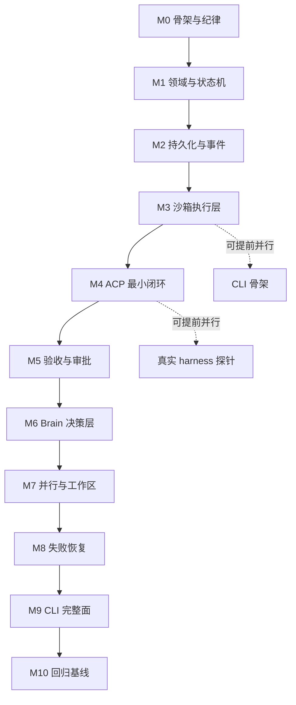

# HubAgent V1.0 实施计划

**目标：** 在最短路径上证明"核心功能是真的"，而不是先把界面做漂亮。
**前置：** `docs/PRD.md`（范围与验收）、`docs/ARCHITECTURE.md`（落地方式）、`docs/adr/`（0002 沙箱、0003/0004 UI）
**专项计划：** Agent 接入与 `ha web` 见 [PLAN-AGENT-ONBOARDING.md](PLAN-AGENT-ONBOARDING.md)；跨机器 A2A 编排见 [PLAN-A2A.md](PLAN-A2A.md)，游戏集成测试见 [PLAN-A2A-GAME-TEST.md](PLAN-A2A-GAME-TEST.md)；3D 舞台见 [PLAN-AGENT-OFFICE.md](PLAN-AGENT-OFFICE.md)；控制台见 [WEB-CONSOLE-PLAN.md](WEB-CONSOLE-PLAN.md)。
**假设：** 1 名全职工程师；已有 PRD、架构、沙箱 PoC（`poc/tc-014`，macOS 11/11 通过）。工作量为粗估，用于排序而非承诺。

---

## 0. 一句话结论

V1.0 的核心不是"能调度几个 Agent"，而是**这条链路能不能从头到尾可信地跑完**：

```text
用户目标 → 计划 → 契约 → 沙箱内执行 → 证据 → 判定 → 失败恢复 → 交付
```

UI 不在关键路径上。V1.0 的全部验收都可以只用 CLI 完成；Web Console 放到 M11（不计入 V1.0 门禁）。

---

## 1. 交付原则

| # | 原则 | 具体含义 |
|---|---|---|
| P1 | **风险先行** | 最不确定的先做：ACP 真实行为、沙箱与 harness 兼容、Brain 输出稳定性 |
| P2 | **每步可验收** | 每个里程碑结束时必须能跑一条命令，输出"通过/不通过"，不接受"基本完成" |
| P3 | **UI 最后** | CLI 的 `--json` 输出就是 V1.0 的界面；Web 只做已有数据的可视化，不引入新逻辑 |
| P4 | **不开新面** | 一个里程碑只动它该动的那一层；想顺手做的写进"延后"清单 |
| P5 | **门禁不可跳** | 没有证据链不允许接 Brain；没有 fail-closed 不允许接真实任务（见 §4） |

**全局 Definition of Done（每个 M 都要满足）：**

```bash
pnpm typecheck && pnpm lint && pnpm test:unit
```

外加：新增不变量有测试；PRD/ARCHITECTURE 对应章节同步；一条可演示命令。

---

## 2. 里程碑总览

| M | 名称 | 产出 | 估算（人日） | 门禁（不过就不进下一步） |
|---|---|---|---|---|
| M0 ✅ | 骨架与纪律 | monorepo、strict TS、Biome、Vitest、dependency-cruiser R1–R8、`doctor` | 2–3 | 故意违反 R1 能让 CI 失败 |
| M1 ✅ | 领域模型与状态机 | 实体 + 迁移表 + 不变量 + 属性测试 | 3–4 | 6 条不变量在随机事件序列下恒成立 |
| M2 ✅ | 持久化与事件 | SQLite schema、WAL、事件 seq、投影、重建命令 | 4–5 | `kill -9` 后重启状态一致 |
| M3 | 沙箱执行层 | `SandboxProvider` + srt 实现 + `AgentHost` | 3–5 | TC-014 全绿 + ACP stdio 往返冒烟 |
| M4 | ACP 最小闭环 | 分帧、initialize、session、prompt、事件映射 | 5–8 | 一条真实任务跑通，产出 diff + 证据 |
| M5 | 验收与审批 | Verification Runner、证据链、Approval | 3–4 | 自述成功但构建失败能被拦下 |
| M6 | Brain 决策层 | `OrchestratorBrain`、决策点队列、快照渲染 | 5–7 | 同快照重复 step 语义等价；重启能续跑 |
| M7 | 并行与工作区 | worktree 租约、allowedPaths、合并/回滚 | 4–6 | 两 Agent 并行改不同目录并合并成功 |
| M8 | 失败恢复 | 升级路径、无进展检测、幂等 | 3–4 | TC-003 / TC-010 / TC-012 通过 |
| M9 | CLI 完整面 | task/agent/approval/logs/doctor（不含任务创建） | 3–4 | 全部 V1.0 验收与审批只用 CLI 完成 |
| M10 | 回归基线与指标 | 20–30 个真实任务、指标采集 | 4–6 | §2.3 六个指标能出数 |
| **合计** | | | **39–56（约 8–11 周）** | |

M11（Web Console）、M12（Agent Office 3D 舞台，见 `docs/PLAN-AGENT-OFFICE.md`）、A2A 与 Relay 的详细实施顺序见 [`docs/PLAN-A2A.md`](PLAN-A2A.md)。跨机器 A2A 是项目必做能力；开工前必须先完成 Runtime 唤醒/租约/outbox（见该文档 §5.1 / §5.1.1），路径为“先直接 HTTPS，再 Relay 穿透”。

**两条口径变更（ADR 0029，2026-11-27）：**

1. **下表与各里程碑里出现的 `pnpm hubagent run "…"` 一律按诊断入口阅读**：它需要显式 `--allow-task-create`，默认拒绝。生产入口是控制台对话。历史记录不改写，只在本处统一说明。
2. **原则 P3「UI 最后」改为「入口最后关闭」**：控制台仍不重做业务逻辑（只调用 Runtime/Brain 既有能力），但它现在是唯一的人类任务入口，所以 CLI 独有的五项能力（并行扇出 / 验收命令 / 交付策略 / 后台执行 / 预算上限）必须先由控制台接管，才允许关闭 CLI 创建（ADR 0029 §2.4）。

---

## 3. 关键路径



**可并行的两处：**

- `M3` 进行时，CLI 骨架（参数解析、`--json` 输出、退出码）可以先搭壳，不依赖执行层。
- `M3` 完成即可启动"真实 harness 探针"（§5.5），为 M4 降低不确定性。

---

## 4. 三个不可跳的门禁

| 门禁 | 位置 | 为什么不能跳 |
|---|---|---|
| **G1：fail-closed 与 cwd 约束** | M3 → M4 | 没有它，M4 之后所有验证都在"没有隔离"的假设上做，结论全部作废 |
| **G2：证据链** | M5 → M6 | 没有证据，Brain 会基于 Agent 自述做决策，等于把产品核心价值外包给被考核方 |
| **G3：Brain 纯函数性** | M6 → M7 | 否则并行与恢复会引入不可复现的决策，问题无法定位 |

门禁的判定方式写在对应里程碑的「验收」里，必须是**命令可复现**。

---

## 5. 里程碑详述

### M0 · 骨架与纪律（2–3 人日）

**目标：** 让"后续所有代码都必须守规矩"这件事，先变成 CI 的失败条件。

**交付**

- `packages/hub` 单包 + 目录分层（`domain/ brain/ runtime/ adapters/ agent-host/ sandbox/ storage/ interfaces/ shared/ bin/`）
- `tsconfig` strict + `noUncheckedIndexedAccess`
- Biome + ESLint（仅 `eslint-plugin-solid`，此时可先跳过）
- Vitest 跑通一个占位测试
- `dependency-cruiser` 配置 **R1–R8**（含"只有 `agent-host`/`sandbox` 可用 `node:child_process`"）
- `hubagent doctor` 雏形：Node 版本、SQLite 可写、git、`srt`/`bwrap`/`rg` 检测
- 单实例锁 + 配置文件加载（TOML）

**验收**

```bash
pnpm verify            # typecheck + lint + test:unit + arch
pnpm hubagent doctor --json    # 缺 srt 时报 sandbox 不 ok 并列入 blocking
pnpm -s hubagentd --check      # 单实例锁：获取后立即释放
```

**状态：已完成（2026-11-23）**

- `pnpm verify` 全绿：23 个用例，架构规则 13 modules / 18 deps cruised。
- 架构自证：真实 src 通过；故意违规的 fixture 被 R1 拦住。
- 本轮又排掉一个隐患（见下）。

**踩到的坑（已修，写下来避免重踩）**

| 坑 | 现象 | 修法 |
|---|---|---|
| dependency-cruiser 18 不支持 TypeScript 7 | 规则静默失效：输出 `0 modules, 0 dependencies cruised` 却返回 0 | 改用 `parser: 'swc'`（新增 `@swc/core`）；测试断言 cruised 模块数 > 0 且不出现 `missing-typescript-transpiler` |
| pnpm 默认跳过 esbuild 构建脚本 | `tsx` 无输出直接失败 | `pnpm.onlyBuiltDependencies: ["esbuild"]` + `pnpm rebuild esbuild` |
| Zod 4 收紧了 `.default({})` 的类型 | 嵌套对象默认值无法编译 | 改用 `prefault({})`（输入侧默认），默认值仍单一来源 |

**不包含**：任何业务逻辑、任何 UI。

---

### M1 · 领域模型与状态机（3–4 人日）

**目标：** 把 PRD §6.5 的状态和 §11 的实体，变成"编不过/测试不过就写错"的东西。

**交付**

- 实体：`Goal / Task / Subtask / Execution / DelegationContract / TaskBrief / VerificationRun / Event / Approval`
- 状态枚举 + **合法迁移表**（不是散落的 if）
- 6 条不变量（ARCHITECTURE §6.1）
- `fast-check` 属性测试：随机事件序列 → 不变量恒成立
- Zod schema（HTTP / 事件 / Brain 输出共用）

**验收**

```bash
pnpm test:unit -- state-machine      # 迁移表 + 非法迁移被拒
pnpm test:unit -- invariants         # 随机序列 1000 次
```

**状态：已完成（2026-11-23）**

- `pnpm verify` 全绿：64 个用例；架构 20 modules / 32 dependencies cruised。
- 交付：`src/domain/{ids,status,entities,events,machine,invariants,schema}.ts`。
- 不变量落地方式：**迁移守卫（前置）+ 独立检查（事后）双保险**。
  - I1/I2/I3/I5 已实现；I4（租约）留到 M7；I6（终态不可逆）由迁移表强制。
- **属性测试抓到一个真实设计漏洞**：守卫只拦了“暂停时有活跃执行”，没拦“暂停后再启动执行”，于是出现 `task=paused + execution=running` 的非法组合。已补反向守卫与回归用例。
- **追加 `ExecutionStatus.paused`**（用户决策）：暂停 = 中断但保留现场（worktree / Session / 证据引用），非终态，恢复走 `paused → running`。
  带来两条顺序约定：暂停时先停执行再停 Task，恢复时反之；`paused` 不计入 `ACTIVE_EXECUTION_STATUSES`，但仍持有工作区现场（M7 租约需单独区分）。
- 语义边界：状态机能表达“已中断且未终结”，但真正的挂起能力取决于 harness（ACP 无法真正 suspend 进程）；
  M4 需实测“中断后能否在同一 Session 继续”，否则恢复时新建 attempt。

**不包含**：持久化、任何 I/O。

---

### M2 ✅ · 持久化与事件（4–5 人日）

**目标：** 进程被杀不会丢状态，且能重建。

**交付**

- SQLite：`PRAGMA WAL / synchronous=NORMAL / busy_timeout / foreign_keys=ON`
- 表：`goals / tasks / subtasks / executions / delegation_contracts / verification_runs / events / approvals / decision_queue / projects / workspace_leases`
- `events.seq` = `INTEGER PRIMARY KEY AUTOINCREMENT`（单调、可续读；回滚可能留空洞，不保证无间隙）
- 单事务：插事件 + 更新投影 + 推进 `projection_meta.last_applied_seq`
- `rebuildProjections` / `verifyProjections` / `replayAll`（`src/storage/rebuild.ts`）
- `maintenance rebuild-projections [--verify] [--json] [--db <path>]`

**验收**

```bash
pnpm test:unit -- storage            # 迁移幂等、事务原子性、重建与篡改检测（13 个用例）
pnpm test:kill9                      # 写一半 kill -9，重启后状态一致、seq 单调
pnpm hubagent maintenance rebuild-projections --verify   # 重建后与投影一致
```

**取舍（已落地，勿重复讨论）**

- 实体表**就是**投影表，不再建 `task_view / subtask_view / execution_view`（两份命名必然漂移）。
- 存在 `delegation_contracts` 时**拒绝重建**：契约不由事件派生，删除即静默丢数据（fail-closed）。
- 数据保留（`purged` 引用语义、`gc`）延到 **M9**：它依赖 artifacts / transcript 目录，而这两者 M4 才产生。
- 拒绝事件时**返回原状态引用**，可断言零副作用。

**代码评审修复（M2 复核，13 项全修）**

外部 review 指出的问题已全部修复并配回归用例：

| # | 问题 | 修复 | 用例 |
|---|---|---|---|
| 1 | `approvals` 缺 `created_at` 列，审批一写就崩 | 001 迁移补列 | `storage.test` 审批往返 |
| 2 | 创建事件可伪造终态，绕过证据链 | 5 类创建事件加初始状态守卫 + `appendEvent` 落库前跑 `checkInvariants` | `state-machine` 5 条 + `storage` 1 条 |
| 3 | `verdict=pass` 可以没有任何通过检查 | `pass` 要求 `checks` 非空且全部通过 | `state-machine` 4 条 |
| 4 | 一个进程只能有一个 goal | `DomainState.goal` → `goals: Record` | `state-machine` 2 条 + `storage` 1 条 |
| 5 | 配置里有“跳过沙箱”开关 | 删 `security.requireSandbox` / `sandbox.provider`，doctor 永远 block | `config.test` 1 条 |
| 6 | daemon 启动即退出、锁不释放 | 显式保活 handle + 干净 shutdown | `agentd.test`（真实子进程） |
| 7 | maintenance 与 daemon 并发会静默丢投影 | 先抢实例锁，抢不到即 `LOCK_HELD` | `maintenance.test` 2 条 |
| 8 | doctor 不检查 SQLite | 新增 `db` 检查（quick_check + 待迁移） | `doctor.test` 4 条 |
| 9 | DB 打不开被报成 `PROJECTION_MISMATCH` | `DB_UNAVAILABLE` + 未知异常归 `UNEXPECTED` | `storage` 1 条 |
| 10 | 投影 `switch` 不穷尽 | `default: never` 守卫 | tsc 强制 |
| 11 | 空锁文件被当陈旧锁接管 | 不可解析 → 短暂重试后判 `LOCK_HELD` | `lock.test` 2 条 |
| 12 | 三个死导出 | 删 `goalOf` / `isCaughtUp`；`pendingMigrations` 改由 doctor 使用 | — |
| 13 | ARCHITECTURE 与实现漂移（Drizzle / 投影表名） | 改回 better-sqlite3 + 手写 SQL，标注未建的表 | — |

**教训（写进 M3 前的检查单）**

- “创建事件带整个实体”= 状态可伪造。新增任何 `*.created` 事件都必须同时加初始状态守卫。
- 不变量检查必须进写入路径，不能只在测试里跑。

**不包含**：长耗时扫描（后续进 worker_threads）。

---

### M3 · 沙箱执行层（3–5 人日）

**目标：** 建立唯一执行入口，并让它真的 fail-closed。

**交付**

- `SandboxProvider` 接口：`wrap(spec) → { argv, env }`
- `SrtProvider`：封装 `@anthropic-ai/sandbox-runtime`
  - **精确锁版本**，类型不向上泄漏
  - 依赖探测失败 → 抛 `SandboxUnavailable`（不降级）
  - **三平台同一接口**：macOS `sandbox-exec` / Linux `bubblewrap` / Windows `srt-win`（PRD §6.9.8）
- `AgentHost`：spawn / stdio / 进程组 / 取消 / 三层超时 / 输出上限
- **强制 `cwd = worktree`**（ADR 0002 C2）
- 拒绝启动的路径不写入任何任务记录（fail-closed 的语义边界）
- `doctor` 平台检测：Linux 查 `bwrap`/`socat` 与 apparmor userns；Windows 查 `windows-install` 是否就绪（未就绪报 `SANDBOX_NOT_PROVISIONED`）

**实现进度（2026-11-24，macOS 验收通过；Linux/Windows 待矩阵）**

- 第 1–3 步已完成：`sandbox/{types,settings,detect}.ts`、`SrtProvider` + `srt-driver`、`AgentHost` + `SandboxedAgentProcess`。
- 精确锁版本：`@anthropic-ai/sandbox-runtime` 固定为 `0.0.83`（manifest 与 lockfile 一致）。
- `AgentHost`：spawn / stdout-stderr 分行 / 进程组（POSIX 负 pid，Windows taskkill /T /F）/ 取消（SIGTERM → 宽限 → SIGKILL）/ 三层超时（startup / idle / total）/ 每流过输出上限 / 退出必 `release()`。
- `cwd = worktree` 变成结构约束：调用方只给 `worktree`，AgentHost 自己填 `SandboxSpec.cwd` 与 spawn cwd；`cwd.test` 用 `process.cwd()` 回读验证。
- 拒绝启动零写记录：新增架构规则 **R9**（`agent-host/**` 不得 import `storage/**`）；失败启动只抛错、不注册进程，任务/执行记录由 Runtime 在 spawn 成功后再写。
- `doctor` 新增 `sandboxPlatform`：Windows 查账户/组/WFP（`SANDBOX_NOT_PROVISIONED`），Linux 查 `kernel.apparmor_restrict_unprivileged_userns`。
- 本机验收：TC-014 **11/11**；`pnpm test:srt-acp` 走真实 srt 包装层完成 JSON-RPC 一行往返 + 越界写被拒；`pnpm verify` 171 用例、arch 39 modules 全绿；`hubagent doctor` 8 项检查全 ok。
- CI 骨架已加：`.github/workflows/ci.yml` 跑 macOS/Ubuntu 的 `pnpm verify` + TC-014，Windows 先只做 typecheck/lint/arch。
- 暂缓：Ubuntu / Windows 平台矩阵与实机验证（用户决定）；Windows 多 worktree 的会话级写授权限制仍存在。

**0.0.83 实测约束（写进检查单，勿想当然）**

| 约束 | 后果 | 本项目的做法 |
|---|---|---|
| 代理只读 `initialize()` 的 `network.allowedDomains`；wrap 的 `customConfig` 不会让代理放行 | 单命令域名白名单静默失效 | `registerCommandNetworkLists()`，key 用 16 字节随机（≥22 字符） |
| 注册必须与 wrap 的 `commandId` 一致，且 key 不可猜 | 用执行 ID / 计数器会抛错或串权限 | `wrap()` 返回 `commandId`；AgentHost 在子进程退出后 `release()` |
| `allowLocalBinding` / `deniedDomains` 是会话级 | 单命令改不了；重初始化会打断在跑命令 | 首个 wrap 固定，后续不一致 fail-closed |
| Windows per-exec 只接受 deny，不接受 `allowRead/allowWrite` | 传 allow 直接抛错 | 首个 spec 的写授权进 `initialize()`；后续 worktree 不一致即拒绝 |
| `wrapWithSandboxArgv()` 的 argv 仍是 `/bin/bash -c "env … sandbox-exec …"` | 必然多一层 shell，stdio 需冒烟 | 已由 `pnpm test:srt-acp` 在真实 srt 包装层验证 |

**验收**

```bash
bash poc/tc-014/run-probes.sh          # 11/11（macOS）；CI 矩阵另跑 Ubuntu / Windows
pnpm test:unit -- sandbox              # 摘掉 srt → 拒绝执行，且错误码明确
pnpm test:unit -- agent-host           # ACP stdio 往返冒烟：发一行、收一行、kill 进程组
pnpm test:unit -- cwd                  # 从非 worktree 启动 → 被拒（防止 C2 回归）
pnpm test:srt-acp                      # 真实 srt + AgentHost：JSON-RPC 往返 + 越界写拒绝
pnpm hubagent doctor                   # 三平台依赖自检：缺 bwrap / 未安装 srt-win → 拒绝执行
```

**不包含**：真实 harness 调度（M4）。

---

### M4 · ACP 最小闭环（5–8 人日）

**目标：** 第一条真实链路跑通——这是整个产品的"能不能成立"。

**交付**

- JSON-RPC 行分帧（背压、粘包、stderr 分离）
- `initialize`（以协商结果为准，不假设方法存在）
- `session/new` → `session/prompt` → `session/update` → 结果
- 事件映射：ACP 进度/工具调用/权限请求 → 内部事件
- 契约下发：Task Brief 写入 session
- 执行结束产出 `{ branch, commitSha, diffstat, changedFiles }`

**先做探针（1 天，降低不确定性）：**

| 探针 | 目的 |
|---|---|
| 启动 + initialize | 确认协商字段与版本 |
| 一次 prompt + 收更新 | 确认事件形态与顺序 |
| cancel 中途打断 | 确认取消语义（是否幂等、是否有终态事件） |
| 进程被 kill | 确认可检测、无僵尸 |

**验收**

```bash
pnpm hubagent agent add --name codex --cmd "<cmd>" --json
pnpm hubagent run "在 utils.ts 里把日期格式化改成 UTC，并跑测试" --json
# 期望：taskId、executionId、diffstat、exit code、无手工干预
```

**实现进度（2026-11-24，协议链路通过；真实 harness 未实机）**

- 采用官方 `@agentclientprotocol/sdk@2.9.1` 做 ACP v1 类型与 NDJSON 分帧；`AgentHost` 负责按行切 stdout/stderr，`adapters/acp/transport.ts` 只把 stdout 行送进 SDK，stderr 走独立回调。
- `AcpClient`：initialize 协商、session/new、session/prompt、session/cancel；`session/close` 仅在 `sessionCapabilities.close` 声明时调用；`session/resume` 只提供能力判断，M4 不调用。
- 客户端不向 Agent 暴露 `fs/*` / `terminal/*` 能力；`session/request_permission` 默认拒绝，调用方显式提供 handler 才能 allow。
- 事件映射：message / thought / tool_call / tool_call_update / plan / 未知 update 都有内部事件，且保留 `raw` 供回放。
- Task Brief 经 `renderTaskBrief()` 作为 prompt 文本下发；固定脚本一个 Goal/Task/Subtask/Execution，不接 Brain。
- 执行结束采集 `branch` / `commitSha` / `diffstat` / `changedFiles`，并写 transcript JSONL 引用；先写 evidence 再把 Execution 置 succeeded（I3）。
- CLI：`agent add|list`、`run --agent --worktree --json`；`run` 先建 ACP session 成功后才写任务记录（拒绝启动零写）。

**四个探针的自动化覆盖**

| 探针 | 用例 |
|---|---|
| 启动 + initialize | `acp-client.test.ts`：协商版本、能力、session/new |
| prompt + 收更新 | `acp-client.test.ts` + `acp-run.test.ts`：message/tool/plan/stopReason |
| cancel | `acp-client.test.ts`：prompt 以 `cancelled` 收敛 |
| 进程被 kill | `acp-client.test.ts`：SIGKILL 后 pending prompt 不挂住 |

**本机验收（真实 srt + mock ACP Agent）**

```bash
pnpm hubagent agent add --name mock --cmd "node packages/hub/test/fixtures/acp/mock-agent.mjs" --json
pnpm hubagent run "写一个 mock-output.txt 并提交" --agent mock --worktree <tmp-repo> --json
# ok, taskId, executionId, branch=main, commitSha, diffstat, changedFiles, transcriptRef
```

`pnpm verify` 全绿（用例数与模块数以实际输出为准）。**真实 Claude Code / OpenCode 本机未安装**；DSH 与 Codex 的探测结果见下。

**P0 网络策略收尾（2026-11-24）**

- 本地受信 Agent 默认 `networkMode=agent-managed`：HubAgent 不安装网络白名单/代理，模型 API 与外部查询由 Agent 自己负责。
- 文件/凭据边界不变：cwd/allowWrite/denyRead/denyWrite 继续强制。
- `agent add` 记录 `networkMode / allowedDomains / allowedWrite`；`run` 自动读取，默认不再需要 `--allow-domain`。
- `allowlist` / `deny` 保留给高风险、无人值守、远程 A2A；ADR 0006 记录这次威胁模型调整。
- DSH 实测：`agent add --allow-write <DSH 状态目录>` 后，`run` 不传任何网络参数即可跑通。

**本地 DSH 连接（2026-11-24 已验证）**

Desktop 版 DSH 自带 ACP profile，`dsh --profile acp` 就是标准 ACP stdio 服务。HubAgent 已实测完成 `initialize → session/new → prompt`，`stopReason=end_turn`，并拿到 sessionId / commitSha / transcript。

```bash
# Desktop：dsh 在 app.asar 内，必须用 Electron 的 Node 模式启动
DSH_CMD="ELECTRON_RUN_AS_NODE=1 \"$DSH_NODE_EXECUTABLE\" \"$DSH_INSTALL_DIR/lib/bin.js\" --profile acp"
pnpm hubagent agent add --name dsh --cmd "$DSH_CMD" \
  --allow-write "$DSH_HOME/sessions" --allow-write "$DSH_HOME/storages" \
  --allow-write "$DSH_HOME/cache" --allow-write "$DSH_HOME/profiles/acp" \
  --allow-write "$DSH_HOME/llm-deepseek" --json

pnpm hubagent run "只回复 OK，不要修改文件" --agent dsh --worktree <abs-repo> \
  --prompt-timeout-ms 120000 --json
```

注意：这是"把本地 harness 作为受信 Agent"的用法，allow-write 只给 DSH 自己的状态目录；DSH 运行所需的模型凭据仍由 harness 自己读取。不要把 `~/.dsh` 整体放开给不可信 Agent。

**WorkBuddy 实测（2026-11-26）**

- 本机 `/Applications/WorkBuddy.app` 5.3.5，内置 CLI `codebuddy` 2.115.0；`--acp` 是稳定旗标（默认 stdio）。
- 启动串：`ELECTRON_RUN_AS_NODE=1 "<App>/Contents/MacOS/Electron" "<App>/Contents/Resources/app.asar.unpacked/cli/bin/codebuddy" --acp`。
- `initialize` 成功（protocolVersion 1；capabilities 含 image/embeddedContext、mcp http+sse、loadSession、delegateToolsSupport；4 种 authMethods）。
- `session/new` 在未登录时返回 `-32000 Authentication required`；内置 CLI 使用独立的 `~/.codebuddy`，不共享桌面应用的登录态。
- 副作用：首次运行会从 CDN 下载两个插件市场（约 62 MB / 5399 文件）。因此扫描**不执行**任何候选二进制（ADR 0021）。
- 结论：目录收录 WorkBuddy；接入状态区分 `needs_auth`，登录走 ACP `authenticate`。

**Codex 探测（2026-11-24）**

- ChatGPT.app 自带 `codex-cli 0.171.0-alpha.13.2`；ACP 适配器为 `@agentclientprotocol/codex-acp@2.10.0`。
- `initialize` / `session/new` 成功，Codex 返回了 `auth`、`loadSession`、`sessionCapabilities` 等能力。
- `session/prompt` 期间 Codex 报 `workspace routing discovery timed out`，WebSocket→HTTPS 回退后仍反复重连，180s 超时。
- 同机 `codex login status` 显示 `Logged in using ChatGPT`，但 `codex exec` 同样不返回；这是 Codex 本机 workspace routing/网络问题，不是 HubAgent/srt 协议失败。
- 修好 Codex 的 routing/网络后，`hubagent run --agent codex` 无需改代码即可复跑；当前保留为已知阻塞项。

**不包含**：多 Agent、重试、Brain（本步由固定脚本驱动，不接 LLM）。

> 这一步刻意**不接 Brain**：先用硬编码流程证明"执行层可信"，再把决策交给 LLM。反过来做（先接 Brain）会把两类问题混在一起，无法定位。

---

### M5 · 验收与审批（3–4 人日）

**目标：** 让"完成"这件事有证据，并且把"要不要放宽"变成产品流程。

**交付**

- Verification Runner：`command / fileExists / diffScope / noUnexpectedChange / llmReview`
- `VerificationRun` + 证据（退出码、耗时、日志引用）
- **禁止自证**：Agent 自述字段不参与状态迁移
- Approval：`reason=sandbox_denied`、建议放宽项、`decisionMode: once | policy`
- `diffScope` 默认开启（越界即 fail）

**验收**

```bash
pnpm test:unit -- verification     # TC-009：自述成功 + 构建失败 → 判 fail
pnpm test:unit -- diff-scope       # TC-008：改 CI 配置 → 越界判失败
pnpm hubagent task show <id> --evidence   # 每条检查：命令 + 退出码 + 日志引用
pnpm hubagent approval list --json        # 沙箱拦截 → 自动生成审批项
```

**实现进度（2026-11-24，已完成）**

- `runtime/verify/runner.ts`：五类检查全部落地；命令经 AgentHost/SandboxProvider 执行，输出落 `artifacts/<executionId>/<checkId>.log`，结果只存引用。
- verdict 规则：任一确定性检查失败 → `fail`；含 `llmReview` 或没有检查 → `manual_required`；全通过才 `pass`。**没有检查不会默认通过。**
- `runAcpTask` 改为先验收再收敛：pass → Execution / Subtask succeeded，Task 保持 running（交付留给 M7）；fail → 全链 failed；manual → waiting_input；sandbox_denied → Approval + waiting_approval。
- `task show <id> --evidence`：任务、执行、每条检查、退出码、日志引用、审批。
- `approval list/approve/reject`：`reason=sandbox_denied`、`decisionMode=once|policy`、过期时间；批准只记录裁决，自动应用放宽留给策略实体（不在 M5 伪造）。
- CLI `run` 新增 `--verify-command` / `--verify-file` / `--allowed-path` / `--unexpected-path` / `--manual-review` / `--approval-mode`。

**验收结果（本机）**

| 场景 | 结果 |
|---|---|
| 正常通过（命令通过 + diffScope） | `verdict=pass`，Execution/Subtask succeeded，Task running（交付待 M7） |
| TC-009 自述成功 + 构建失败 | `verdict=fail`，Execution/Task failed，证据保留 |
| TC-008 改 `.github/workflows/ci.yml` 超出 `allowedPath src` | `diffScope fail` |
| sandbox_denied 越界写 | 自动生成 pending Approval，Task waiting_approval |
| `task show --evidence` | 打印命令、退出码、日志引用 |
| `approval approve` | pending → approved |

`pnpm verify` 全绿（用例数与模块数以实际输出为准）。

**不包含**：判断性评审的质量优化（先保证确定性检查可信）。

---

### M6 · Brain 决策层（5–7 人日）

**目标：** 把"做什么"从硬编码换成可替换的决策层，且决策可复现。

**交付**

- `OrchestratorBrain` 接口：`step(snapshot) → actions`、`explain(snapshot)`
- 快照渲染（不含原始事件流，只含派生视图）
- 决策点队列（表驱动，单写者 + `stateVersion` 乐观并发）
- 动作校验：schema → 权限 → 护栏 → 幂等
- `DecisionRecord`：每次决策写理由
- 护栏：单回合 token 估算 / 动作数 / 超时
- 澄清 / 决策：`clarify` / `decide` 两种语义 + 答案按 `questionId + executionId` 路由（PRD §13.5.6）

**验收**

```bash
pnpm test:unit -- brain-purity     # 同一快照重复 step → 语义等价
pnpm test:unit -- decision-queue   # 并发投递同一决策点 → 只派发一次
pnpm hubagent run "..." --json     # 接 Brain 后仍完成 M4 的同一条任务
pnpm hubagent task decisions <id>  # 能看到"为什么这样拆/为什么选它"
pnpm test:unit -- clarify          # 两个并行问题回答不串（TC-018）
```

**实现进度（2026-11-24，完成；真实 LLM 默认，Scripted 仅测试/离线）**

- `brain/types.ts`：`OrchestratorBrain`、`BrainInput`、`BrainAction`、`BrainBudget`、`DecisionRecord`、`Clarification`。
- `brain/snapshot.ts`：从 DomainState 折叠派生视图，不含原始事件流/工具流水/完整日志。
- `brain/scripted-brain.ts`：确定性测试替身，只在 `HUBAGENT_BRAIN_MODE=scripted` 时使用；不再作为默认产品 Brain。
- `brain/pi/session.ts` / `pi-brain.ts`：Pi SDK 的 in-memory session + `OrchestratorBrain` 实现；`brain/pi/meta-tools.ts` 注册 8 个稳定元工具（只读/记录 intent）；`brain/create-brain.ts` 负责 env 选择。
- 默认 `HUBAGENT_BRAIN_MODE=pi`；Pi 模型/认证缺失时 fail-closed，不静默退回 scripted。
- CLI `run` 支持 `--brain-mode pi|scripted`；`--no-brain` 仍保留为 M4 固定脚本排障。
- `brain/validate.ts`：schema → 权限/引用 → 护栏 → 幂等；返回可执行动作与错误，不产生副作用。
- `runtime/decision-queue.ts`：`dedupe_key UNIQUE` + 条件 claim；重复投递只派发一次；重启可续。
- `runtime/decision-record.ts`：每次回合写 `DecisionRecord`（type / rationale / inputs / alternatives）。
- `runtime/brain-loop.ts`：入队/claim → 快照 → step → 校验 → 记录；输入/输出 token、动作数、超时都受护栏约束。
- `runtime/clarify.ts`：`clarify` / `decide`，答案按 `questionId + executionId` 精确路由；有 options 时只能选其中之一。
- `runtime/brain-run.ts`：Goal → Brain 拆计划 → Brain 委派 → 执行 → Brain accept/finish；CLI `run` 默认走 Brain，`--no-brain` 可回退 M4 固定脚本。
- `hubagent task decisions <id>`：查看 DecisionRecord。

**验收结果**

| 场景 | 结果 |
|---|---|
| 同一快照重复 step/explain | 语义等价（`brain.test.ts`） |
| 同一 dedupeKey 重复投递 | 只入队一次、只 claim 一次 |
| `hubagent run` 接 Brain | 仍完成 ACP + 验收，产出 2 条 DecisionRecord |
| TC-018 两个并行问题 | executionId 不匹配时拒绝路由 |

`pnpm verify` 全绿（用例数与模块数以实际输出为准）。**已知边界**：Pi SDK 已接；`runGoalWithBrain` 用 dispatch 回合执行 delegate/计划子任务（同一 worktree；并行仍属 M7）。`PiBrain` 已用 fake session factory + 真实 DeepSeek smoke 验证；元工具循环用 `meta-tools.test.ts` 覆盖。Runtime 会处理 `revise_plan / delegate / cancel / request_human`，并按 dispatch 回合继续推进。

**不包含**：多 Agent 并行（M7）、复杂重规划（M8）。

---

### M7 · 并行与工作区（4–6 人日）

**目标：** 多 Agent 同时干活不互相踩。

**交付**

- `WorkspaceLease`：`shared / worktree / copy`，DB 互斥 + 过期清理
- `git worktree add` 生命周期
- `allowedPaths` 强制 + 越界即失败
- 交付：默认 `branch-only`；`patch-export`。**没有 `auto-merge`**（ADR 0031：合并进主干是人的动作），V1.0 不 push / 不开 PR
- 确定性合并（`merge --no-ff` / cherry-pick）；冲突升级 Brain
- 回滚到基线 ref；失败/取消现场保留与 `task clean`

**验收**

```bash
pnpm test:unit -- lease            # 同一 worktree 同时只允许一个写入型 Execution
pnpm test:unit -- merge            # 两分支改不同目录 → 自动合并；同文件 → 升级
pnpm test:unit -- chat-run-settings # 交付只接受两种模式；无验收结论不让交付
pnpm hubagent run "分析依赖风险，同时检查核心代码质量" --json   # TC-002
```

**实现进度（2026-11-24，完成）**

- `runtime/workspace/lease.ts`：`shared / worktree / copy` 租约，路径重叠互斥、不同 worktree 可并行、过期 sweep、release/renew。
- `runtime/workspace/git.ts`：`GitRunner` 抽象 + `AgentHostGitRunner`（Runtime 不直接 child_process）；worktree add/remove/prune、`merge --no-ff`、`reset --hard`、rev-parse。
- 交付：`runtime/workspace/deliver.ts`（用户动作：`branch-only` / `patch-export`）；自动化路径在 `session.ts` 里直接回报 `branch-only`。
- 测试：`lease.test.ts` 4 个、`merge.test.ts` 2 个（不同文件合并成功/同文件冲突）；交付由 `chat-run-settings.test.ts` 覆盖。
- `run` 默认 `worktree` 隔离：自动注册项目、建 worktree、acquire lease、执行、branch-only 交付、Task completed；`--isolation shared` 可回退。
- `task clean` 默认拒绝丢弃未提交改动，`--force` 才清理；worktree 的 git 元数据只放行 objects/worktrees/refs/logs，不给 hooks/config。
- TC-002 双 Agent 并行：`--agents a1,a2`，一个 Goal/Task、两个 Subtask、各自 worktree/lease，并行执行后 `merge --no-ff`；不同文件成功，同文件冲突 `DELIVERY_CONFLICT`。
- 本地实测：两 Agent 改 `src/a.txt` / `src/b.txt`，两个 merge 成功，Task completed；`task clean` 删除两个 worktree。
- `auto-merge` / `patch-export` 策略库已完成；CLI 默认 branch-only。（**2026-11-28 修订**：`auto-merge` 已按 ADR 0031 删除，`delivery.ts` 一并移除。）

`pnpm verify` 全绿（用例数与模块数以实际输出为准）。

**不包含**：跨机协作、Relay。

---

### M8 · 失败恢复（3–4 人日）

**目标：** 失败不会变成人工收尾。

**交付**

- 升级路径：协议重试 → 同 Agent 重试 → 换 Agent → 重规划 → 询问用户（阈值可配）
- 副作用核验：有 diff 的失败先核验再决定
- 无进展检测：无事件超时、等价计划重复、diff 震荡
- 幂等：`idempotencyKey` 去重（TC-010）
- 重启恢复扫描（TC-005 / TC-012）

**验收**

```bash
pnpm test:unit -- escalation       # 三个阈值各触发一次，升级链正确
pnpm test:unit -- no-progress      # 注入"卡住"场景 → 被检测并暂停
pnpm test:unit -- idempotency      # 重复投递 → 只有一个 Execution
```

**实现进度（2026-11-24，自动重试循环完成；换 Agent/重规划未接）**

- `runtime/recovery/failure.ts`：失败分类 + 升级链（协议重试 2 → 同 Agent → 换 Agent → 重规划 2 → 用户），`sandbox_denied` 不计失败，`unknown` 不重试。
- `runtime/recovery/side-effect.ts`：`none/partial/complete/unknown` 副作用分类；有 diff 先核验。
- `runtime/recovery/no-progress.ts`：事件超时、等价计划、diff 震荡、重复工具调用；配合 `pauseTask` 暂停现场。（**注**：目前只有单测覆盖，尚未接入调度循环；`budgetUsed/budgetLimit` 两个参数没有数据源（ADR 0031）。）
- `runtime/recovery/idempotency.ts`：`idempotencyKey` 派生 + `delegation_contracts` 唯一约束；`runAcpTask` 已接入，重复投递拒绝新 Execution。
- `runtime/recovery/scan.ts`：重启扫描把非终态 Execution 收敛为 `unknown` 并写恢复决策点；`hubagentd` 启动时执行。
- `runtime/recovery/pause.ts`：Task/Execution/Subtask 暂停与反向恢复。
- `runtime/acp-retry.ts`：协议/启动重试最多 2 次；执行失败无 diff 时同 Agent 重试 1 次；**进程输出超限（`output_limit`）重试 1 次（沿用原 Task/Subtask）**；有 diff/审批/人工输入不静默重试；重试耗尽才 `failTask`，每次升级写 DecisionRecord。判据与阈值见 ADR 0013。
- `agent-host` 输出保留分两种：`full`（短命令，超上限即终止）与 `bounded`（长驻 ACP Agent，只留头 16 KB + 尾 64 KB，**不因累计输出杀进程**）；真实事故是 review 回合 7.2 MB 输出顶穿 8 MB 上限。
- `runtime/acp-transcript.ts`：transcript 落盘前瘦身（丢 `raw._meta` / `message.delta.raw` / `tool.call.update.rawInput`），实测 7.88 MB → 2.42 MB；`runAcpTask` 不再把全部事件常驻内存（建文件前缓冲、之后只计数）。
- 执行证据新增 `result`（Agent 最终回答，16k 字上限，截断显式标记）与 `sessionId`（回查 Agent 侧原会话）；Brain 快照按 4k 字截断后可见——以前只看得到 verdict，只能再派 Agent 去读 transcript。
- `brain-run` 主循环接受中途 `revise_plan`（子任务全部成功后再补步骤不再被静默丢弃）；派单选定的 Agent 通过 `subtask.assigned` 写回子任务。
- 对话最终回答按执行分段（`runtime/chat/agent-outputs.ts`），多 Agent 输出不再拼成一条无归属长文。
- 测试：`escalation.test.ts` 5、`no-progress.test.ts` 5、`idempotency.test.ts` 2、`recovery.test.ts` 4、`side-effect.test.ts` 2、`brain-run.test.ts` 新增 2 个自动重试用例、`acp-retry.test.ts` 4 个输出超限用例、`agent-host.test.ts` 新增 3 个 bounded 用例、`acp-transcript.test.ts` 5 个痦身用例。

`pnpm verify` 全绿（用例数与模块数以实际输出为准）。**已接**：Selection Engine + 自动换 Agent + 自动重规划（最多 2 次）；`task retry` 对 paused 任务 resume，对 failed 任务创建新 attempt（新 Goal/Task）并执行。

---

### M9 · CLI 完整面（3–4 人日）

**目标：** 不打开浏览器也能完成全部**验收与审批**（但不创建任务，见 ADR 0029）。

**交付**

- `task list|show|events|evidence|decisions|pause|resume|cancel|clean|answer / agent list|show|add / approval list|approve|reject / config / logs / doctor / gc / maintenance`
- `run` 降级为诊断入口：必须显式 `--allow-task-create`，默认拒绝真实派单
- 全部支持 `--json`
- 退出码约定：0 成功 / 2 参数 / 3 审批被拒 / 4 验收失败 / 5 运行异常

**验收**

```bash
pnpm test:unit -- cli-exit-codes
bash scripts/acceptance-v1.sh        # 串跑 TC-001~TC-005、TC-008~TC-018
```

**实现进度（2026-11-24，完成）**

- 顶级命令：`init / config / logs / gc / doctor / maintenance`；`gc` 默认 dry-run，`--apply` 才删除。
- `agent add|list|show`；`run` 单 Agent / `--agents` 并行 / `--json`。
- `task list|show|events|evidence|decisions|pause|resume|cancel|retry|clean|answer`；`--json` 全支持。
- `approval list|approve|reject --json`。
- [exit-codes.ts](<packages/hub/src/interfaces/cli/exit-codes.ts>)：0 成功 / 2 参数/引用 / 3 审批 / 4 验收失败 / 5 运行异常；`cli-exit-codes.test.ts` 覆盖。
- [acceptance-v1.sh](<scripts/acceptance-v1.sh>)：`pnpm verify` + `init/doctor/config/task list/approval list/gc` 最小闭环，本机通过。
- `task retry` 目前只对 `paused` 任务执行 resume；失败任务的自动重试循环仍待把 M8 升级链接进 Runtime（不伪造）。

`pnpm verify` 全绿（用例数与模块数以实际输出为准）。

---

### M10 · 回归基线与指标（4–6 人日）

**目标：** 把"多 Agent 更好"从主张变成数据。

**交付**

- `fixtures/regression-tasks`：20–30 个真实仓库任务（含**不该拆**的反例）
- 指标采集：自主完成率、验收误判率、恢复成功率（公式见 PRD §19.1）、过度拆解率、Brain 成本、单任务人工介入次数
- 一份 `pnpm bench` 输出报告

**验收**

```bash
pnpm bench --suite fixtures/regression-tasks --out reports/baseline.json
```

**实现进度（2026-11-24，完成）**

- [fixtures/regression-tasks](<fixtures/regression-tasks/README.md>)：24 个 mock 任务描述符（20 正常 + 4 负例）。
- [fixtures/regression-tasks-real](<fixtures/regression-tasks-real/README.md>)：27 个真实任务描述符（24 正例 + 3 负例）。
- [bench/run.ts](<packages/hub/src/bench/run.ts>)：`pnpm bench` 跑任务、写 `reports/baseline.json`；默认 mock agent，可用 `--agent-command` 接真实 harness。
- [bench/metrics.ts](<packages/hub/src/bench/metrics.ts>)：自主完成率、验收误判率、恢复成功率、过度拆解率、Brain 决策数、人工介入次数、平均耗时。
- [bench/recovery-probe.ts](<packages/hub/src/bench/recovery-probe.ts>)：确定性 seed running Execution → `scanRecovery`，验证 unknown + 决策点。
- 实测 [benchmarks/real-dsh-expanded.json](<benchmarks/real-dsh-expanded.json>)：27 tasks（24 正例 + 3 负例），`autonomousCompletionRate=1`、`verificationMisjudgmentRate=0`、`recoverySuccessRate=1`、`overDecompositionRate=0`、`brainDecisionsPerTask≈3.04`、`averageDurationMs≈18342`。
- 诚实边界：默认 mock 模式度量编排/验收链路，不代表 LLM 规划质量；真实 harness 需用 `--agent-command` 并提供能完成任务的 Agent。

`pnpm verify` 全绿（用例数与模块数以实际输出为准）。

---

### M11 · Web Console（P1 生产基础，不计入 V1.0 门禁）

**完整 Console Web 实施计划：** [WEB-CONSOLE-PLAN.md](<WEB-CONSOLE-PLAN.md>)

**交互重构计划：** [PLAN-CONSOLE-INTERACTION.md](<PLAN-CONSOLE-INTERACTION.md>) —— 信息架构改为注意力优先，导航收敛为 对话 / Agent / 设置。**P2（壳层 + Graphite 令牌）、P3（活数据）、P4（浮层队列）、P6（对话降噪）已落地（2026-11-27）**；P5/P7/P8/P9 待做。


**交付**

- `packages/web`：Solid 2 + Vite，构建产物 `dist/` 由 daemon 同源托管
- 任务列表 / 详情：subtasks、executions、diffstat、verification checks、DecisionRecord
- Agents 列表、Approvals 列表与 approve/reject
- SSE `/api/v1/events/stream?sinceSeq=N` 事件流
- HTTP API + Bearer token + 静态页 token 注入

**验证**

```bash
pnpm --filter @hubagent/web typecheck
pnpm --filter @hubagent/web build
pnpm verify   # 已包含 web typecheck + build
```

**实现进度（2026-11-24，首个可用切片）**

- `packages/hub/src/interfaces/http/app.ts`：tasks/task/plan/evidence/decisions/agents/approvals/SSE；Bearer token；`POST approvals/:id/approve|reject`
- `packages/hub/src/bin/hubagentd.ts`：真正起 HTTP，默认 `127.0.0.1:7788`，token 写入 `$HUBAGENT_HOME/token`（0600）
- `packages/web`：Solid 2 + `@solidjs/router@2.0.1`；`/tasks`、`/tasks/:id`、`/agents`、`/approvals`、`/settings` 真实路由，不再用 `<Show>` 切页
- 三态主题（system/light/dark）、`light-dark()` token、FOUC 防护、中英文 typed dictionary、图标按钮、无边框选中
- 同源 API；SSE 事件流；任务证据/决策/审批视图
- 实测：daemon `/api/v1/health` 200、`/tasks` 200 且注入 token；P1 页面截图通过

**边界**

- `chat_threads/chat_messages` 已接：异步 run、对话式直接回复（`reply`/`finish` 不建 Task）、clarification 选项按钮、执行过程时间线（progress）、Agent 授权卡（auth）、approval 消息、会话重命名/归档/删除、回合视图（折叠头/产物）、右侧任务与文件阅读器、token 流式、精确续跑（审批同 execution / 澄清同 task）；Chat UI 已接真实 API 且不再有 Run/Ask 切换（ADR 0022）；消息按 100 条分页并可加载更早
- 左右栏折叠、主题、无边框 Composer、图标按钮已落 P1/P3；Playwright 3 条 E2E 覆盖路由/主题/折叠/1000 条消息分页；精确 per-execution approval resume 仍延后
- token 注入同源 HTML，适合 localhost 单用户；远程/V1.1 必须改 cookie/短期 token。

---

## 6. 验收用例与里程碑的对应

| 用例 | 归属 | 说明 |
|---|---|---|
| TC-001 单 Agent 任务 | M4 | 第一条端到端 |
| TC-002 多 Agent 并行 | M7 | 需要租约与合并 |
| TC-003 失败重试 | M8 | 升级路径 |
| TC-004 权限审批 | M5 | 沙箱拦截 → Approval |
| TC-005 重启恢复 | M2 + M6 | 数据能恢复 + 决策能续跑 |
| TC-008 越界写入 | M3 + M5 | 沙箱拦 + diffScope 判 |
| TC-009 自述成功但失败 | M5 | 禁止自证 |
| TC-010 重复投递幂等 | M2 + M8 | 幂等键 |
| TC-011 不该拆的任务 | M6 | Brain 的判断力 |
| TC-012 重启与唤醒不重复 | M6 + M8 | 单写者 + 去重 |
| TC-013 仓库夹带指令 | M3 + M5 | untrusted 标记 + 契约不可变 |
| TC-014 沙箱边界 | M3 | 已有可执行脚本 |
| TC-015 Brain 可替换性 | M6 | 契约层 + `scripted-brain` 跑通 TC-001 |
| TC-016 Brain 越权被拒 | M6 | 无 DB 句柄 / 无写权限 / 动作被拒可审计 |
| TC-017 执行护栏 | M6 + M8 | 两档：委派墙钟 / Brain 回合（动作数与 token 估算）；暂停≠失败（ADR 0031） |
| TC-018 澄清恢复与并发不串 | M6 | `clarify` / `decide` + 答案路由 |
| TC-006 / TC-007 | V1.1 / V1.2 | 不在 V1.0 |

---

## 7. 如果时间不够，按这个顺序砍

**从后往前砍，不要横向稀释。**

| 优先级 | 可牺牲项 | 代价 |
|---|---|---|
| 1（先砍） | M7 并行 → 退化为串行执行 | 失去"多 Agent 同时干"的卖点，但链路仍成立 |
| 2 | M8 无进展检测 → 只保留超时 | 卡死场景需人工介入 |
| 3 | M10 指标 → 只保留 3 个核心指标 | 无法证明"更好"，只能证明"可用" |
| 4 | M6 Brain → 退化为规则引擎（单层规划） | 产品叙事受损，但工程上仍可交付 |
| **不可砍** | M3 沙箱、M5 证据链、M6 可替换接口 | 砍掉任何一个，前面所有工作失去意义 |

> 这条界限很重要：**沙箱与证据链是产品的地基，不是附加功能。**

---

## 8. 前五个风险

| 风险 | 触发里程碑 | 缓解 |
|---|---|---|
| ACP 实际行为与文档不符（resume/cancel/事件形态） | M4 | 先做 1 天探针；适配层记录能力矩阵 |
| harness 在沙箱内跑不动（缓存/依赖目录） | M3–M4 | 项目级 base allowlist + 私有 HOME；PoC 已证 npm/git 可用 |
| Brain 输出抖动导致计划反复 | M6 | schema 强约束 + 决策点 + 决策记录回放 |
| worktree 合并冲突率高 | M7 | 默认"路径不重叠才并行"，冲突即串行 |
| 验收误判（假通过） | M5 | 确定性检查优先，`llmReview` 仅兜底且需证据 |

---

## 9. 节奏建议

- **每个里程碑一次 demo**：一条命令 + 一段输出，不用 PPT。
- **每周一次门禁复查**：跑 `pnpm typecheck && pnpm lint && pnpm test:unit` + `poc/tc-014`。
- **不在里程碑内顺手做下一层的事**：想做的写进 §6 或 §7，不写进当前 PR。

---

## 10. 与现有产物的关系

| 产物 | 角色 |
|---|---|
| `docs/PRD.md` | 验收口径；本计划的 §6 直接对应其 §17 |
| `docs/ARCHITECTURE.md` | 每层怎么做；里程碑按 §4–§8 的层次切 |
| `docs/adr/0002` | M3 的硬约束来源（fail-closed、cwd、`-c` 调用） |
| `docs/adr/0003/0004` | 只影响 M11，不阻塞 M0–M10 |
| `poc/tc-014` | M3 的验收脚本，直接进 CI |
